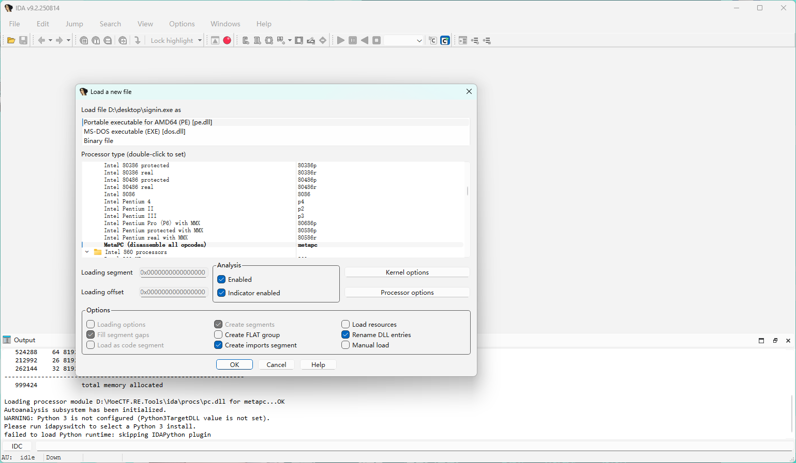
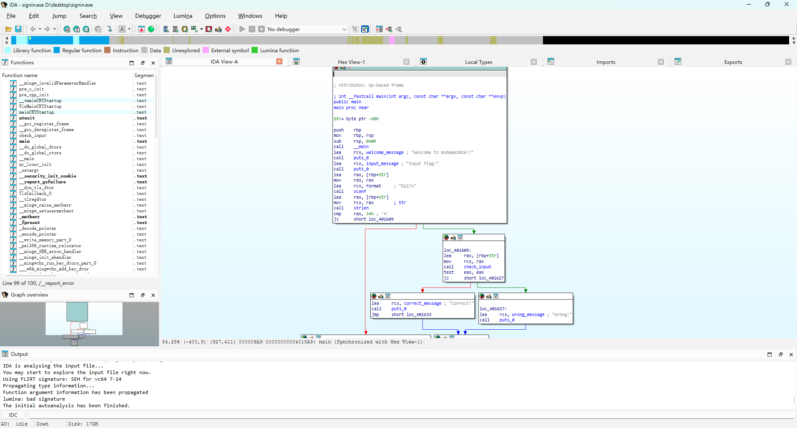
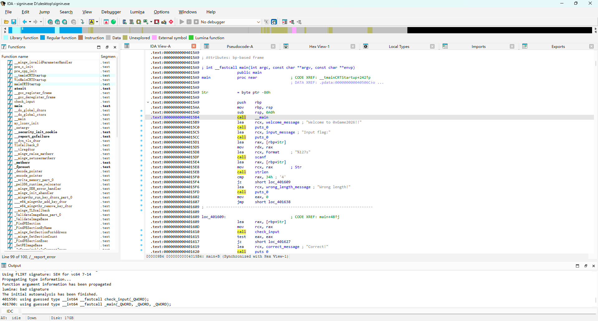
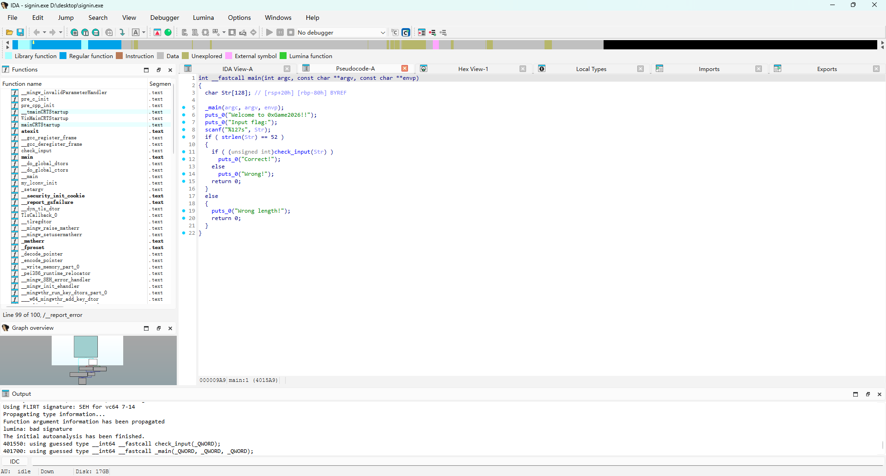
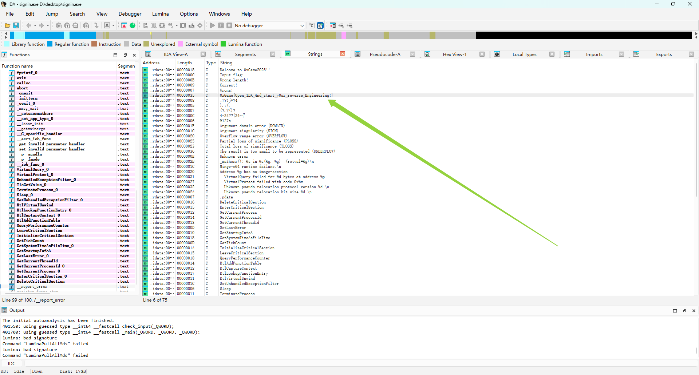
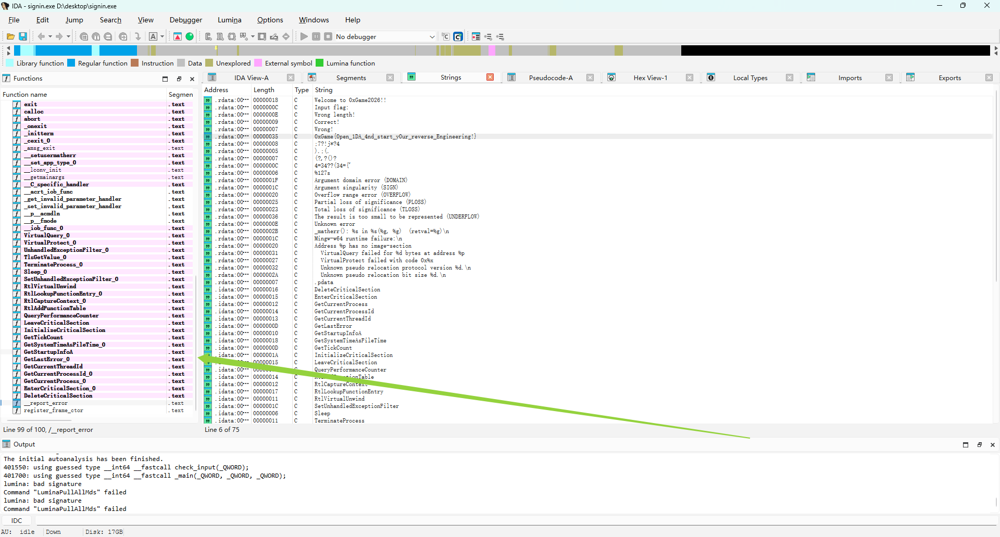
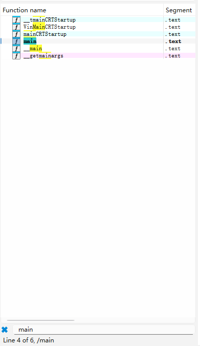

# 0xGame 2026 Re signin wp&IDA简单教程

> 发布于 2026-09-29 06:23:00

首先用DIE检测语言为*语言: C/C++*

将文件拖入ida

无脑ok



**注意！：IDA通常用于C类型的语言进行分析，一些语言（比如说rust），IDA无法正确反编译出正确的伪代码**

**而且IDA反编译的伪代码一般是C风格的**

将程序成功导入后是这样的界面



这种界面就叫做**汇编视图**，汇编视图在后期有助于我们梳理程序的逻辑，方便我们看各种分支

**这里可以按空格键切换样式**

切换后的样子如下



可以看到汇编语言更加清晰了

### **伪代码界面**

按下Tab或者F5进入**伪代码（反汇编）**，一般会有个弹窗，依旧无脑点ok就行了

下面是伪代码



我们讲完了伪代码界面，接下来讲讲IDA中同样泛用的一个界面

### **String界面**

如同字面意思，就是各种字符串，如果你是在打CTF，那么有些简单的题目会把flag直接藏在这个界面

进入这个界面的方式很简单

#### **1️⃣ 在主页面点击**

```
View → Open subviews → Strings
```

#### **2️⃣快捷键**

按下**shift+F12**

字符串界面如下



### **函数视图**

其实函数视图自从打开IDA后，一直在我们身边

没错，函数视图就是最左边的这一栏



这里是IDA识别出来的各种各样的函数，点击进去即可进行分析（很多一部分是系统函数哦！），一般我们会先在这个视图搜索main函数再进行分析，搜索的快捷键是**ctrl+F**（记得先点击一下函数视图界面，不然很可能是搜索成别的东西了）


