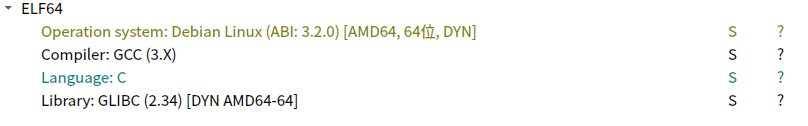

## 《CTF Reverse 刷题日志｜从基础校验到算法逆向》

> 发布于 2026-11-15 16-19-46

```a
Level 1 → Level 2
6 道真题 · 由易到难 · 独立分析训练

适合当前阶段

01  nasm crack
https://crackmes.one/download/crackme/5ea48a1433c5d47611746436?utm_source=chatgpt.com
难度 1.0 · 汇编与输入校验   下载 ZIP
02  Plain sight
https://crackmes.one/download/crackme/6513567328b5870bef263329?utm_source=chatgpt.com
难度 1.1 · IDA 导航、查找校验   下载 ZIP
03  PieIsMyFav
https://crackmes.one/download/crackme/5c11e1f333c5d41e58e00579?utm_source=chatgpt.com
难度 1.0 · 算术判断与汇编阅读   下载 ZIP
04  simple XOR crackme
https://crackmes.one/download/crackme/6946be18523504d8c842eb7e?utm_source=chatgpt.com
难度 1.9 · 输入校验、字节处理   下载 ZIP
05  jumpjumpjump
https://crackmes.one/download/crackme/5c1a939633c5d41e58e005d1?utm_source=chatgpt.com
难度 2.0 · 控制流与条件分析 下载 ZIP
06  ComputeTheKey
https://crackmes.one/download/crackme/6a53f2cb055757d3df60fcd4?utm_source=chatgpt.com
难度 2.3 · 综合静态逆向 下载 ZIP

题目及对应平台、架构、难度已根据 Crackmes.one 的题目页面核对。
Crackmes.one 的压缩包统一密码是：
crackmes.one
```

## 第一题

尝试运行

```fish
 /home/qinyuanxin132/Downloads/5ea48a1433c5d47611746436/nasm_crack
Enter your password: dawd
Wrong!
```

这个应该是密码效验题，打开IDA

反编译后

```c
if ( memcmp((const void *)0x402031, &passwd, 0xBu) )
```

这个就是效验，直接看&passwd

```c++
.data:0000000000402026 passwd          db  73h ; s             ; DATA XREF: _start+36↑o
.data:0000000000402027                 db  75h ; u
.data:0000000000402028                 db  70h ; p
.data:0000000000402029                 db  65h ; e
.data:000000000040202A                 db  72h ; r
.data:000000000040202B                 db  73h ; s
.data:000000000040202C                 db  65h ; e
.data:000000000040202D                 db  63h ; c
.data:000000000040202E                 db  72h ; r
.data:000000000040202F                 db  65h ; e
.data:0000000000402030                 db  74h ; t
```

```bash
 /home/qinyuanxin132/Downloads/5ea48a1433c5d47611746436/nasm_crack
Enter your password: supersecret
Correct!
```

完成

## 第二题



```bash
 /home/qinyuanxin132/Downloads/6513567328b5870bef263329/plain_sight
Enter the password: dwadw
Wrong password!
```

又是密码效验

打开IDA

```c++
__int64 Login()
{
  __int64 v0; // rax
  _BYTE v2[40]; // [rsp+0h] [rbp-30h] BYREF

  std::string::basic_string(v2);
  std::operator<<<std::char_traits<char>>(&std::cout, "Enter the password: ");
  std::operator>><char>(&std::cin, v2);
  if ( (unsigned __int8)std::operator==<char>(v2, "do_not_hardcode") )
    v0 = std::operator<<<std::char_traits<char>>(&std::cout, "Welcome!");
  else
    v0 = std::operator<<<std::char_traits<char>>(&std::cout, "Wrong password!");
  std::ostream::operator<<(v0, &std::endl<char,std::char_traits<char>>);
  return std::string::~string(v2);
}
```

这是一个c++的反编译

`std::operator>><char>(&std::cin, v2);`

这应该就是把输入的字符串给v2数组

呃，原来是直接比较

`do_not_hardcode`

## 第三题

IDA

```c++
int __fastcall main(int argc, const char **argv, const char **envp)
{
  int v4; // [rsp+0h] [rbp-10h] BYREF
  int v5; // [rsp+4h] [rbp-Ch]
  int v6; // [rsp+8h] [rbp-8h]
  int v7; // [rsp+Ch] [rbp-4h]

  v7 = 100;
  v6 = 14;
  v4 = 0;
  v5 = 0;
  puts("Welcome to the wonderful world of assembly!");
  printf("Qual o numero magico? ");
  __isoc99_scanf("%d", &v4);
  v5 = (3 * v7 + v6) / v7;
  if ( v5 == v4 )
    puts("Essa eh a sua flag!");
  else
    puts("Try harder...");
  return 0;
}
```

v5 = (3*100+14)/100 = 3

尝试输入3

```bash
 /home/qinyuanxin132/Downloads/cafbf5539ffdf47067536ff14282817ebca234cd9123b46a7d85457eb13fc094/simple
Welcome to the wonderful world of assembly!
Qual o numero magico? 3
Essa eh a sua flag!
```

## 第四题

无法直接运行

直接开IDA

```c++
int __fastcall main(int argc, const char **argv, const char **envp)
{
  __m128i *v3; // rdx
  __m128i *v4; // r8
  const char *v5; // rcx
  __m128i *v6; // rdi
  __m128i *v7; // rsi
  __m128i si128; // [rsp+0h] [rbp-88h] BYREF
  char v10; // [rsp+10h] [rbp-78h] BYREF
  __m128i v11; // [rsp+20h] [rbp-68h] BYREF
  char v12; // [rsp+30h] [rbp-58h]
  __m128i v13; // [rsp+40h] [rbp-48h] BYREF
  char v14; // [rsp+50h] [rbp-38h]
  __m128i v15; // [rsp+60h] [rbp-28h] BYREF
  char v16; // [rsp+70h] [rbp-18h]
  unsigned __int64 v17; // [rsp+78h] [rbp-10h]

  v17 = __readfsqword(0x28u);
  if ( argc == 2 )
  {
    v10 = 0;
    v3 = &si128;
    v4 = &v11;
    v12 = 0;
    v5 = argv[1];
    v6 = &v13;
    v7 = &v15;
    v14 = 0;
    v16 = 0;
    si128 = _mm_load_si128((const __m128i *)&xmmword_2030);
    v11 = _mm_load_si128((const __m128i *)&xmmword_2040);
    v13 = _mm_load_si128((const __m128i *)&xmmword_2050);
    v15 = _mm_load_si128((const __m128i *)&xmmword_2060);
    while ( *v5 == ((unsigned __int8)(v6->m128i_i8[0] ^ v4->m128i_i8[0] ^ v7->m128i_i8[0] ^ v3->m128i_i8[0]) ^ 0x20) )
    {
      v3 = (__m128i *)((char *)v3 + 1);
      v4 = (__m128i *)((char *)v4 + 1);
      v6 = (__m128i *)((char *)v6 + 1);
      v7 = (__m128i *)((char *)v7 + 1);
      ++v5;
      if ( v3 == (__m128i *)&v10 )
      {
        puts("Pass valid!");
        return 0;
      }
    }
    puts("Nope.");
  }
  else
  {
    puts("usage ./crackme \"<key>\"");
  }
  return 0;
}
```

先找这四个数组

```c++
xmmword_2030    xmmword 3E7D517C6A377260332679412832365Eh
xmmword_2040    xmmword 43496C4B392444704255692837756936h
xmmword_2050    xmmword 433F38666F2756637D5A5B3F3354763Ah
xmmword_2060    xmmword 4E646B40295F786A644E2B332A704B33h
```

换成16字节：

```c++
.rodata:0000000000002030 dword_2030      dd 2832365Eh            ; DATA XREF: main+43↑r
.rodata:0000000000002034                 dd 33267941h
.rodata:0000000000002038                 dd 6A377260h
.rodata:000000000000203C                 dd 3E7D517Ch
.rodata:0000000000002040 dword_2040      dd 37756936h            ; DATA XREF: main+5E↑r
.rodata:0000000000002044                 dd 42556928h
.rodata:0000000000002048                 dd 39244470h
.rodata:000000000000204C                 dd 43496C4Bh
.rodata:0000000000002050 dword_2050      dd 3354763Ah            ; DATA XREF: main+6B↑r
.rodata:0000000000002054                 dd 7D5A5B3Fh
.rodata:0000000000002058                 dd 6F275663h
.rodata:000000000000205C                 dd 433F3866h
.rodata:0000000000002060 dword_2060      dd 2A704B33h            ; DATA XREF: main+78↑r
.rodata:0000000000002064                 dd 644E2B33h
.rodata:0000000000002068                 dd 295F786Ah
.rodata:000000000000206C                 dd 4E646B40h
```

注意，由于内存是小端序，所以应该从上到下，从右往左读

```python
byte_2030 = [0x5E, 0x36, 0x32, 0x28, 0x41, 0x79, 0x26, 0x33, 0x60, 0x72, 0x37, 0x6A, 0x7C, 0x51, 0x7D, 0x3E]

byte_2040 = [0x36, 0x69, 0x75, 0x37, 0x28, 0x69, 0x55, 0x42, 0x70, 0x44, 0x24, 0x39, 0x4B, 0x6C, 0x49, 0x43]

byte_2050 = [0x3A, 0x76, 0x54, 0x33, 0x3F, 0x5B, 0x5A, 0x7D, 0x63, 0x56, 0x27, 0x6F, 0x66, 0x38, 0x3F, 0x43]

byte_2060 = [0x33, 0x4B, 0x70, 0x2A, 0x33, 0x2B, 0x4E, 0x64, 0x6A, 0x78, 0x5F, 0x29, 0x40, 0x6B, 0x64, 0x4E]

v5        = [0,0,0,0,0,0,0,0,0,0,0,0,0,0,0,0]
for a in [0,1,2,3,4,5,6,7,8,9,10,11,12,13,14,15]:
    v5[a] = ((byte_2050[a] ^ byte_2040[a] ^ byte_2060[a] ^ byte_2030[a]) &0xff) ^ 0x20
print(v5)
print("还原字符串:", "".join(chr(x) for x in v5))
```

输出：

```python
[65, 66, 67, 38, 69, 64, 71, 72, 57, 56, 75, 53, 49, 78, 79, 80]
还原字符串: ABC&E@GH98K51NOP
```

```bash
 chmod +x ./crackme
  ./crackme "ABC&E@GH98K51NOP"
Pass valid!
```

## 第五题

运行测试

```bash
 /home/qinyuanxin132/Downloads/5c1a939633c5d41e58e005d1/rev03
enter the magic string
dwasdwasdwasd
too long...sorry no flag for you!!!
```

开来还是效验

```c++
      printf("flag is flag{");
      for ( i = 0; i <= 9; ++i )
        putchar(*(char *)(i + v6));
      puts("}");
      return 0;
```

貌似我们可以直接分析输出的字符串

打开strcat_str()

```c++
char *strcat_str()
{
  int i; // [rsp+0h] [rbp-4h]

  f_2605[0] = 33;
  for ( i = 1; i <= 9; ++i )
    f_2605[i] = f_2605[i - 1] + i + 1;
  return f_2605;
}
```

尝试python运行一遍

```python
f_2605 = [0,0,0,0,0,0,0,0,0,0]
f_2605[0] = 33
for i in [1,2,3,4,5,6,7,8,9]:
    f_2605[i] = f_2605[i - 1] + i + 1
print(f_2605)
print("还原字符串:", "".join(chr(x) for x in f_2605))
```

输出

```python
[33, 35, 38, 42, 47, 53, 60, 68, 77, 87]
还原字符串: !#&*/5<DMW
```

## 第六题

尝试运行

```bash
 chmod +x /home/qinyuanxin132/Downloads/6a53f2cb055757d3df60fcd4/crackme_th; and /home/qinyuanxin132/Downloads/6a53f2cb055757d3df60fcd4/crackme_th
Usage: /home/qinyuanxin132/Downloads/6a53f2cb055757d3df60fcd4/crackme_th key
```

看来需要

```bash
/home/qinyuanxin132/Downloads/6a53f2cb055757d3df60fcd4/crackme_th "你算出来的key"
```

打开IDA

```c++
__int64 __fastcall main(int a1, char **a2, char **a3)
{
  const char *v3; // rbx
  size_t v4; // rax

  if ( a1 == 2 )
  {
    byte_4018 = sub_1312(main, &loc_13E5 - (_UNKNOWN *)main, a3);
    v3 = a2[1];
    v4 = strlen(v3);
    if ( v4 + 1 == n && (sub_11C3(v3, (unsigned int)(v4 + 1)), !memcmp(v3, &unk_4030, n)) )
      puts("Correct key!");
    else
      puts("Incorrect key!");
  }
  else
  {
    __printf_chk(2, "Usage: %s key\n", *a2);
  }
  return 0;
}
```

```c++
v3 = a2[1]; //把输入的字符串传给v3
v4 = strlen(v3);
if ( v4 + 1 == n && (sub_11C3(v3, (unsigned int)(v4 + 1)), !memcmp(v3, &unk_4030, n)) )
```

输入的长度为n - 1 = 14h - 1 = 19

分析加密函数

```c++
__int64 __fastcall sub_11C3(__int64 a1, int a2)
{
  unsigned __int64 v2; // rax
  int v3; // ebx
  unsigned __int64 v4; // rax
  int v5; // r15d
  int v6; // ebp
  int v7; // ebx
  __int64 v8; // r12
  bool *v10; // [rsp+0h] [rbp-40h]
  int v11; // [rsp+Ch] [rbp-34h]

  if ( a1 )
  {
    if ( a2 > 1 )
    {
      v2 = a2 - 1LL;
      v10 = (bool *)(a1 + v2);
      if ( !*(_BYTE *)(a1 + v2) )
      {
        qword_4050 = 0;
        v3 = a2 - 1;
        v11 = a2 - 1;
        v4 = v2 / qword_4010;
        v5 = v4;
        if ( (_DWORD)v4 )
        {
          v6 = v3 - v4;
          if ( v3 - (int)v4 < 0 )
          {
            v7 = 0;
LABEL_7:
            sub_11A9(a1 + v7, v11 - v7, (unsigned __int8)byte_4018[qword_4050]);
            if ( ++qword_4050 >= (unsigned __int64)qword_4010 )
              qword_4050 = 0;
LABEL_13:
            *v10 = !*v10;
            return a1;
          }
        }
        else
        {
          v6 = a2 - 2;
          v5 = 1;
        }
        v8 = a1;
        v7 = 0;
        do
        {
          sub_11A9(v8, v5, (unsigned __int8)byte_4018[qword_4050]);
          if ( ++qword_4050 >= (unsigned __int64)qword_4010 )
            qword_4050 = 0;
          v7 += v5;
          v8 += v5;
        }
        while ( v7 <= v6 );
        if ( v11 <= v7 )
          goto LABEL_13;
        goto LABEL_7;
      }
    }
  }
  return a1;
}
```

a1 是 v3  
a2 是 v4+1 即 20

过于复杂，过段时间再看
