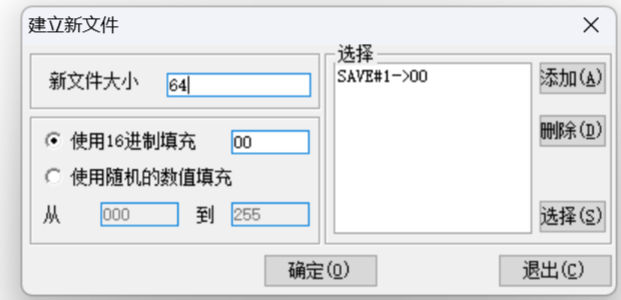
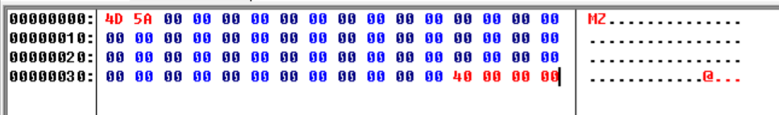
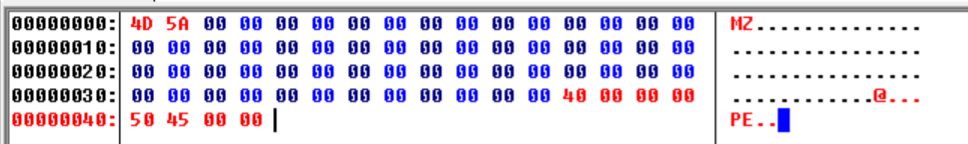
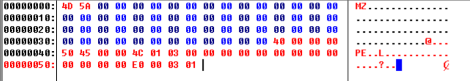

> 发布于 2026-10-29 18:47:25
> 
# PE结构学习 #2 (PE工具)

## 常用PE工具

### Stud_PE

查看PE文件格式，比较文件格式，识别壳，

加载文件后点击`Basic HEADERS tree view in hexeditor`按钮，选择左侧树形结构的PE头部或头部的字段，右侧会以选中的方式查看相对应的十六进制数据

修改PE文件后按`Save to file`保存文件

还提供了地址转换计算器（RVA<==>RAW）

# 手写PE文件

## 准备工作

安装C32Asm

## 用16进制字节完成PE文件

### 1.构造IMAGE_DOS_HEADER 结构

```
typedef struct _IMAGE_DOS_HEADER {
    WORD   e_magic;        // +0x00  DOS 签名，固定 0x5A4D ('MZ')
    WORD   e_cblp;         // +0x02  最后页的字节数
    WORD   e_cp;           // +0x04  文件页数
    WORD   e_crlc;         // +0x06  重定位项数
    WORD   e_cparhdr;      // +0x08  头部大小（以 16 字节为单位）
    WORD   e_minalloc;     // +0x0A  所需最小额外内存（节）
    WORD   e_maxalloc;     // +0x0C  所需最大额外内存（节）
    WORD   e_ss;           // +0x0E  初始 SS 值（相对段）
    WORD   e_sp;           // +0x10  初始 SP 值
    WORD   e_csum;         // +0x12  校验和
    WORD   e_ip;           // +0x14  初始 IP 值
    WORD   e_cs;           // +0x16  初始 CS 值（相对段）
    WORD   e_lfarlc;       // +0x18  重定位表文件偏移
    WORD   e_ovno;         // +0x1A  覆盖号
    WORD   e_res[4];       // +0x1C  保留字（4 个 WORD）
    WORD   e_oemid;        // +0x24  OEM 标识
    WORD   e_oeminfo;      // +0x26  OEM 信息
    WORD   e_res2[10];     // +0x28  保留字（10 个 WORD）
    LONG   e_lfanew;       // +0x3C  ★ PE 头文件偏移（FOA）
} IMAGE_DOS_HEADER, *PIMAGE_DOS_HEADER;
```

该结构体大小为0x40字节 10进制64字节

点击新建



插入了一个64字节的文件

关键字段只有两个
WORD e_magic;  可执行文件的标识
WORD e_lfanew;  存PE头的偏移



### 2.构造PE标识符

PE标识符占4字节 因此插入数据大小4

PE标识符对应的16进制数据是`50 45 00 00`



### 3.构造IMAGE_FILE_HEADER结构体

```
typedef struct _IMAGE_FILE_HEADER {
    WORD  Machine;                // +0x00  目标平台
    WORD  NumberOfSections;       // +0x02  节表项数
    DWORD TimeDateStamp;          // +0x04  文件创建时间戳
    DWORD PointerToSymbolTable;   // +0x08  符号表 FOA
    DWORD NumberOfSymbols;        // +0x0C  符号表条目数
    WORD  SizeOfOptionalHeader;   // +0x10  可选头大小
    WORD  Characteristics;        // +0x12  文件属性
} IMAGE_FILE_HEADER, *PIMAGE_FILE_HEADER;
```

大小14h字节（10进制20字节）

IMAGE_FILE_HEADER关键字取值：

|字段|取值|备注|
|---|---|---|
|Machine|4C 01|表示i386类型的CPU|
|NumberOfSections|03 00|该PE文件节的数量是3|
|SizeOfOptionalHeader|E0 00|在win32环境下可选头大小|
|Characteristics|03 00|没有重定位信息的32位平台的可执行文件|

填充数据时，SizeOfOptionalHeader字段值的大小与32位平台的IMAGE_Optional_Header结构体大小相同
NumberOfSections表示PE文件中节的数量



### 4.构造IMAGE_OPTIONAL_HEADER结构体

可选头结构

```
typedef struct _IMAGE_OPTIONAL_HEADER32 {
    // ── Standard fields（PE32/PE32+ 相同，28 字节）──
    WORD    Magic;                       // +0x00  0x10B=PE32, 0x20B=PE32+
    BYTE    MajorLinkerVersion;          // +0x02
    BYTE    MinorLinkerVersion;          // +0x03
    DWORD   SizeOfCode;                  // +0x04
    DWORD   SizeOfInitializedData;       // +0x08
    DWORD   SizeOfUninitializedData;     // +0x0C
    DWORD   AddressOfEntryPoint;         // +0x10  ★ 入口点 RVA
    DWORD   BaseOfCode;                  // +0x14
    DWORD   BaseOfData;                  // +0x18  （PE32+ 无此字段）

    // ── NT additional fields ──
    DWORD   ImageBase;                   // +0x1C  ★ 首选基址（PE32+ 为 ULONGLONG）
    DWORD   SectionAlignment;            // +0x20  ★ 内存对齐
    DWORD   FileAlignment;               // +0x24  ★ 文件对齐
    WORD    MajorOperatingSystemVersion; // +0x28
    WORD    MinorOperatingSystemVersion; // +0x2A
    WORD    MajorImageVersion;           // +0x2C
    WORD    MinorImageVersion;           // +0x2E
    WORD    MajorSubsystemVersion;       // +0x30
    WORD    MinorSubsystemVersion;       // +0x32
    DWORD   Win32VersionValue;           // +0x34  保留，必须为 0
    DWORD   SizeOfImage;                 // +0x38  ★ 内存中总大小
    DWORD   SizeOfHeaders;               // +0x3C  ★ 所有头部总大小
    DWORD   CheckSum;                    // +0x40
    WORD    Subsystem;                   // +0x44  ★ GUI/Console
    WORD    DllCharacteristics;          // +0x46  ★ ASLR/DEP
    DWORD   SizeOfStackReserve;          // +0x48  （PE32+ 为 ULONGLONG）
    DWORD   SizeOfStackCommit;           // +0x4C  （PE32+ 为 ULONGLONG）
    DWORD   SizeOfHeapReserve;           // +0x50  （PE32+ 为 ULONGLONG）
    DWORD   SizeOfHeapCommit;            // +0x54  （PE32+ 为 ULONGLONG）
    DWORD   LoaderFlags;                 // +0x58  已过时
    DWORD   NumberOfRvaAndSizes;         // +0x5C  = 0x10
    IMAGE_DATA_DIRECTORY DataDirectory[16]; // +0x60  16×8=128 字节
} IMAGE_OPTIONAL_HEADER32, *PIMAGE_OPTIONAL_HEADER32;
```

待更
......