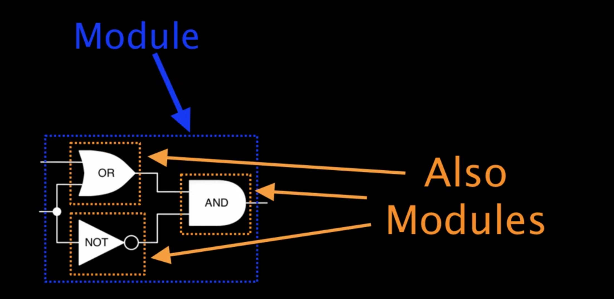
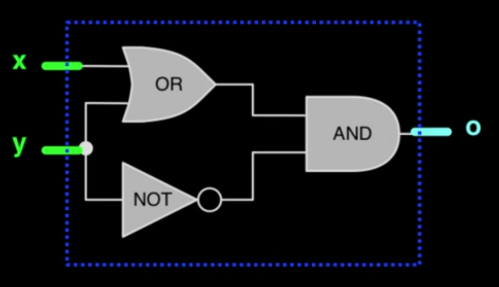
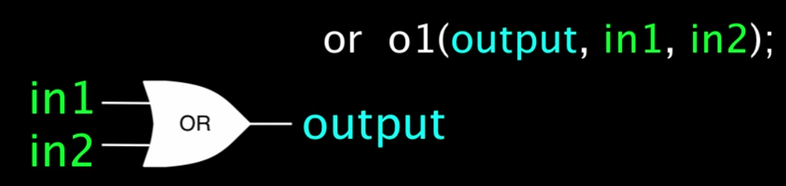
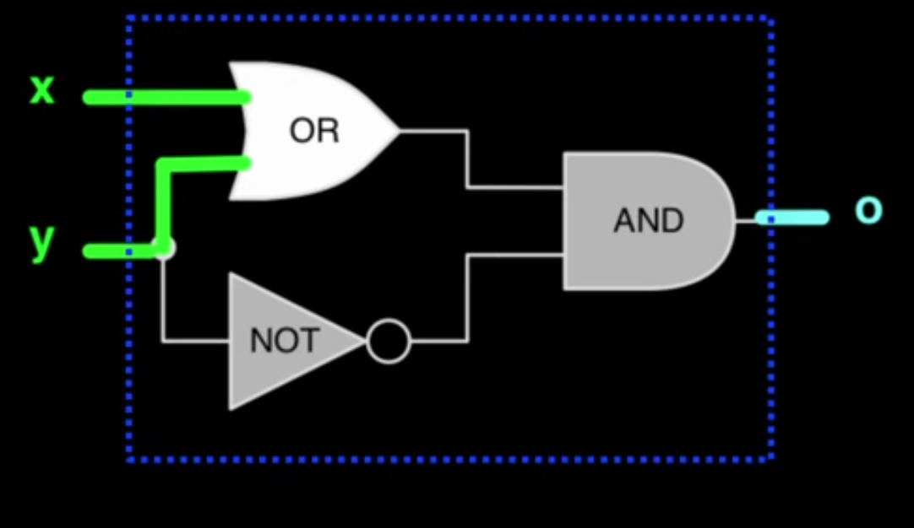
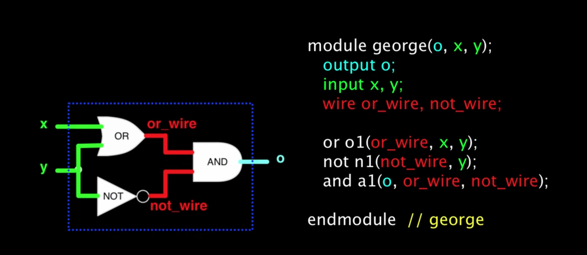
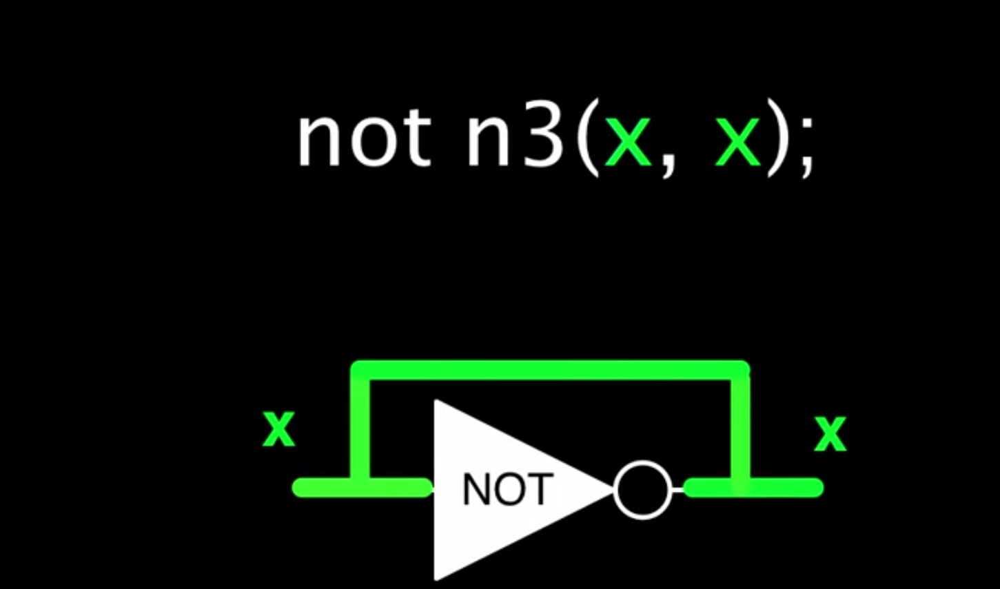

> 发布于 2026-10-27 11:09:25

# Verilog 入门学习

## 0 快速了解Verilog

[摘抄自](https://www.youtube.com/watch?v=q1QwC3YlHG0&list=PLFuWv2uq4Oazj9cfYSCkAiooxNTQ2mtm7&index=2)

### 0.1 介绍
verilog 是一种硬件描述语言，他是一种用文本方式描述数字电路的方法

想象一下，你想通过电话告诉你朋友你的卧室结构

你可以创造一种卧室描述语言

```Verilog
bedroom my_bedroom
    size:12ft,8ft //用来描述你卧室的大小

    bed(3,4);  //床的位置
    chair(10,2,135);  //椅子的位置和朝向
    ... //等
endbedroom
```

这与verilog非常相似，只不过它描述的是电路

在Verilog中，电路被称为模块

我们使用Verilog来描述如何使用其他模块来构成每个模块



在verilog中描述模块的第一步是用module和end module语句标记模块描述的开始和结束

接下来我们需要给模块起个名字

```
module george

endmodule //george
```
模块语句末尾添加注释会方便在众多模块中辨认

### 0.2模块如何使用称为端口的装置连接到外部装置



首先给端口命个名

```
module george(o,x,y);
    output o;  //然后告诉verilog哪个是输出端口
    input x,y; //哪个是输入端口
endmodule //george
```
注意，在第一行列出端口时，输出端口放在了第一位，这是常见的约定俗成的方法

接下来，我们将根据组成该模块的其他模块来描述该模块

verilog内置了OR,AND,NOT的原语

但我们实例化他们的方式与实例化任何其他模块的方式相同

当我们引入一个模块时，我们需要指定模块的名称，给组件命名并指定模块的连接方式

module_name name(port1,port2,...)



对于或门

我们要给他取一个独一无二的名字来表明它，比如o1

为了连接端口，我们需要知道他们在模块定义中的顺序

verilog的内置模块遵循输出端口放前面的约定

or o1(output,in1,in2);

### 0.3连入电路



看OR，它的两个输入分别连接的模块的输入x和y  
输出端连接到AND的输入端  
为了解决这个问题，我们需要声明两条线路  
wire or_wire  
wire not_wire

现在我们可以吧OR的输出连接到或线

`or o1(or_wire,x,y);`

同样的，NOT：

`not n1(not_wire,y);`

AND:

`and a1(o,or_wire,not_wire);`



### 0.4 常见误解

1.模块实例化的顺序并不重要

`or o1(or_wire,x,y);`

`not n1(not_wire,y);`

`and a1(o,or_wire,not_wire);`

在不改变拓扑结构的情况下位置可以互换

2.verilog会将模块中所有具有相同线名的模块端口连接起来



---
---
## 1 Verilog 模块结构

`模块说明部分`
```
module 模块名([端口列表]);
[端口信号声明;]
[参数声明;]
```
`功能描述部分 `
```
内部信号声明          //常用
assign语句            //常用
initial或always语句块 //常用

底层模块或门原语调用(包括生成块)

任务和函数定义
specify块(路径延迟)
```
```
endmodule
```

三种语句


