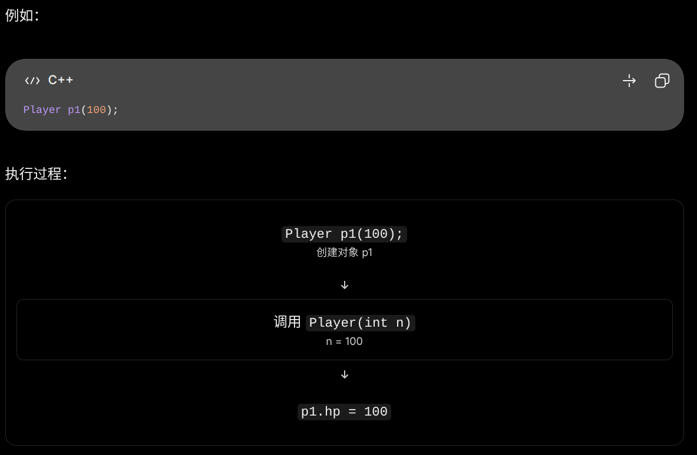
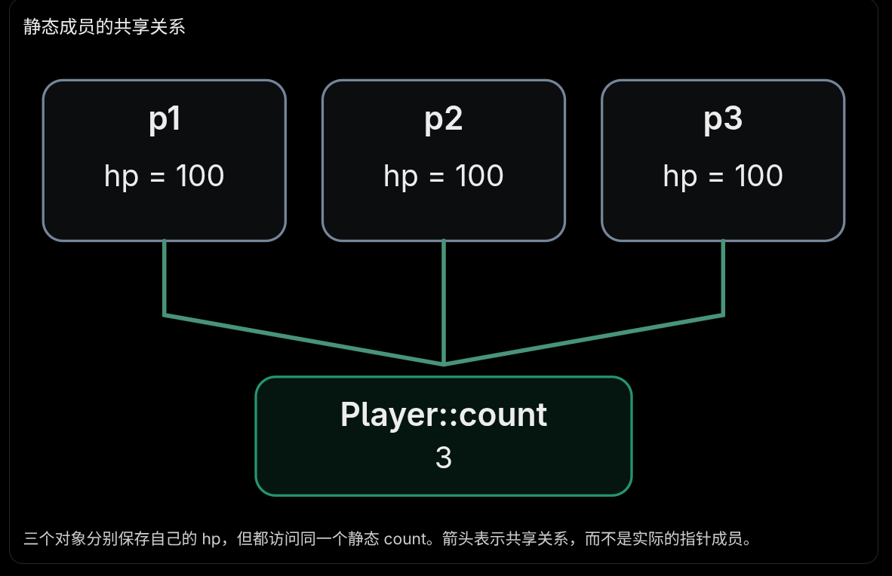
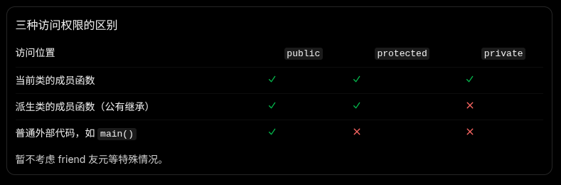
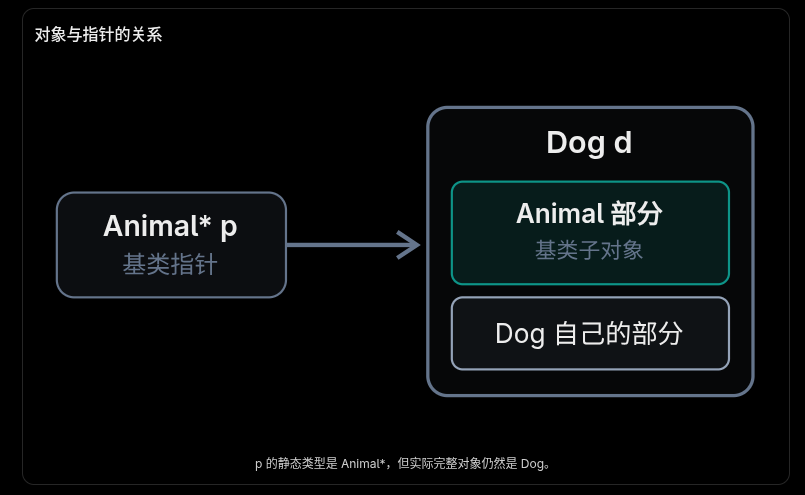

## C++ 入门学习

> 发布于 2026-11-15 16-49-46
> 参考GPT生成的C++教程
> 本篇文章为学习笔记，建议在C语言的基础上阅读学习

## 基本语法

```cpp
#include <iostream> //包含头文件iostream
using namespace std;  //告诉编译器使用std命名空间

int main()
{
    std::cout << "Hello World" << std::endl;   //会在屏幕上打印"Hello World" //endl 将光标移动到新的一行
    std::cin.get();//等待按下回车键 然后移动到程序的下一行
    return 0;
}
```

main() 入口，如果不返回任何值，系统会视为返回0（仅限main函数）

```c++
#include <iostream>
using namespace std;

void Log(const char* message)
{
    std::cout << message << std::endl;
}
int main()
{
    Log("Hello World");
    std::cin.get();
    return 0;
}
```

## 数据类型

类型|关键字
---|---
布尔型|bool
字符型|char
整型|int
浮点型|float
双浮点型|double
无类型|void
宽字符型|wchar_t

修饰符|描述|示例
---|---|---
signed|表示有符号类型（默认）|signed int x = -10;
unsigned|表示无符号类型|unsigned int y = 10;
short|表示短整型|short int z = 100;
long|表示长整型|long int a = 100000;
const|表示常量，值不可修改|const int b = 5;
volatile|表示变量可能被意外修改，禁止编译器优化|volatile int c = 10;
mutable|表示类成员可以在 const 对象中修改|mutable int counter;

### C++11 新增类型

数据类型|描述|示例
---|---|---
auto|自动类型推断|auto x = 10;
decltype|获取表达式的类型|decltype(x) y = 20;
nullptr|空指针常量|int* ptr = nullptr;
std::initializer_list|初始化列表类型|`std::initializer_list <int> list = {1, 2, 3};`
std::tuple|元组类型，可以存储多个不同类型的值|`std::tuple<int, float, char> t(1, 2.0, 'a');`

## 命名空间

C++中的命名空间是一种将标识符分组的机制，避免标识符之间的冲突

定义方式如下

```c++
namespace namespace_name {
    int varl;
    void funcl();
    namespace sub_namespace{
        //sub-namespace content
    }
}
```

调用命名空间里的函数

```c++
namespace_name::funcl();
```

实例：

```C++
#include <iostream>

namespace wufeng
{
    int age = 18;
    void fun()
    {
        std::cout << "age=" << age << std::endl;
    }
    namespace sun_wufeng
    {
        int age = 20;
        void fun()
        {
            std::cout << "age=" << age << std::endl;
        }

    }
}

int main()
{
    wufeng::fun();
    std::cout << wufeng::age << std::endl;
    wufeng::sun_wufeng::fun();
    std::cout << wufeng::sun_wufeng::age << std::endl;
}
```

输出：

```c
age=18
18
age=20
20
```

指定命名空间：

`using namespace std;`放开某个命名空间的访问，即不用std::就可以访问std下的函数

不建议全部放开，可能出现重名的函数等问题

## 类

### 类 定义

C++中的类是一种用户自定义的数据类型，它将数据和操作封装在一起。类的目的在于提供了一种更好的代码重用和封装性，通过封装数据和方法，将其组织为一个独立的整体来管理数据

定义:

```c++
class 类名{
    //访问属性
    //类中成员
};
```

例:

```c++
class Student
{
    char name[20];
    int age;
    int id;

    void speak()
    {
        std::cout << "今年我" << age << "岁" << std::endl;
    }

    void play_ball()
    {
        speak();
        std::cout << "打篮球" << std::endl;
    }
};

```

这里面就包含了数据和方法

### 类中成员和访问属性

访问属性分三种：

- public：公有成员，可以在类中和类外直接访问
- protected： 保护成员，类中可以访问，类外不能直接访问
- private：私有成员，类中可以访问，类外不能直接访问

```c++
#include <iostream>
#include <cstring>

class Student
{
    private:
    int age;
    int id;

    public:
    char name[20];

    void setage(int x)
    {
        age = x;
    }

    int getage()
    {
        return age;
    }
};

int main()
{
    Student stu;
    std::strcpy(stu.name,"张三");
    std::cout << stu.name << std::endl;

    stu.setage(18);
    std::cout << stu.getage() << std::endl;
    return 0;
}
```

公有成员可以直接外部访问
`std::strcpy(stu.name,"张三");`

私有成员直接访问会报错，但可以通过提供的函数修改

`stu.setage(18);`

### this指针

## 面向对象

对象： 具有状态和行为 例如： 一只狗的颜色（状态），吃（行为）  对象是类的实例

类： 描述对象行为状态的模板蓝图

方法 : 一个方法表示一个行为，一个类包含多个方法，可以在方法中写入逻辑，操作数据以及执行所有的动作

即时变量： 每个对象都有其独特的即时变量，对象的状态是由这些即时变量值创建的

## 编程原则

SOLID

DRY

KISS

YAGNI

高内聚，低耦合

## ‘this’指针

看一个实例：

```c++
class Player
{
public:
    int hp = 100;

    void damage(int n)
    {
        this->hp -= n;
    }
};

int main()
{
    Player p1;
    p1.damage(30);
}
```

clas Player创建了一个类

player p1是新建了一个对象（实例） (类似于结构体)，名字是p1

类是模板，对象是根据类创建出来的具体实例。

`p1.damage(30);`调用p1对象里的damage函数

我们并没有手动传入 &p1，但是 damage() 仍然知道应该修改 p1。因为 C++ 会隐式地把当前对象的信息传给成员函数，这个对象指针就是 this。


表达式|含义
---|---
p1|整个玩家对象
&p1|整个玩家对象的地址
p1.hp|玩家的血量值
tis|当前对象的指针
this->hp|当前对象的血量

当执行 p1.damage(30) 时：
this == &p1

而：
this->hp

相当于：
p1.hp

\[\boxed{p\texttt{->}hp = (*p).hp}\]


### 什么时候需要显式写 this

```c++
class Player
{
public:
    int hp;

    void setHP(int hp)
    {
        this->hp = hp;
    }
};
```

这里出现了两个 hp：  

- this->hp：对象的成员变量。
- hp：函数接收的参数。

## 构造函数

例如这个实例

```c++
class Player {
public:
    int hp = 100;
};

int main() {
    Player p1;
}
```

创建一个玩家的时候，只能固定血量是100，但如果我想让p1血量是100，p2血量是200呢

这就需要构造函数：

```c++
#include <iostream>

class Player
{
public:
    int hp;

    Player(int n){
        hp = n;
    }
};

int main()
{
    Player p1(100);
    Player p2(200);

    std::cout << p1.hp << " " << p2.hp << std::endl;
}
```

其中

```c++
Player(int n){
        hp = n;
    }
```

与类的名字相同而且没有定义返回类型

并且**创建对象会自动调用**



## 析构函数

那么对象不再使用时，怎么执行清理操作呢？

答案是：析构函数（Destructor）。

```c++
#include <iostream>

class Player {
public:
    Player() {
        std::cout << "Created\n";
    }

    ~Player() {
        std::cout << "Destroyed\n";
    }
};

int main() {
    Player p1;

    std::cout << "Hello\n";
}
```

其中

```c++
Player()   // 构造函数
~Player()  // 析构函数
```

析构函数比构造函数多一个~

### 析构顺序

```c++
#include <iostream>

class Player {
public:
    Player() {
        std::cout << "A";
    }

    ~Player() {
        std::cout << "B";
    }
};

int main() {
    Player p1;
    Player p2;

    std::cout << "C";
}
```

main()函数运行完后，p1和p2的生命周期结束

由于是先创建的p1，再创建的p2，所以会先析构p2，再析构p1

### 理解作用域对析构的影响

```c++
#include <iostream>

class Player {
public:
    Player() {
        std::cout << "A";
    }

    ~Player() {
        std::cout << "B";
    }
};

int main() {
    Player p1;

    {
        Player p2;
        std::cout << "C";
    }

    std::cout << "D";
}
```

p2 在内层作用域结束时就会自动调用析构函数，而 p1 要等到 main() 结束时才析构。因此输出 AACBDB。

输出`AACBDB`

## 构造函数初始化列表

先看两组代码：

构造函数体内赋值

```c++
class Player{
    public:
    int hp;

    player(int n){
        hp = n;
    }
};
```

初始化列表

```c++
class Player{
    public:
    int hp;

    player(int n)
        :hp(n){

    }
};
```

这两段代码创建出的 Player 对象，其 hp 都可以得到传入的 n

区别：

- A 先进入构造结构体，再执行`hp=n`赋值
- B 在进入构造结构体之前，直接用n初始化hp

### 为什么需要初始化列表？

接下来我们看一个特殊情况：const 成员变量。

如果写

```c++
class Player {
public:
    const int maxHP;

    Player(int n) {
        maxHP = n;  // 编译错误
    }
};
```

编译器会报错，因为maxHP是const成员，必须在初始化确定它的值，不能等进入构造函数再赋值

正确写法：

```c++
class Player {
public:
    const int maxHP;

    Player(int n) : maxHP(n) {
    }
};
```

### 引用成员的初始化

现在来看另一种情况：引用成员 int&

```c++
class Test {
public:
    int& ref;

    Test(int& x) : ref(x) {
    }
};
```

这里`int& ref;`表示ref是一个整数引用

`Test(int& x) : ref(x) {}`表示创建对象时，让ref绑定到传入的变量

例如：

```c++
int main() {
    int a = 10;

    Test t(a);

    t.ref = 50;

    std::cout << a << std::endl;
}
```

打印`50`

错误写法：

```c++
class Test {
public:
    int& ref;

    Test(int& x) {
        ref = x;  // 编译错误
    }
};
```

原因是：进入构造函数体之前，引用成员就必须已经绑定到某个对象。

而 ref = x 是赋值操作，不是引用绑定操作。

### 成员初始化顺序

C++ 规定：同一个类的非静态成员变量，按照它们在类中声明的顺序初始化，而不是初始化列表中的书写顺序。

例如：

```c++
class Test {
public:
    int a;
    int b;

    Test(int x) : b(x + 10), a(x) {
    }
};
```

虽然初始化列表中b写在前面，但是是按照在类中的声明顺序初始化

所以应该是先初始化a，再初始化b

> 推荐你始终让初始化列表与成员声明顺序保持一致，并避免用尚未初始化的成员计算其他成员。

## static 静态成员

### 成员

#### 为什么需要 static

假设我们在开发一个游戏，需要创建多个玩家。

```c++
class Player {
public:
    int hp = 100;
};

int main() {
    Player p1;
    Player p2;
    Player p3;
}
```

假设我们希望记录程序一共创建了多少个玩家。

这时候应该把计数器放在哪里？

我们需要的是：不管创建多少个对象，都共享同一个计数器。

这就是 static 静态成员变量的用途之一。

#### static 基本语法

```c++
#include <iostream>

class Player {
public:
    int hp = 100;

    inline static int count = 0;

    Player() {
        count++;
    }
};

int main() {
    Player p1;
    Player p2;
    Player p3;

    std::cout << Player::count << '\n';
}
```

输出3

inline static int count = 0

inline 允许在类内定义并初始化静态成员

static 这是属于类的静态成员，不属于某个对象独有

#### static 内存管理



count 不会因为有三个 Player 对象就分配三份

#### static 在什么时候创建

普通成员`Player p1`在创建对象的时候创建

但静态成员在整个程序执行期间存在且初始化不会由于创建对象而重复执行

#### 为什么要使用 Player::count

::是作用域解析运算符

`Player::count`表示在这个类作用域中寻找count

即使一个对象都没创建，也能访问

语义上假如有个p1对象，写p1.count也合法，但Player::count能更清楚的表示这是个类共享的变量

#### static小测试

```c++
class Player {
public:
    int hp = 100;
    inline static int count = 0;

    Player() {
        count++;
    }
};

int main() {
    Player p1;
    Player p2;

    p1.hp = 50;
    Player::count += 5;

    Player p3;

    std::cout << p1.hp << " "
              << p2.hp << " "
              << p3.hp << " "
              << Player::count;
}
```

请你回答：

1. 最终输出哪四个数字？
2. Player::count += 5 为什么不需要指定 p1 或 p2？
3. 如果执行 p1.hp = 50，为什么不会影响 p2.hp？

输出：50 100 100 8  

因为这是类的共享变量

不会，hp又不共享，每个对象都有个单独的hp

### 静态成员函数

既然变量能属于类，那函数能不能也属于类

这就是静态成员函数

```c++
#include <iostream>

class Player {
public:
    inline static int count = 0;

    Player() {
        count++;
    }

    static void showCount() {
        std::cout << count << '\n';
    }
};

int main() {
    Player p1;
    Player p2;

    Player::showCount();
}
```

输出 2

重点是`static void showCount()`在函数前面加了个static

因此，我们可以通过类名调用

`Player::showCount();`

不需要先创建一个专门用来调用它的对象

#### 静态成员函数没有this指针

普通成员需要this指针指向正在操作的对象

但静态成员函数没有this指针

因此

```c++
class Player {
public:
    int hp = 100;
    inline static int count = 0;

    static void show() {
        std::cout << count;  // 正确
        std::cout << hp;     // 编译错误
    }
};
```

因为没有this指针`std::cout << hp;`不知道访问哪个对象的hp

但如果明确提供对象，就可以访问公开成员

```c++
static void showHP(const Player& p) {
    std::cout << p.hp;
}
```

这里的 p 是我们自己传入的对象引用，并不是 this。

特征|普通成员函数|静态成员函数
---|---|---
声明|void show()|static void show()
是否有this|有|没有
能否直接访问静态成员|可以|可以
能否直接访问普通成员|可以|不可以
典型调用|p1.show()|Player::show()

#### 小测试

```c++
#include <iostream>

class Player {
public:
    int hp = 100;
    inline static int count = 0;

    Player() {
        count++;
    }

    static void addCount(int n) {
        count += n;
    }

    void damage(int n) {
        hp -= n;
    }
};

int main() {
    Player p1;
    Player p2;

    Player::addCount(3);
    p1.damage(40);

    std::cout << p1.hp << " "
              << p2.hp << " "
              << Player::count;
}
```

回答三个问题：

1. 最终输出什么？
2. addCount() 为什么能直接修改 count？
3. 如果在 addCount() 中写 this->hp = 50;，能否编译？为什么？

60 100 5

这是静态成员函数，可以直接修改类的静态成员变量

不能，静态成员函数不支持使用this指针，不过可以通过引用来修改

第三题使用引用来修改示例

```c++
class Player {
public:
    int hp = 100;

    static void setHP(Player& p, int n) {
        p.hp = n;
    }
};

int main() {
    Player p1;
    Player::setHP(p1, 50);
}
```

## 函数重载

假如要编写一个加法函数

```c++
int add(int a, int b) {
    return a + b;
}
```

如果想让他也支持小数呢

C 语言通常需要不同的函数名，而 C++ 可以定义多个同名函数

```c++
#include <iostream>

int add(int a, int b) {
    return a + b;
}

double add(double a, double b) {
    return a + b;
}

int main() {
    std::cout << add(10, 20) << '\n';
    std::cout << add(1.5, 2.5) << '\n';
}
```

输出：

```c
30
4
```

虽然两个函数都叫add

但是参数类型不同

编译器会根据调用时提供的参数，选择合适的函数

这就是函数重载

### 编译器怎么区分

一般来说，函数重载需要参数列表存在区别

例如

```c++
void add(double a);
void add(int b);
void add(int a,int b)

```

但不能仅靠返回值类型不同来重载函数

```c++
int test(int a);
double test(int a);  // 错误
```

### 运算符重载

例：

```c++
class point{
    public:
    int x;
    int y;

    point(int a,int b):x(a),y(b){}
};
```

现在创建两个坐标

```c++
point p1(5,5);
point p2(4,9);
```

如果我想执行`point p3 = p1 + p2`

那么编译器会报错，因为它不知道p1怎么加p2

所以需要我们定义一下+的行为

```c++
class Point {
public:
    int x;
    int y;

    Point(int a, int b) : x(a), y(b) {}

    Point operator+(const Point& other) const {
        return Point(x + other.x, y + other.y);
    }
};
```

Point：返回一个 Point 对象。

operator+：重载加法运算符。

const Point& other：接收另一个对象的常量引用。

函数末尾的 const：不允许通过当前对象修改其普通成员。

return Point(...)：构造并返回一个新的对象。

p1 + p2：调用 p1.operator+(p2)

#### 重载比较运算符 ==

现在有一个新需求：

如果两个 Point 对象的 x、y 都相同，我们希望使用 == 判断它们是否相等。

```c++
#include <iostream>

class Point {
public:
    int x;
    int y;

    Point(int a, int b) : x(a), y(b) {}

    bool operator==(const Point& other) const {
        return x == other.x && y == other.y;
    }
};

int main() {
    Point p1(10, 20);
    Point p2(10, 20);
    Point p3(10, 30);

    std::cout << (p1 == p2) << '\n';
    std::cout << (p1 == p3) << '\n';
}
```

#### 重载输出运算符 <<

```c++
Point p1(10, 20);

std::cout << p1;
```

在默认状态是无法编译的，因为编译器不知道如何输出point类型

```c++
#include <iostream>

class Point {
public:
    int x;
    int y;

    Point(int a, int b) : x(a), y(b) {}
};

std::ostream& operator<<(std::ostream& os, const Point& p) {
    os << "(" << p.x << ", " << p.y << ")";
    return os;
}

int main() {
    Point p1(10, 20);

    std::cout << p1 << '\n';
}
```

std::ostream&   返回输出流的引用

operator<<  定义输出运算符

std::ostream& os    接收输出流对象

const Point& p  接收要输出的 Point 对象

现在的输出运算符是非成员函数

`std::ostream& operator<<(std::ostream& os, const Point& p)`

所以需要显式接收左右两个操作数。

## 继承（Inheritance）

假设我们要开发一个游戏，里面有两种角色：

- 玩家（Player）
- 怪物（Monster）

它们都有血量 hp 和名字 name。

```c++
class Player {
public:
    int hp = 100;
    std::string name;
};

class Monster {
public:
    int hp = 100;
    std::string name;
};
```

两个类重复写了相同的成员变量

如果以后还要增加 attack、defense 等成员，重复的代码就会越来越多

### 继承的基本写法

我们把两个类共同拥有的东西，放进一个更基础的类：

```c++
#include <iostream>
#include <string>

class Character {
public:
    int hp = 100;
    std::string name;
};

class Player : public Character {
public:
    int level = 1;
};

int main() {
    Player p1;

    p1.hp = 80;
    p1.name = "Alice";
    p1.level = 5;

    std::cout << p1.name << '\n';
    std::cout << p1.hp << '\n';
    std::cout << p1.level << '\n';
}
```

重点在这里：

`class Player : public Character`

class Player    定义一个名为 Player 的类

:      表示后面指定基类
public  采用公有继承方式
Character   被继承的类，也叫基类


也就是说，Player 不仅拥有自己定义的 level，还包含继承而来的 Character 基类部分。

继承不仅仅涉及成员变量，还包括成员函数

```c++
class Character {
public:
    int hp = 100;

    void damage(int n) {
        hp -= n;
    }
};

class Player : public Character {
public:
    int level = 1;
};
```

现在

```c++
Player p1;
p1.damage(30);
```

是合法的

当 p1.damage(30) 执行时，damage() 中的 this 指向 p1 对象内部的 Character 基类子对象

### 小测

```c++
#include <iostream>

class Animal {
public:
    int age = 2;

    void grow() {
        age++;
    }
};

class Dog : public Animal {
public:
    int weight = 10;

    void eat() {
        weight += 5;
    }
};

int main() {
    Dog d1;
    Dog d2;

    d1.grow();
    d1.grow();
    d1.eat();

    d2.grow();

    std::cout << d1.age << " " << d1.weight << '\n';
    std::cout << d2.age << " " << d2.weight << '\n';
}
```

1. 最终输出的两行内容分别是什么？

2. Dog 类里面没有定义 grow()，为什么 d1.grow() 能够执行？

3. d1 修改自己的 age，为什么不会影响 d2.age？

答案

```c++
4 15 和 3 10
Dog 继承了 Animal
d1 和 d2 内部都包含一个独立的 Animal 基类子对象。
```

## public、protected、private

### 继承之后，private 会怎么样？

```c++
class Animal {
public:
    int age = 2;

private:
    int secret = 100;
};

class Dog : public Animal {
public:
    void test() {
        age = 5;       // 合法
        secret = 200;   // 编译错误
    }
};
```

问题：

Dog 明明继承了 Animal，为什么不能访问 secret？

因为继承并不意味着派生类可以随意访问基类的所有成员。

Animal 的 private 成员仍然受到访问控制。

Dog 对象里面仍然包含 Animal 的基类子对象，而 secret 仍然属于这个基类子对象。

只是 Dog 的成员函数不能直接访问它。

### protected

它的作用可以理解为：

不允许普通外部代码直接访问，但允许派生类成员函数访问。

```c++
#include <iostream>

class Animal {
protected:
    int hp = 100;
};

class Dog : public Animal {
public:
    void damage(int n) {
        hp -= n;
    }

    void showHP() {
        std::cout << hp << '\n';
    }
};

int main() {
    Dog d1;

    d1.damage(30);
    d1.showHP();

    // d1.hp = 50;  // 编译错误
}
```

输出`70`

```md
在 Dog 的成员函数中：

hp -= n;

可以访问继承而来的 protected 成员。

但是在 main() 中：

d1.hp = 50;

不允许直接访问，因为 hp 是受保护成员。

```



## 三种继承方式

```c++
class Dog : public Animal {
};
```

这里有两个关键字：

- class：定义类。
- public：指定继承方式。

C++ 一共有三种继承方式：

```c++
class Dog : public Animal {};
class Cat : protected Animal {};
class Bird : private Animal {};
```

它们的区别在于：基类成员在派生类中具有怎样的访问权限。

### public 继承

```c++
class Animal {
public:
    int age = 2;

protected:
    int hp = 100;

private:
    int secret = 999;
};

class Dog : public Animal {
public:
    void test() {
        age = 5;      // 可以
        hp = 80;      // 可以
        // secret = 0; // 不可以
    }
};

int main() {
    Dog d;

    d.age = 10; // 可以
    // d.hp = 50; // 不可以
}
```

因为采用 public 继承：

- 基类的 public 成员仍然是 public。
- 基类的 protected 成员仍然是 protected。
- 基类的 private 成员仍然不能被派生类直接访问。

### private 继承

```c++
class Dog : private Animal {
public:
    void test() {
        age = 5;  // 可以
        hp = 80;  // 可以
    }
};

int main() {
    Dog d;

    // d.age = 10; // 编译错误
}
```

采用 private 继承后，原来基类的 public 和 protected 成员，在派生类中都变成了 private 访问权限。

也就是说，继承方式改变了成员的可访问性，并不是把成员删掉了。

### protected 继承

```c++
class Dog : protected Animal {
public:
    void test() {
        age = 5;   // 可以
        hp = 80;   // 可以
    }
};
```

```c++
class Puppy : public Dog {
public:
    void test() {
        age = 10;  // 可以
    }
};
```

### 总结

基类中的访问权限|public|继承|protected|继承|private 继承
---|---|---|---
public|public|protected|private
protected|protected|protected|private
private|不能直接访问|不能直接访问|不能直接访问

对于 class，如果省略继承方式，默认就是 private 继承。

### 来个小测试

```c++
#include <iostream>

class Animal {
public:
    int age = 2;

protected:
    int hp = 100;
};

class Dog : private Animal {
public:
    void grow() {
        age++;
        hp -= 10;
    }

    void show() {
        std::cout << age << " " << hp;
    }
};

int main() {
    Dog d;
    d.grow();
    d.show();

    // d.age = 10;
}
```

程序输出什么？

为什么 Dog::grow() 能访问 age 和 hp，虽然它使用的是 private 继承？

如果把 // d.age = 10; 的注释去掉，会发生什么？

1. 3 90
2. private继承：在类Dog内部的函数可以访问继承的Animal
3. 编译错误，因为private继承不支持外部直接访问继承的Animal

## 多态与 virtual 虚函数

看这段代码：

```c++
class Animal {
public:
    void speak() {
        std::cout << "Animal\n";
    }
};

class Dog : public Animal {
public:
    void speak() {
        std::cout << "Dog\n";
    }
};

int main() {
    Dog d;
    Animal* p = &d;
}
```

然后

`Animal* p = &d;`

这行只是让一个 Animal* 指针指向 d 内部的 Animal 基类部分。

它并没有把 Dog 对象变成 Animal 对象，也没有删除 Dog 自己的部分。



> 改变指针类型，不等于改变它所指向的实际对象。

```c++
class Animal {
public:
    void speak() {
        std::cout << "Animal\n";
    }
};

class Dog : public Animal {
public:
    void speak() {
        std::cout << "Dog\n";
    }
};
```

执行：

```c++
Dog d;

Animal* p = &d;
p->speak();
```

输出：`Animal`

p 是 Animal*。

对于这里的非虚成员函数，C++ 根据指针的静态类型选择 Animal::speak()
