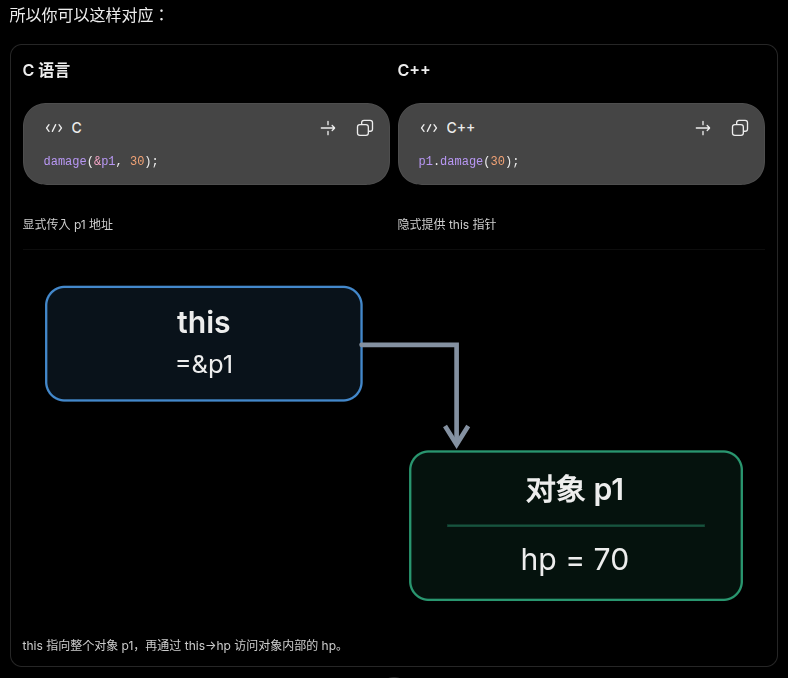
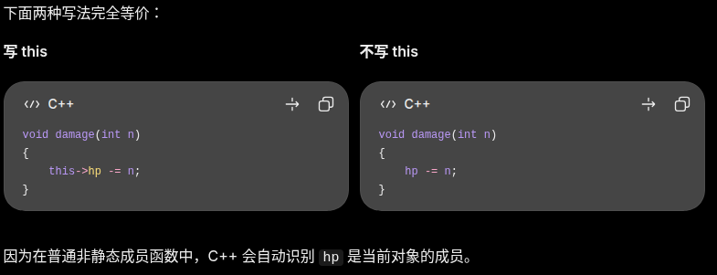

## C++ 入门学习

> 发布于 2026-11-15 16-49-46

## 基本语法

```cpp
#include <iostream> //包含头文件iostream
using namespace std;  //告诉编译器使用std命名空间

int main()
{
    std::cout << "Hello World" << std::endl;   //会在屏幕上打印"Hello World" //endl 将光标移动到新的一行
    std::cin.get();//等待按下回车键 然后移动到程序的下一行
    return 0;
}
```

main() 入口，如果不返回任何值，系统会视为返回0（仅限main函数）

```c++
#include <iostream>
using namespace std;

void Log(const char* message)
{
    std::cout << message << std::endl;
}
int main()
{
    Log("Hello World");
    std::cin.get();
    return 0;
}
```

## 数据类型

类型|关键字
---|---
布尔型|bool
字符型|char
整型|int
浮点型|float
双浮点型|double
无类型|void
宽字符型|wchar_t

修饰符|描述|示例
---|---|---
signed|表示有符号类型（默认）|signed int x = -10;
unsigned|表示无符号类型|unsigned int y = 10;
short|表示短整型|short int z = 100;
long|表示长整型|long int a = 100000;
const|表示常量，值不可修改|const int b = 5;
volatile|表示变量可能被意外修改，禁止编译器优化|volatile int c = 10;
mutable|表示类成员可以在 const 对象中修改|mutable int counter;

### C++11 新增类型

数据类型|描述|示例
---|---|---
auto|自动类型推断|auto x = 10;
decltype|获取表达式的类型|decltype(x) y = 20;
nullptr|空指针常量|int* ptr = nullptr;
std::initializer_list|初始化列表类型|`std::initializer_list <int> list = {1, 2, 3};`
std::tuple|元组类型，可以存储多个不同类型的值|`std::tuple<int, float, char> t(1, 2.0, 'a');`

## 命名空间

C++中的命名空间是一种将标识符分组的机制，避免标识符之间的冲突

定义方式如下

```c++
namespace namespace_name {
    int varl;
    void funcl();
    namespace sub_namespace{
        //sub-namespace content
    }
}
```

调用命名空间里的函数

```c++
namespace_name::funcl();
```

实例：

```C++
#include <iostream>

namespace wufeng
{
    int age = 18;
    void fun()
    {
        std::cout << "age=" << age << std::endl;
    }
    namespace sun_wufeng
    {
        int age = 20;
        void fun()
        {
            std::cout << "age=" << age << std::endl;
        }

    }
}

int main()
{
    wufeng::fun();
    std::cout << wufeng::age << std::endl;
    wufeng::sun_wufeng::fun();
    std::cout << wufeng::sun_wufeng::age << std::endl;
}
```

输出：

```c
age=18
18
age=20
20
```

指定命名空间：

`using namespace std;`放开某个命名空间的访问，即不用std::就可以访问std下的函数

不建议全部放开，可能出现重名的函数等问题

## 类

### 类 定义

C++中的类是一种用户自定义的数据类型，它将数据和操作封装在一起。类的目的在于提供了一种更好的代码重用和封装性，通过封装数据和方法，将其组织为一个独立的整体来管理数据

定义:

```c++
class 类名{
    //访问属性
    //类中成员
};
```

例:

```c++
class Student
{
    char name[20];
    int age;
    int id;

    void speak()
    {
        std::cout << "今年我" << age << "岁" << std::endl;
    }

    void play_ball()
    {
        speak();
        std::cout << "打篮球" << std::endl;
    }
};

```

这里面就包含了数据和方法

### 类中成员和访问属性

访问属性分三种：

- public：公有成员，可以在类中和类外直接访问
- protected： 保护成员，类中可以访问，类外不能直接访问
- private：私有成员，类中可以访问，类外不能直接访问

```c++
#include <iostream>
#include <cstring>

class Student
{
    private:
    int age;
    int id;

    public:
    char name[20];

    void setage(int x)
    {
        age = x;
    }

    int getage()
    {
        return age;
    }
};

int main()
{
    Student stu;
    std::strcpy(stu.name,"张三");
    std::cout << stu.name << std::endl;

    stu.setage(18);
    std::cout << stu.getage() << std::endl;
    return 0;
}
```

公有成员可以直接外部访问
`std::strcpy(stu.name,"张三");`

私有成员直接访问会报错，但可以通过提供的函数修改

`stu.setage(18);`

### this指针

## 面向对象

对象： 具有状态和行为 例如： 一只狗的颜色（状态），吃（行为）  对象是类的实例

类： 描述对象行为状态的模板蓝图

方法 : 一个方法表示一个行为，一个类包含多个方法，可以在方法中写入逻辑，操作数据以及执行所有的动作

即时变量： 每个对象都有其独特的即时变量，对象的状态是由这些即时变量值创建的

## 编程原则

SOLID

DRY

KISS

YAGNI

高内聚，低耦合

## ‘this’指针

看一个实例：

```c++
class Player
{
public:
    int hp = 100;

    void damage(int n)
    {
        this->hp -= n;
    }
};

int main()
{
    Player p1;
    p1.damage(30);
}
```

clas Player创建了一个类

player p1是新建了一个对象（实例） (类似于结构体)，名字是p1

类是模板，对象是根据类创建出来的具体实例。

`p1.damage(30);`调用p1对象里的damage函数

我们并没有手动传入 &p1，但是 damage() 仍然知道应该修改 p1。因为 C++ 会隐式地把当前对象的信息传给成员函数，这个对象指针就是 this。



表达式|含义
---|---
p1|整个玩家对象
&p1|整个玩家对象的地址
p1.hp|玩家的血量值
this|当前对象的指针
this->hp|当前对象的血量

当执行 p1.damage(30) 时：
this == &p1

而：
this->hp

相当于：
p1.hp

\[\boxed{p\texttt{->}hp = (*p).hp}\]



### 什么时候需要显式写 this

```c++
class Player
{
public:
    int hp;

    void setHP(int hp)
    {
        this->hp = hp;
    }
};
```

这里出现了两个 hp：  

- this->hp：对象的成员变量。
- hp：函数接收的参数。

