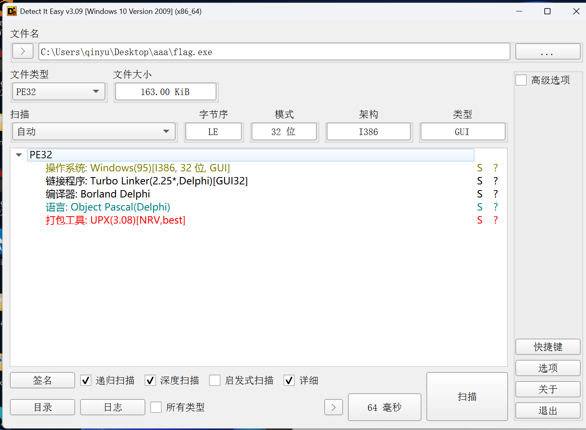

# ctfshow flag白给 wp

> 发布于 2026-10-12 12:02:00



脱壳

upx -d flag.exe -o a.exe

IDA打开

GUI文件得找交互

我们发现了

*TForm1*Button1Click

应该是点击下边那个检查按钮的

```
_DWORD *__fastcall TForm1_Button1Click(int a1)
{
  int v1; // edx
  unsigned int v3[2]; // [esp-10h] [ebp-14h] BYREF
  int *v4; // [esp-8h] [ebp-Ch]
  char *v5; // [esp+0h] [ebp-4h] BYREF
  int savedregs; // [esp+4h] [ebp+0h] BYREF

  v5 = 0;
  v4 = &savedregs;
  v3[1] = (unsigned int)&loc_454799;
  v3[0] = (unsigned int)NtCurrentTeb()->NtTib.ExceptionList;
  __writefsdword(0, (unsigned int)v3);
  Controls::TControl::GetText(*(Controls::TControl **)(a1 + 764), &v5);
  if ( Sysutils::CompareStr(v5, &str_HackAv[1]) )
    Dialogs::ShowMessage((Dialogs *)&str_____[1], v1);
  else
    Dialogs::ShowMessage((Dialogs *)&str______[1], v1);
  __writefsdword(0, v3[0]);
  v4 = (int *)&loc_4547A0;
  return System::__linkproc__ LStrClr(&v5);
}
```

Controls::TControl::GetText 是Delphi VCL标准的获取文本函数

v5是用户输入的值

Dialogs::ShowMessage 是判断是否相等的函数

相等成功

那我们查看下

str_HackAv[1]

是什么

```
CODE:004547A4 _str_HackAv     dd 0FFFFFFFFh           ; _top
CODE:004547A4                                         ; DATA XREF: _TForm1_Button1Click+27↑o
CODE:004547A8                 dd 6                    ; Len
CODE:004547AC                 db 'HackAv',0           ; Text
```

实际存储的值是HackAv

尝试输入到程序中

显示成功

那HackAv大概就是flag
