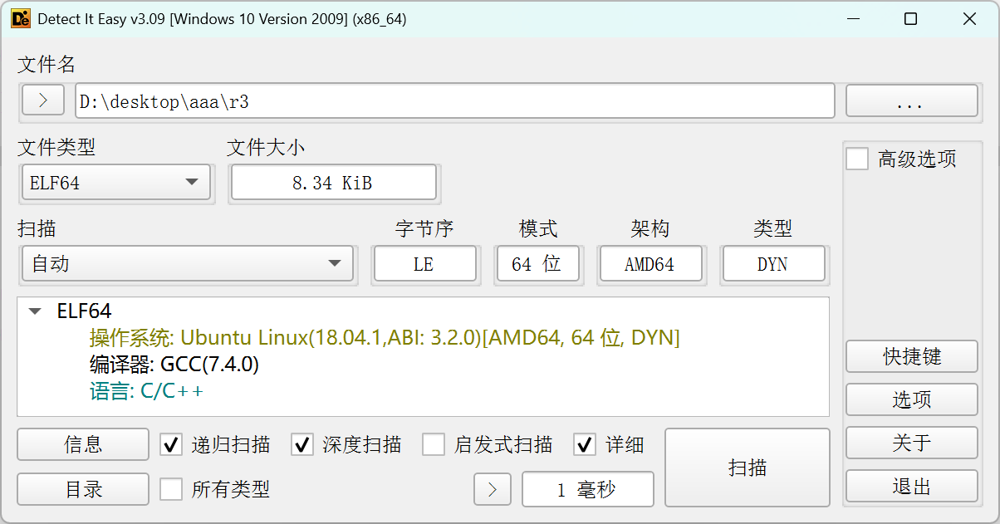
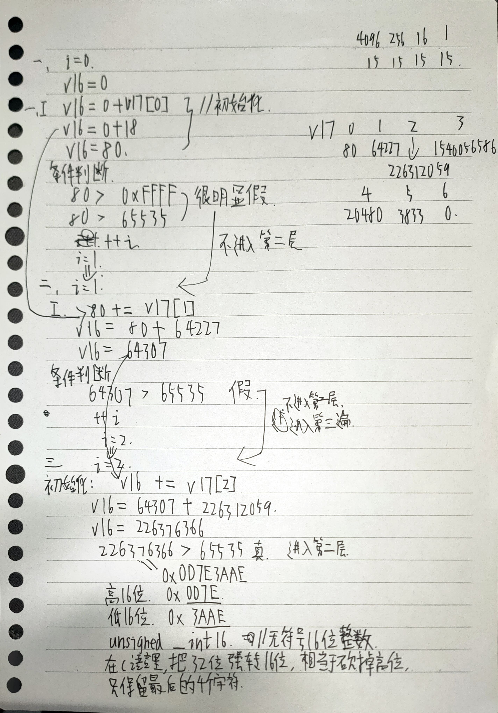
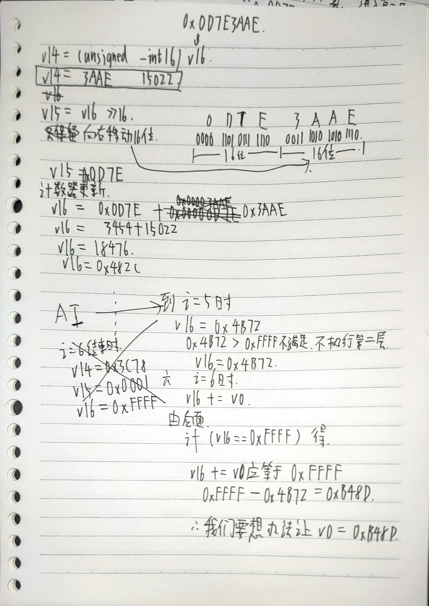

# ctfshow re3 wp

> 发布于 2026-10-09 12:08:01

DIE分析



直接生成伪代码

```
int __fastcall main(int argc, const char **argv, const char **envp)
{
  size_t v3; // rax
  int v0; // [rsp+Ch] [rbp-134h] BYREF
  unsigned int i; // [rsp+10h] [rbp-130h]
  int v80; // [rsp+14h] [rbp-12Ch]
  int v64227; // [rsp+18h] [rbp-128h]
  int v226312059; // [rsp+1Ch] [rbp-124h]
  int v1540056586; // [rsp+20h] [rbp-120h]
  int v5; // [rsp+24h] [rbp-11Ch]
  int vv16; // [rsp+28h] [rbp-118h]
  int v3833; // [rsp+2Ch] [rbp-114h]
  int v14; // [rsp+30h] [rbp-110h]
  int v15; // [rsp+34h] [rbp-10Ch]
  unsigned __int64 v16; // [rsp+38h] [rbp-108h]
  _DWORD v17[8]; // [rsp+40h] [rbp-100h]
  char s[5]; // [rsp+60h] [rbp-E0h] BYREF
  char v19[107]; // [rsp+65h] [rbp-DBh] BYREF
  char dest[104]; // [rsp+D0h] [rbp-70h] BYREF
  unsigned __int64 v21; // [rsp+138h] [rbp-8h]

  v21 = __readfsqword(0x28u);
  v80 = 80;
  v64227 = 64227;
  v226312059 = 226312059;
  v1540056586 = -1540056586;
  v5 = 5;
  vv16 = 16;
  v3833 = 3833;
  v0 = 0;
  puts("plz input the key:");
  __isoc99_scanf("%s");
  v3 = strlen(s);
  strncpy(dest, v19, v3 - 6);
  dest[strlen(s) - 6] = 0;
  __isoc99_sscanf(dest, "%x", &v0);
  v17[0] = v80;
  v17[1] = v64227;
  v17[2] = v226312059;
  v17[3] = v1540056586;
  v17[4] = (v5 << 12) + vv16;                   // 20480 << 是左移运算符。5 << 12 的意思是将数字 5 的二进制表示向左移动 12 位，相当于在十进制下乘以 4096
  v17[5] = v3833;
  v17[6] = v0;
  v16 = 0;
  for ( i = 0; i <= 6; ++i )                    // 执行7次
  {
    for ( v16 += (unsigned int)v17[i]; v16 > 0xFFFF; v16 = v15 + (unsigned int)(unsigned __int16)v16 )
    {
      v14 = (unsigned __int16)v16;
      v15 = v16 >> 16;
    }
  }
  if ( v16 == 0xFFFF )
    puts("OK");
  else
    puts("Error");
  return 0;
}
```

`<<` 是**左移运算符**。`5 << 12` 的意思是将数字 5 的二进制表示向左移动 12 位，**相当于在十进制下乘以2的12次方（即 4096）**

5*4096=20480

重点看

for(计数器设置初始值;循环条件;计数器更新)

```
  for ( i = 0; i <= 6; ++i )                    // 执行7次
  {
    for ( v16 += (unsigned int)v17[i]; v16 > 0xFFFF; v16 = v15 + (unsigned int)(unsigned __int16)v16 )
    {
      v14 = (unsigned __int16)v16;
      v15 = v16 >> 16;
    }
  }
```

一共是执行7次

第1，1次：

i = 0

v16 = 0

v16 = 0 + v17[0]

v16 = 0 + 80

v16 = 80

**先执行“初始化表达式”，然后进行“条件判断”，如果为真才进入循环体。**

很明显不满足

4096*15+256*15+16*15+1*15=65535

80+64227=64307

64307+226312059=226376366

- 在 C 语言里，把一个 32 位数强制转换成 16 位，相当于**砍掉前面的高位，只保留最后的 4 个字符（低 16 位）**。





### **🧐 语法拆解**

```
v16 = v15 + (unsigned int)(unsigned __int16)v16;
```

- `v15`：是你刚刚算出来的**高16位**（`0x0D7E`）。

- `(unsigned __int16)v16`：看括号里的内容。因为 `v16` 是 32 位的，强制转成 16 位，就是**砍掉高位，只保留低16位**（也就是你算出的 `0x3AAE`）。

- `(unsigned int)`：把 16 位的低位数提升回 32 位，以便和 `v15` 相加（其实在 C 语言里不加这个也行，编译器会自动处理，加上是为了严谨）。

- 最后赋值给 `v16`。

现在要想办法让V0 = 0xB48D

### **1️⃣ 第一行：**`puts("plz input the key:");`

- **人话翻译**：在屏幕上打印 `plz input the key:` 并换行。

- **逆向视角**：这是程序的提示语，告诉你该输入了。

---

### **2️⃣ 第二行：**`__isoc99_scanf("%s");`

- **人话翻译**：从键盘读取一个字符串，存放到栈上的 `s` 数组里。

- char s[5]; // [rsp+60h] [rbp-E0h] BYREF s是长度为5的字符数组

- **逆向视角（重要）**：反编译代码里它把参数藏起来了。但在汇编层面，它其实传入了 `s` 的地址（`lea rax, [rbp-0xE0]`）。因为 `s` 只声明了 5 个字节大小，但 `scanf` 读取的字符串会一直往高地址写，导致**溢出覆盖**到了 `v19` 数组的地址。所以你的整串输入（`AAAAAb48dZ`），被连续存放在了 `s` 和 `v19` 这块内存区域里。

- Q：是因为声明的时候是连续的才会溢出到这吗？ char s[5]; // [rsp+60h] [rbp-E0h] BYREF char v19[107]; // [rsp+65h] [rbp-DBh] BYREF

- A：程序里写的是 `scanf("%s")`，它其实会把你的输入，从 `s` 的首地址（`[rbp-0xE0]`）开始，**一个字节一个字节地往高地址写**，直到写完你输入的所有字符才停下。你输入第 1~5 个字符 `AAAAA`：正好填满 `s[5]`。

- 你输入第 6 个字符 `b`：它会自动覆盖到 `s` 后面的地址 `[rbp-0xDB]`，也就是 `v19` 的开头。

- 你输入第 7~10 个字符 `48dZ`：继续往 `v19` 的后面写入。

---

### **3️⃣ 第三行：**`v3 = strlen(s);`

- **人话翻译**：计算 `s` 数组里字符串的长度（不包括末尾的 `\0`），存到 `v3` 变量里。

- **逆向视角**：因为输入了 `AAAAAb48dZ`，所以 `v3 = 10`。

- 所以是因为我要v0=0xB48D是四个字符，所以我要让v3-6为4，所以v3要=10

---

### **4️⃣ 第四行：**`strncpy(dest, v19, v3 - 6);`

- **人话翻译**：从 `v19` 这个地址开始，拷贝 `v3 - 6` 个字符到 `dest` 里。

- **逆向视角**：`v19` 在栈上的地址是 `[rbp-0xDB]`，它其实是你的输入字符串的**第 6 个字符**（`s` 占了前 5 个字节，`v19` 是第 6 个字节开始）。

- 你的输入里，第 6 个字符开始是 `b48dZ`。

- `v3 - 6 = 10 - 6 = 4`。

- 所以这行代码的意思是：**从第 6 个字符开始，截取 4 个字符**（`b48d`），拷到 `dest` 里。

---

### **5️⃣ 第五行：**`dest[strlen(s) - 6] = 0;`

- **人话翻译**：在 `dest` 数组的 `strlen(s) - 6` 位置写入一个 `0`（字符串结束符 `\0`）。

- **逆向视角**：也就是执行 `dest[4] = 0;`。这步是为了保证刚才拷进来的字符能组成一个合法的 C 语言字符串（`"b48d"`），末尾必须有结束符。

- **为什么 **`b48dZ`** 会变成 **`b48d`**？**因为代码里写的是 `strncpy(dest, v19, 4)`。
`strncpy` 的工作方式很简单：**从 **`v19`** 的内存首地址开始，老老实实地拷贝 4 个字符，然后停下。**内存里的字符是：
`[b] [4] [8] [d] [Z] [\0] ...`从 `b` 开始，数 4 个字符：`b`、`4`、`8`、`d`。

- 到这为止，`strncpy` 拷贝完毕。

- 后面的 `Z` 根本没被碰过，留在了原来的内存里，被彻底丢弃。

**注意：这是“从左往右数4个”，而“0xB48D”的四个字符恰好就是 **`b48d`**。这是按字符数量截取，不是按数值大小截取。**

---

### **6️⃣ 第六行：**`__isoc99_sscanf(dest, "%x", &v0);`

- **人话翻译**：把 `dest` 里的内容，当作**十六进制整数**（`%x`）来解析，解析出的数值存到 `v0` 变量里。

- **逆向视角**：`dest` 现在的内容是 `"b48d"`。

- `%x` 会把它当成十六进制 `0xB48D`。

- 转换成十进制就是 `46221`。

- 最后赋值给了 `v0`。

纠错

之所以结果错误是因为我们忽略了v17[2]是无符号数

v17[3] = -1540056586 （转无符号：4294967296 - 1540056586 = 2754910710）

# 第二次尝试

在逆向题和校验和算法中，**“折叠（Fold）”** 是一个非常经典的术语。

简单来说，**“折叠”就是将一个超出目标位宽（比如32位）的大数字，切分成几段，然后强制相加，直到结果能塞进目标位宽（比如16位）为止。**

### 折叠相当于一直减0xFFFF，减到这个数正好<0xFFFF而不能再减0xFFFF

所以我们只要用最后结果取余数就可以了
80 + 64227 + 226312059 + 2754910710 + 20496 + 3833

得出2981311405 = 0xB1B333AD

除以0xFFFF取余

得出`0xE560`

再根据上述的“**🧐 语法拆解**”

v15 = 0xE560

0xFFFF-0xE560

```
  F F F F
- E 5 6 0
---------
  1 A 9 F
```

得出结果

提交flag{1a9f}

{
  size_t v3; // rax
  int v0; // [rsp+Ch] [rbp-134h] BYREF
  unsigned int i; // [rsp+10h] [rbp-130h]
  int v80; // [rsp+14h] [rbp-12Ch]
  int v64227; // [rsp+18h] [rbp-128h]
  int v226312059; // [rsp+1Ch] [rbp-124h]
  int v1540056586; // [rsp+20h] [rbp-120h]
  int v5; // [rsp+24h] [rbp-11Ch]
  int vv16; // [rsp+28h] [rbp-118h]
  int v3833; // [rsp+2Ch] [rbp-114h]
  int v14; // [rsp+30h] [rbp-110h]
  int v15; // [rsp+34h] [rbp-10Ch]
  unsigned __int64 v16; // [rsp+38h] [rbp-108h]
  _DWORD v17[8]; // [rsp+40h] [rbp-100h]
  char s[5]; // [rsp+60h] [rbp-E0h] BYREF
  char v19[107]; // [rsp+65h] [rbp-DBh] BYREF
  char dest[104]; // [rsp+D0h] [rbp-70h] BYREF
  unsigned __int64 v21; // [rsp+138h] [rbp-8h]

  v21 = __readfsqword(0x28u);
  v80 = 80;
  v64227 = 64227;
  v226312059 = 226312059;
  v1540056586 = -1540056586;
  v5 = 5;
  vv16 = 16;
  v3833 = 3833;
  v0 = 0;
  puts("plz input the key:");
  __isoc99_scanf("%s");
  v3 = strlen(s);
  strncpy(dest, v19, v3 - 6);
  dest[strlen(s) - 6] = 0;
  __isoc99_sscanf(dest, "%x", &v0);
  v17[0] = v80;
  v17[1] = v64227;
  v17[2] = v226312059;
  v17[3] = v1540056586;
  v17[4] = (v5 << 12) + vv16;                   // 20480 << 是左移运算符。5 << 12 的意思是将数字 5 的二进制表示向左移动 12 位，相当于在十进制下乘以 4096
  v17[5] = v3833;
  v17[6] = v0;
  v16 = 0;
  for ( i = 0; i <= 6; ++i )                    // 执行7次
  {
    for ( v16 += (unsigned int)v17[i]; v16 > 0xFFFF; v16 = v15 + (unsigned int)(unsigned __int16)v16 )
    {
      v14 = (unsigned __int16)v16;
      v15 = v16 >> 16;
    }
  }
  if ( v16 == 0xFFFF )
    puts("OK");
  else
    puts("Error");
  return 0;
}

`<<` 是**左移运算符**。`5 << 12` 的意思是将数字 5 的二进制表示向左移动 12 位，**相当于在十进制下乘以2的12次方（即 4096）**

5*4096=20480

重点看

for(计数器设置初始值;循环条件;计数器更新)

```
  for ( i = 0; i <= 6; ++i )                    // 执行7次
  {
    for ( v16 += (unsigned int)v17[i]; v16 > 0xFFFF; v16 = v15 + (unsigned int)(unsigned __int16)v16 )
    {
      v14 = (unsigned __int16)v16;
      v15 = v16 >> 16;
    }
  }
```

一共是执行7次

第1，1次：

i = 0

v16 = 0

v16 = 0 + v17[0]

v16 = 0 + 80

v16 = 80

**先执行“初始化表达式”，然后进行“条件判断”，如果为真才进入循环体。**

很明显不满足

4096*15+256*15+16*15+1*15=65535

80+64227=64307

64307+226312059=226376366

- 在 C 语言里，把一个 32 位数强制转换成 16 位，相当于**砍掉前面的高位，只保留最后的 4 个字符（低 16 位）**。


### **🧐 语法拆解**

```
v16 = v15 + (unsigned int)(unsigned __int16)v16;
```

- `v15`：是你刚刚算出来的**高16位**（`0x0D7E`）。

- `(unsigned __int16)v16`：看括号里的内容。因为 `v16` 是 32 位的，强制转成 16 位，就是**砍掉高位，只保留低16位**（也就是你算出的 `0x3AAE`）。

- `(unsigned int)`：把 16 位的低位数提升回 32 位，以便和 `v15` 相加（其实在 C 语言里不加这个也行，编译器会自动处理，加上是为了严谨）。

- 最后赋值给 `v16`。

现在要想办法让V0 = 0xB48D

### **1️⃣ 第一行：**`puts("plz input the key:");`

- **人话翻译**：在屏幕上打印 `plz input the key:` 并换行。

- **逆向视角**：这是程序的提示语，告诉你该输入了。

---

### **2️⃣ 第二行：**`__isoc99_scanf("%s");`

- **人话翻译**：从键盘读取一个字符串，存放到栈上的 `s` 数组里。

- char s[5]; // [rsp+60h] [rbp-E0h] BYREF s是长度为5的字符数组

- **逆向视角（重要）**：反编译代码里它把参数藏起来了。但在汇编层面，它其实传入了 `s` 的地址（`lea rax, [rbp-0xE0]`）。因为 `s` 只声明了 5 个字节大小，但 `scanf` 读取的字符串会一直往高地址写，导致**溢出覆盖**到了 `v19` 数组的地址。所以你的整串输入（`AAAAAb48dZ`），被连续存放在了 `s` 和 `v19` 这块内存区域里。

- Q：是因为声明的时候是连续的才会溢出到这吗？ char s[5]; // [rsp+60h] [rbp-E0h] BYREF char v19[107]; // [rsp+65h] [rbp-DBh] BYREF

- A：程序里写的是 `scanf("%s")`，它其实会把你的输入，从 `s` 的首地址（`[rbp-0xE0]`）开始，**一个字节一个字节地往高地址写**，直到写完你输入的所有字符才停下。你输入第 1~5 个字符 `AAAAA`：正好填满 `s[5]`。

- 你输入第 6 个字符 `b`：它会自动覆盖到 `s` 后面的地址 `[rbp-0xDB]`，也就是 `v19` 的开头。

- 你输入第 7~10 个字符 `48dZ`：继续往 `v19` 的后面写入。

---

### **3️⃣ 第三行：**`v3 = strlen(s);`

- **人话翻译**：计算 `s` 数组里字符串的长度（不包括末尾的 `\0`），存到 `v3` 变量里。

- **逆向视角**：因为输入了 `AAAAAb48dZ`，所以 `v3 = 10`。

- 所以是因为我要v0=0xB48D是四个字符，所以我要让v3-6为4，所以v3要=10

---

### **4️⃣ 第四行：**`strncpy(dest, v19, v3 - 6);`

- **人话翻译**：从 `v19` 这个地址开始，拷贝 `v3 - 6` 个字符到 `dest` 里。

- **逆向视角**：`v19` 在栈上的地址是 `[rbp-0xDB]`，它其实是你的输入字符串的**第 6 个字符**（`s` 占了前 5 个字节，`v19` 是第 6 个字节开始）。

- 你的输入里，第 6 个字符开始是 `b48dZ`。

- `v3 - 6 = 10 - 6 = 4`。

- 所以这行代码的意思是：**从第 6 个字符开始，截取 4 个字符**（`b48d`），拷到 `dest` 里。

---

### **5️⃣ 第五行：**`dest[strlen(s) - 6] = 0;`

- **人话翻译**：在 `dest` 数组的 `strlen(s) - 6` 位置写入一个 `0`（字符串结束符 `\0`）。

- **逆向视角**：也就是执行 `dest[4] = 0;`。这步是为了保证刚才拷进来的字符能组成一个合法的 C 语言字符串（`"b48d"`），末尾必须有结束符。

- **为什么 **`b48dZ`** 会变成 **`b48d`**？**因为代码里写的是 `strncpy(dest, v19, 4)`。
`strncpy` 的工作方式很简单：**从 **`v19`** 的内存首地址开始，老老实实地拷贝 4 个字符，然后停下。**内存里的字符是：
`[b] [4] [8] [d] [Z] [\0] ...`从 `b` 开始，数 4 个字符：`b`、`4`、`8`、`d`。

- 到这为止，`strncpy` 拷贝完毕。

- 后面的 `Z` 根本没被碰过，留在了原来的内存里，被彻底丢弃。

**注意：这是“从左往右数4个”，而“0xB48D”的四个字符恰好就是 **`b48d`**。这是按字符数量截取，不是按数值大小截取。**

---

### **6️⃣ 第六行：**`__isoc99_sscanf(dest, "%x", &v0);`

- **人话翻译**：把 `dest` 里的内容，当作**十六进制整数**（`%x`）来解析，解析出的数值存到 `v0` 变量里。

- **逆向视角**：`dest` 现在的内容是 `"b48d"`。

- `%x` 会把它当成十六进制 `0xB48D`。

- 转换成十进制就是 `46221`。

- 最后赋值给了 `v0`。

纠错

之所以结果错误是因为我们忽略了v17[2]是无符号数

v17[3] = -1540056586 （转无符号：4294967296 - 1540056586 = 2754910710）

# 第二次尝试

在逆向题和校验和算法中，**“折叠（Fold）”** 是一个非常经典的术语。

简单来说，**“折叠”就是将一个超出目标位宽（比如32位）的大数字，切分成几段，然后强制相加，直到结果能塞进目标位宽（比如16位）为止。**

### 折叠相当于一直减0xFFFF，减到这个数正好<0xFFFF而不能再减0xFFFF

所以我们只要用最后结果取余数就可以了
80 + 64227 + 226312059 + 2754910710 + 20496 + 3833

得出2981311405 = 0xB1B333AD

除以0xFFFF取余

得出`0xE560`

再根据上述的“**🧐 语法拆解**”

v15 = 0xE560

0xFFFF-0xE560

```
  F F F F
- E 5 6 0
---------
  1 A 9 F
```

得出结果

{
  size_t v3; // rax
  int v0; // [rsp+Ch] [rbp-134h] BYREF
  unsigned int i; // [rsp+10h] [rbp-130h]
  int v80; // [rsp+14h] [rbp-12Ch]
  int v64227; // [rsp+18h] [rbp-128h]
  int v226312059; // [rsp+1Ch] [rbp-124h]
  int v1540056586; // [rsp+20h] [rbp-120h]
  int v5; // [rsp+24h] [rbp-11Ch]
  int vv16; // [rsp+28h] [rbp-118h]
  int v3833; // [rsp+2Ch] [rbp-114h]
  int v14; // [rsp+30h] [rbp-110h]
  int v15; // [rsp+34h] [rbp-10Ch]
  unsigned __int64 v16; // [rsp+38h] [rbp-108h]
  _DWORD v17[8]; // [rsp+40h] [rbp-100h]
  char s[5]; // [rsp+60h] [rbp-E0h] BYREF
  char v19[107]; // [rsp+65h] [rbp-DBh] BYREF
  char dest[104]; // [rsp+D0h] [rbp-70h] BYREF
  unsigned __int64 v21; // [rsp+138h] [rbp-8h]

  v21 = __readfsqword(0x28u);
  v80 = 80;
  v64227 = 64227;
  v226312059 = 226312059;
  v1540056586 = -1540056586;
  v5 = 5;
  vv16 = 16;
  v3833 = 3833;
  v0 = 0;
  puts("plz input the key:");
  __isoc99_scanf("%s");
  v3 = strlen(s);
  strncpy(dest, v19, v3 - 6);
  dest[strlen(s) - 6] = 0;
  __isoc99_sscanf(dest, "%x", &v0);
  v17[0] = v80;
  v17[1] = v64227;
  v17[2] = v226312059;
  v17[3] = v1540056586;
  v17[4] = (v5 << 12) + vv16;                   // 20480 << 是左移运算符。5 << 12 的意思是将数字 5 的二进制表示向左移动 12 位，相当于在十进制下乘以 4096
  v17[5] = v3833;
  v17[6] = v0;
  v16 = 0;
  for ( i = 0; i <= 6; ++i )                    // 执行7次
  {
    for ( v16 += (unsigned int)v17[i]; v16 > 0xFFFF; v16 = v15 + (unsigned int)(unsigned __int16)v16 )
    {
      v14 = (unsigned __int16)v16;
      v15 = v16 >> 16;
    }
  }
  if ( v16 == 0xFFFF )
    puts("OK");
  else
    puts("Error");
  return 0;
}

`<<` 是**左移运算符**。`5 << 12` 的意思是将数字 5 的二进制表示向左移动 12 位，**相当于在十进制下乘以2的12次方（即 4096）**

5*4096=20480

重点看

for(计数器设置初始值;循环条件;计数器更新)

```
  for ( i = 0; i <= 6; ++i )                    // 执行7次
  {
    for ( v16 += (unsigned int)v17[i]; v16 > 0xFFFF; v16 = v15 + (unsigned int)(unsigned __int16)v16 )
    {
      v14 = (unsigned __int16)v16;
      v15 = v16 >> 16;
    }
  }
```

一共是执行7次

第1，1次：

i = 0

v16 = 0

v16 = 0 + v17[0]

v16 = 0 + 80

v16 = 80

**先执行“初始化表达式”，然后进行“条件判断”，如果为真才进入循环体。**

很明显不满足

4096*15+256*15+16*15+1*15=65535

80+64227=64307

64307+226312059=226376366

- 在 C 语言里，把一个 32 位数强制转换成 16 位，相当于**砍掉前面的高位，只保留最后的 4 个字符（低 16 位）**。


### **🧐 语法拆解**

```
v16 = v15 + (unsigned int)(unsigned __int16)v16;
```

- `v15`：是你刚刚算出来的**高16位**（`0x0D7E`）。

- `(unsigned __int16)v16`：看括号里的内容。因为 `v16` 是 32 位的，强制转成 16 位，就是**砍掉高位，只保留低16位**（也就是你算出的 `0x3AAE`）。

- `(unsigned int)`：把 16 位的低位数提升回 32 位，以便和 `v15` 相加（其实在 C 语言里不加这个也行，编译器会自动处理，加上是为了严谨）。

- 最后赋值给 `v16`。

现在要想办法让V0 = 0xB48D

### **1️⃣ 第一行：**`puts("plz input the key:");`

- **人话翻译**：在屏幕上打印 `plz input the key:` 并换行。

- **逆向视角**：这是程序的提示语，告诉你该输入了。

---

### **2️⃣ 第二行：**`__isoc99_scanf("%s");`

- **人话翻译**：从键盘读取一个字符串，存放到栈上的 `s` 数组里。

- char s[5]; // [rsp+60h] [rbp-E0h] BYREF   s是长度为5的字符数组

- **逆向视角（重要）**：反编译代码里它把参数藏起来了。但在汇编层面，它其实传入了 `s` 的地址（`lea rax, [rbp-0xE0]`）。因为 `s` 只声明了 5 个字节大小，但 `scanf` 读取的字符串会一直往高地址写，导致**溢出覆盖**到了 `v19` 数组的地址。所以你的整串输入（`AAAAAb48dZ`），被连续存放在了 `s` 和 `v19` 这块内存区域里。

- Q：是因为声明的时候是连续的才会溢出到这吗？   char s[5]; // [rsp+60h] [rbp-E0h] BYREF   char v19[107]; // [rsp+65h] [rbp-DBh] BYREF

- A：程序里写的是 `scanf("%s")`，它其实会把你的输入，从 `s` 的首地址（`[rbp-0xE0]`）开始，**一个字节一个字节地往高地址写**，直到写完你输入的所有字符才停下。你输入第 1~5 个字符 `AAAAA`：正好填满 `s[5]`。

- 你输入第 6 个字符 `b`：它会自动覆盖到 `s` 后面的地址 `[rbp-0xDB]`，也就是 `v19` 的开头。

- 你输入第 7~10 个字符 `48dZ`：继续往 `v19` 的后面写入。

---

### **3️⃣ 第三行：**`v3 = strlen(s);`

- **人话翻译**：计算 `s` 数组里字符串的长度（不包括末尾的 `\0`），存到 `v3` 变量里。

- **逆向视角**：因为输入了 `AAAAAb48dZ`，所以 `v3 = 10`。

- 所以是因为我要v0=0xB48D是四个字符，所以我要让v3-6为4，所以v3要=10

---

### **4️⃣ 第四行：**`strncpy(dest, v19, v3 - 6);`

- **人话翻译**：从 `v19` 这个地址开始，拷贝 `v3 - 6` 个字符到 `dest` 里。

- **逆向视角**：`v19` 在栈上的地址是 `[rbp-0xDB]`，它其实是你的输入字符串的**第 6 个字符**（`s` 占了前 5 个字节，`v19` 是第 6 个字节开始）。

- 你的输入里，第 6 个字符开始是 `b48dZ`。

- `v3 - 6 = 10 - 6 = 4`。

- 所以这行代码的意思是：**从第 6 个字符开始，截取 4 个字符**（`b48d`），拷到 `dest` 里。

---

### **5️⃣ 第五行：**`dest[strlen(s) - 6] = 0;`

- **人话翻译**：在 `dest` 数组的 `strlen(s) - 6` 位置写入一个 `0`（字符串结束符 `\0`）。

- **逆向视角**：也就是执行 `dest[4] = 0;`。这步是为了保证刚才拷进来的字符能组成一个合法的 C 语言字符串（`"b48d"`），末尾必须有结束符。

- **为什么 **`b48dZ`** 会变成 **`b48d`**？**因为代码里写的是 `strncpy(dest, v19, 4)`。
`strncpy` 的工作方式很简单：**从 **`v19`** 的内存首地址开始，老老实实地拷贝 4 个字符，然后停下。**内存里的字符是：
`[b] [4] [8] [d] [Z] [\0] ...`从 `b` 开始，数 4 个字符：`b`、`4`、`8`、`d`。

- 到这为止，`strncpy` 拷贝完毕。

- 后面的 `Z` 根本没被碰过，留在了原来的内存里，被彻底丢弃。

**注意：这是“从左往右数4个”，而“0xB48D”的四个字符恰好就是 **`b48d`**。这是按字符数量截取，不是按数值大小截取。**

---

### **6️⃣ 第六行：**`__isoc99_sscanf(dest, "%x", &v0);`

- **人话翻译**：把 `dest` 里的内容，当作**十六进制整数**（`%x`）来解析，解析出的数值存到 `v0` 变量里。

- **逆向视角**：`dest` 现在的内容是 `"b48d"`。

- `%x` 会把它当成十六进制 `0xB48D`。

- 转换成十进制就是 `46221`。

- 最后赋值给了 `v0`。

纠错

之所以结果错误是因为我们忽略了v17[2]是无符号数

v17[3] = -1540056586 （转无符号：4294967296 - 1540056586 = 2754910710）

{
  size_t v3; // rax
  int v0; // [rsp+Ch] [rbp-134h] BYREF
  unsigned int i; // [rsp+10h] [rbp-130h]
  int v80; // [rsp+14h] [rbp-12Ch]
  int v64227; // [rsp+18h] [rbp-128h]
  int v226312059; // [rsp+1Ch] [rbp-124h]
  int v1540056586; // [rsp+20h] [rbp-120h]
  int v5; // [rsp+24h] [rbp-11Ch]
  int vv16; // [rsp+28h] [rbp-118h]
  int v3833; // [rsp+2Ch] [rbp-114h]
  int v14; // [rsp+30h] [rbp-110h]
  int v15; // [rsp+34h] [rbp-10Ch]
  unsigned __int64 v16; // [rsp+38h] [rbp-108h]
  _DWORD v17[8]; // [rsp+40h] [rbp-100h]
  char s[5]; // [rsp+60h] [rbp-E0h] BYREF
  char v19[107]; // [rsp+65h] [rbp-DBh] BYREF
  char dest[104]; // [rsp+D0h] [rbp-70h] BYREF
  unsigned __int64 v21; // [rsp+138h] [rbp-8h]

  v21 = __readfsqword(0x28u);
  v80 = 80;
  v64227 = 64227;
  v226312059 = 226312059;
  v1540056586 = -1540056586;
  v5 = 5;
  vv16 = 16;
  v3833 = 3833;
  v0 = 0;
  puts("plz input the key:");
  __isoc99_scanf("%s");
  v3 = strlen(s);
  strncpy(dest, v19, v3 - 6);
  dest[strlen(s) - 6] = 0;
  __isoc99_sscanf(dest, "%x", &v0);
  v17[0] = v80;
  v17[1] = v64227;
  v17[2] = v226312059;
  v17[3] = v1540056586;
  v17[4] = (v5 << 12) + vv16;                   // 20480 << 是左移运算符。5 << 12 的意思是将数字 5 的二进制表示向左移动 12 位，相当于在十进制下乘以 4096
  v17[5] = v3833;
  v17[6] = v0;
  v16 = 0;
  for ( i = 0; i <= 6; ++i )                    // 执行7次
  {
    for ( v16 += (unsigned int)v17[i]; v16 > 0xFFFF; v16 = v15 + (unsigned int)(unsigned __int16)v16 )
    {
      v14 = (unsigned __int16)v16;
      v15 = v16 >> 16;
    }
  }
  if ( v16 == 0xFFFF )
    puts("OK");
  else
    puts("Error");
  return 0;
}

`<<` 是**左移运算符**。`5 << 12` 的意思是将数字 5 的二进制表示向左移动 12 位，**相当于在十进制下乘以2的12次方（即 4096）**

5*4096=20480

重点看

for(计数器设置初始值;循环条件;计数器更新)

```
  for ( i = 0; i <= 6; ++i )                    // 执行7次
  {
    for ( v16 += (unsigned int)v17[i]; v16 > 0xFFFF; v16 = v15 + (unsigned int)(unsigned __int16)v16 )
    {
      v14 = (unsigned __int16)v16;
      v15 = v16 >> 16;
    }
  }
```

一共是执行7次

第1，1次：

i = 0

v16 = 0

v16 = 0 + v17[0]

v16 = 0 + 80

v16 = 80

**先执行“初始化表达式”，然后进行“条件判断”，如果为真才进入循环体。**

很明显不满足

4096*15+256*15+16*15+1*15=65535

80+64227=64307

64307+226312059=226376366

- 在 C 语言里，把一个 32 位数强制转换成 16 位，相当于**砍掉前面的高位，只保留最后的 4 个字符（低 16 位）**。


### **🧐 语法拆解**

```
v16 = v15 + (unsigned int)(unsigned __int16)v16;
```

- `v15`：是你刚刚算出来的**高16位**（`0x0D7E`）。

- `(unsigned __int16)v16`：看括号里的内容。因为 `v16` 是 32 位的，强制转成 16 位，就是**砍掉高位，只保留低16位**（也就是你算出的 `0x3AAE`）。

- `(unsigned int)`：把 16 位的低位数提升回 32 位，以便和 `v15` 相加（其实在 C 语言里不加这个也行，编译器会自动处理，加上是为了严谨）。

- 最后赋值给 `v16`。

现在要想办法让V0 = 0xB48D

### **1️⃣ 第一行：**`puts("plz input the key:");`

- **人话翻译**：在屏幕上打印 `plz input the key:` 并换行。

- **逆向视角**：这是程序的提示语，告诉你该输入了。

---

### **2️⃣ 第二行：**`__isoc99_scanf("%s");`

- **人话翻译**：从键盘读取一个字符串，存放到栈上的 `s` 数组里。

- char s[5]; // [rsp+60h] [rbp-E0h] BYREF   s是长度为5的字符数组

- **逆向视角（重要）**：反编译代码里它把参数藏起来了。但在汇编层面，它其实传入了 `s` 的地址（`lea rax, [rbp-0xE0]`）。因为 `s` 只声明了 5 个字节大小，但 `scanf` 读取的字符串会一直往高地址写，导致**溢出覆盖**到了 `v19` 数组的地址。所以你的整串输入（`AAAAAb48dZ`），被连续存放在了 `s` 和 `v19` 这块内存区域里。

- Q：是因为声明的时候是连续的才会溢出到这吗？   char s[5]; // [rsp+60h] [rbp-E0h] BYREF   char v19[107]; // [rsp+65h] [rbp-DBh] BYREF

- A：程序里写的是 `scanf("%s")`，它其实会把你的输入，从 `s` 的首地址（`[rbp-0xE0]`）开始，**一个字节一个字节地往高地址写**，直到写完你输入的所有字符才停下。你输入第 1~5 个字符 `AAAAA`：正好填满 `s[5]`。

- 你输入第 6 个字符 `b`：它会自动覆盖到 `s` 后面的地址 `[rbp-0xDB]`，也就是 `v19` 的开头。

- 你输入第 7~10 个字符 `48dZ`：继续往 `v19` 的后面写入。

---

### **3️⃣ 第三行：**`v3 = strlen(s);`

- **人话翻译**：计算 `s` 数组里字符串的长度（不包括末尾的 `\0`），存到 `v3` 变量里。

- **逆向视角**：因为输入了 `AAAAAb48dZ`，所以 `v3 = 10`。

- 所以是因为我要v0=0xB48D是四个字符，所以我要让v3-6为4，所以v3要=10

---

### **4️⃣ 第四行：**`strncpy(dest, v19, v3 - 6);`

- **人话翻译**：从 `v19` 这个地址开始，拷贝 `v3 - 6` 个字符到 `dest` 里。

- **逆向视角**：`v19` 在栈上的地址是 `[rbp-0xDB]`，它其实是你的输入字符串的**第 6 个字符**（`s` 占了前 5 个字节，`v19` 是第 6 个字节开始）。

- 你的输入里，第 6 个字符开始是 `b48dZ`。

- `v3 - 6 = 10 - 6 = 4`。

- 所以这行代码的意思是：**从第 6 个字符开始，截取 4 个字符**（`b48d`），拷到 `dest` 里。

---

### **5️⃣ 第五行：**`dest[strlen(s) - 6] = 0;`

- **人话翻译**：在 `dest` 数组的 `strlen(s) - 6` 位置写入一个 `0`（字符串结束符 `\0`）。

- **逆向视角**：也就是执行 `dest[4] = 0;`。这步是为了保证刚才拷进来的字符能组成一个合法的 C 语言字符串（`"b48d"`），末尾必须有结束符。

- **为什么 **`b48dZ`** 会变成 **`b48d`**？**因为代码里写的是 `strncpy(dest, v19, 4)`。
`strncpy` 的工作方式很简单：**从 **`v19`** 的内存首地址开始，老老实实地拷贝 4 个字符，然后停下。**内存里的字符是：
`[b] [4] [8] [d] [Z] [\0] ...`从 `b` 开始，数 4 个字符：`b`、`4`、`8`、`d`。

- 到这为止，`strncpy` 拷贝完毕。

- 后面的 `Z` 根本没被碰过，留在了原来的内存里，被彻底丢弃。

**注意：这是“从左往右数4个”，而“0xB48D”的四个字符恰好就是 **`b48d`**。这是按字符数量截取，不是按数值大小截取。**

---

### **6️⃣ 第六行：**`__isoc99_sscanf(dest, "%x", &v0);`

- **人话翻译**：把 `dest` 里的内容，当作**十六进制整数**（`%x`）来解析，解析出的数值存到 `v0` 变量里。

- **逆向视角**：`dest` 现在的内容是 `"b48d"`。

- `%x` 会把它当成十六进制 `0xB48D`。

- 转换成十进制就是 `46221`。

- 最后赋值给了 `v0`。

{
  size_t v3; // rax
  int v0; // [rsp+Ch] [rbp-134h] BYREF
  unsigned int i; // [rsp+10h] [rbp-130h]
  int v80; // [rsp+14h] [rbp-12Ch]
  int v64227; // [rsp+18h] [rbp-128h]
  int v226312059; // [rsp+1Ch] [rbp-124h]
  int v1540056586; // [rsp+20h] [rbp-120h]
  int v5; // [rsp+24h] [rbp-11Ch]
  int vv16; // [rsp+28h] [rbp-118h]
  int v3833; // [rsp+2Ch] [rbp-114h]
  int v14; // [rsp+30h] [rbp-110h]
  int v15; // [rsp+34h] [rbp-10Ch]
  unsigned __int64 v16; // [rsp+38h] [rbp-108h]
  _DWORD v17[8]; // [rsp+40h] [rbp-100h]
  char s[5]; // [rsp+60h] [rbp-E0h] BYREF
  char v19[107]; // [rsp+65h] [rbp-DBh] BYREF
  char dest[104]; // [rsp+D0h] [rbp-70h] BYREF
  unsigned __int64 v21; // [rsp+138h] [rbp-8h]

  v21 = __readfsqword(0x28u);
  v80 = 80;
  v64227 = 64227;
  v226312059 = 226312059;
  v1540056586 = -1540056586;
  v5 = 5;
  vv16 = 16;
  v3833 = 3833;
  v0 = 0;
  puts("plz input the key:");
  __isoc99_scanf("%s");
  v3 = strlen(s);
  strncpy(dest, v19, v3 - 6);
  dest[strlen(s) - 6] = 0;
  __isoc99_sscanf(dest, "%x", &v0);
  v17[0] = v80;
  v17[1] = v64227;
  v17[2] = v226312059;
  v17[3] = v1540056586;
  v17[4] = (v5 << 12) + vv16;                   // 20480 << 是左移运算符。5 << 12 的意思是将数字 5 的二进制表示向左移动 12 位，相当于在十进制下乘以 4096
  v17[5] = v3833;
  v17[6] = v0;
  v16 = 0;
  for ( i = 0; i <= 6; ++i )                    // 执行7次
  {
    for ( v16 += (unsigned int)v17[i]; v16 > 0xFFFF; v16 = v15 + (unsigned int)(unsigned __int16)v16 )
    {
      v14 = (unsigned __int16)v16;
      v15 = v16 >> 16;
    }
  }
  if ( v16 == 0xFFFF )
    puts("OK");
  else
    puts("Error");
  return 0;
}

`<<` 是**左移运算符**。`5 << 12` 的意思是将数字 5 的二进制表示向左移动 12 位，**相当于在十进制下乘以2的12次方（即 4096）**

5*4096=20480

重点看

for(计数器设置初始值;循环条件;计数器更新)

```
  for ( i = 0; i <= 6; ++i )                    // 执行7次
  {
    for ( v16 += (unsigned int)v17[i]; v16 > 0xFFFF; v16 = v15 + (unsigned int)(unsigned __int16)v16 )
    {
      v14 = (unsigned __int16)v16;
      v15 = v16 >> 16;
    }
  }
```

一共是执行7次

第1，1次：

i = 0

v16 = 0

v16 = 0 + v17[0]

v16 = 0 + 80

v16 = 80

**先执行“初始化表达式”，然后进行“条件判断”，如果为真才进入循环体。**

很明显不满足

4096*15+256*15+16*15+1*15=65535

80+64227=64307

64307+226312059=226376366

- 在 C 语言里，把一个 32 位数强制转换成 16 位，相当于**砍掉前面的高位，只保留最后的 4 个字符（低 16 位）**。

### **🧐 语法拆解**

```
v16 = v15 + (unsigned int)(unsigned __int16)v16;
```

- `v15`：是你刚刚算出来的**高16位**（`0x0D7E`）。

- `(unsigned __int16)v16`：看括号里的内容。因为 `v16` 是 32 位的，强制转成 16 位，就是**砍掉高位，只保留低16位**（也就是你算出的 `0x3AAE`）。

- `(unsigned int)`：把 16 位的低位数提升回 32 位，以便和 `v15` 相加（其实在 C 语言里不加这个也行，编译器会自动处理，加上是为了严谨）。

- 最后赋值给 `v16`。

现在要想办法让V0 = 0xB48D

### **1️⃣ 第一行：**`puts("plz input the key:");`

- **人话翻译**：在屏幕上打印 `plz input the key:` 并换行。

- **逆向视角**：这是程序的提示语，告诉你该输入了。

---

### **2️⃣ 第二行：**`__isoc99_scanf("%s");`

- **人话翻译**：从键盘读取一个字符串，存放到栈上的 `s` 数组里。

- char s[5]; // [rsp+60h] [rbp-E0h] BYREF   s是长度为5的字符数组

- **逆向视角（重要）**：反编译代码里它把参数藏起来了。但在汇编层面，它其实传入了 `s` 的地址（`lea rax, [rbp-0xE0]`）。因为 `s` 只声明了 5 个字节大小，但 `scanf` 读取的字符串会一直往高地址写，导致**溢出覆盖**到了 `v19` 数组的地址。所以你的整串输入（`AAAAAb48dZ`），被连续存放在了 `s` 和 `v19` 这块内存区域里。

- Q：是因为声明的时候是连续的才会溢出到这吗？   char s[5]; // [rsp+60h] [rbp-E0h] BYREF   char v19[107]; // [rsp+65h] [rbp-DBh] BYREF

- A：程序里写的是 `scanf("%s")`，它其实会把你的输入，从 `s` 的首地址（`[rbp-0xE0]`）开始，**一个字节一个字节地往高地址写**，直到写完你输入的所有字符才停下。你输入第 1~5 个字符 `AAAAA`：正好填满 `s[5]`。

- 你输入第 6 个字符 `b`：它会自动覆盖到 `s` 后面的地址 `[rbp-0xDB]`，也就是 `v19` 的开头。

- 你输入第 7~10 个字符 `48dZ`：继续往 `v19` 的后面写入。

---

### **3️⃣ 第三行：**`v3 = strlen(s);`

- **人话翻译**：计算 `s` 数组里字符串的长度（不包括末尾的 `\0`），存到 `v3` 变量里。

- **逆向视角**：因为输入了 `AAAAAb48dZ`，所以 `v3 = 10`。

- 所以是因为我要v0=0xB48D是四个字符，所以我要让v3-6为4，所以v3要=10

---

### **4️⃣ 第四行：**`strncpy(dest, v19, v3 - 6);`

- **人话翻译**：从 `v19` 这个地址开始，拷贝 `v3 - 6` 个字符到 `dest` 里。

- **逆向视角**：`v19` 在栈上的地址是 `[rbp-0xDB]`，它其实是你的输入字符串的**第 6 个字符**（`s` 占了前 5 个字节，`v19` 是第 6 个字节开始）。

- 你的输入里，第 6 个字符开始是 `b48dZ`。

- `v3 - 6 = 10 - 6 = 4`。

- 所以这行代码的意思是：**从第 6 个字符开始，截取 4 个字符**（`b48d`），拷到 `dest` 里。

---

### **5️⃣ 第五行：**`dest[strlen(s) - 6] = 0;`

- **人话翻译**：在 `dest` 数组的 `strlen(s) - 6` 位置写入一个 `0`（字符串结束符 `\0`）。

- **逆向视角**：也就是执行 `dest[4] = 0;`。这步是为了保证刚才拷进来的字符能组成一个合法的 C 语言字符串（`"b48d"`），末尾必须有结束符。

- **为什么 **`b48dZ`** 会变成 **`b48d`**？**因为代码里写的是 `strncpy(dest, v19, 4)`。
`strncpy` 的工作方式很简单：**从 **`v19`** 的内存首地址开始，老老实实地拷贝 4 个字符，然后停下。**内存里的字符是：
`[b] [4] [8] [d] [Z] [\0] ...`从 `b` 开始，数 4 个字符：`b`、`4`、`8`、`d`。

- 到这为止，`strncpy` 拷贝完毕。

- 后面的 `Z` 根本没被碰过，留在了原来的内存里，被彻底丢弃。

**注意：这是“从左往右数4个”，而“0xB48D”的四个字符恰好就是 **`b48d`**。这是按字符数量截取，不是按数值大小截取。**

---

### **6️⃣ 第六行：**`__isoc99_sscanf(dest, "%x", &v0);`

- **人话翻译**：把 `dest` 里的内容，当作**十六进制整数**（`%x`）来解析，解析出的数值存到 `v0` 变量里。

- **逆向视角**：`dest` 现在的内容是 `"b48d"`。

- `%x` 会把它当成十六进制 `0xB48D`。

- 转换成十进制就是 `46221`。

- 最后赋值给了 `v0`。
