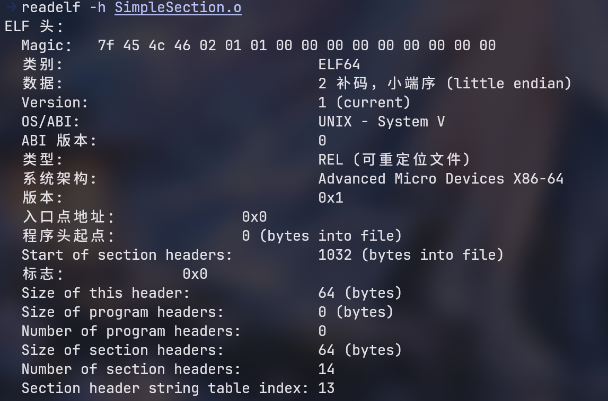

# ELF 文件结构入门

> 发布于：2026-11-12 20:30:00  
> 参考书籍：《程序员的自我修养——链接、装载与库》  
> 学习环境：Linux x86-64，主要讨论 **ELF64（小端序）**。

## 第二章：编译和链接

### 2.1 被隐藏了的过程

C 程序生成可执行文件，通常经历四个阶段：

```text
C 源代码 (.c)
    │ 预处理
    ▼
预处理文件 (.i)
    │ 编译
    ▼
汇编文件 (.s)
    │ 汇编
    ▼
可重定位目标文件 (.o)
    │ 链接
    ▼
可执行文件（通常为 ELF）
```

| 阶段 | 主要作用 | 示例命令 |
| --- | --- | --- |
| 预处理 | 处理宏、条件编译、头文件包含等 | `gcc -E main.c -o main.i` |
| 编译 | 将预处理后的 C 代码分析、优化并转换成汇编 | `gcc -S main.i -o main.s` |
| 汇编 | 将汇编指令转换为机器码，生成目标文件 | `gcc -c main.s -o main.o` |
| 链接 | 解析符号引用、完成必要的重定位，生成可执行文件 | `gcc main.o -o main` |

#### 2.1.1 预处理

主要处理源代码中的预处理指令，例如：

- 展开宏定义（`#define`）。
- 处理条件编译（`#if`、`#ifdef` 等）。
- 处理头文件包含（`#include`）。
- 删除注释，并生成文件名、行号等位置信息。
- 处理或保留编译器需要的 `#pragma` 信息。

#### 2.1.2 编译

将预处理后的源代码转换为**汇编代码**（通常是 `.s` 文件）。

#### 2.1.3 汇编

将汇编指令转换为机器码，生成**可重定位目标文件**（通常是 `.o` 文件）。

#### 2.1.4 链接

将多个目标文件及所需库结合起来，解决跨文件符号引用、重定位等问题，最终生成可执行文件或共享库。

> 本篇主要关注 ELF 文件格式；链接器的具体工作原理以后再深入。

---

## 第三章：目标文件里有什么

### 3.1 ELF 文件的四种类型

| 类型 | ELF 类型标识 | 常见文件 | 主要用途 |
| --- | --- | --- | --- |
| 可重定位文件 | `ET_REL` | `main.o` | 保存机器码、数据和重定位信息，供链接器继续处理 |
| 可执行文件 | `ET_EXEC` | `program` | 包含可被加载执行的程序；非 PIE 程序常见 |
| 共享目标文件 | `ET_DYN` | `libxxx.so` | 作为共享库使用；**PIE 可执行文件也通常是该类型** |
| 核心转储文件 | `ET_CORE` | `core` | 保存程序异常终止时的调试现场 |

> **注意**：不能只凭文件名或扩展名判断 ELF 类型，应使用 `readelf -h` 查看 `Type` 字段。Linux 的可重定位文件通常以 `.o` 结尾。

#### 可重定位文件：为什么 `.o` 通常不能直接运行？

假设有两个源文件：

`main.c`：

```c
extern int add(int a, int b);

int main(void)
{
    return add(10, 20);
}
```

`add.c`：

```c
int add(int a, int b)
{
    return a + b;
}
```

分别编译：

```bash
gcc -c main.c -o main.o
gcc -c add.c -o add.o
```

此时 `main.o` 已包含 `main` 的机器码，但其中对 `add` 的引用还需要链接器处理。

```bash
gcc main.o add.o -o program
./program
```

链接器会解析 `add` 等符号，并根据需要调整地址引用。

#### 共享目标文件（`.so`）

共享库为其他程序提供可复用的代码和数据，例如 `libmath.so`。

- **链接阶段**：链接器记录并处理程序对共享库中函数、符号的依赖；通常不会把共享库全部代码复制进程序。
- **运行阶段**：动态链接器加载所需共享库，并进行必要的符号解析和重定位。
- 程序也可以在运行过程中通过 `dlopen()` 动态加载共享库。

#### 核心转储文件（Core Dump）

Core Dump 可保存寄存器、内存映像、线程状态等调试现场（具体内容取决于系统配置）。例如：

```bash
gdb ./program core
```

可用于分析程序崩溃，也与以后的 Pwn 调试有关。

### 3.2 目标文件中的常见节

| 节名（Section） | 作用 |
| --- | --- |
| `.text` | 存放机器指令 |
| `.rodata` | 存放只读数据，例如字符串常量 |
| `.data` | 存放已初始化的可写静态存储期数据 |
| `.bss` | 存放未初始化或零初始化的静态存储期数据，通常不占用对应的文件内容空间 |
| `.symtab` | 普通符号表 |
| `.strtab` | 普通字符串表 |
| `.dynsym` | 动态符号表 |
| `.dynstr` | 动态字符串表 |
| `.plt` | 与动态函数调用有关的代码 |
| `.got` | 保存运行时需要解析的地址等信息 |
| `.rela.plt` | PLT 相关的重定位信息（名称可能因平台而不同） |

#### Section 和 Segment 不要混淆

- **Section（节）**：用于组织代码、数据、符号等内容，主要从**链接与分析**的角度看文件。
- **Segment（段）**：描述文件的哪些区域应当怎样映射到内存，主要从**装载**的角度看文件。
- 一个可加载 Segment 可以覆盖多个 Section，它们**不是一一对应**的关系。

> 书中某些地方将两者统称为“段”，本文笔记使用 Section＝**节**、Segment＝**段** 的严格叫法。

---

### 3.4 ELF 文件结构描述

**ELF64 的核心结构及常见固定大小：**

| 结构 | 名称 | 大小 |
| --- | --- | --- |
| `Elf64_Ehdr` | ELF 文件头 | **64 字节** |
| `Elf64_Phdr` | 程序头表中的**一项** | **56 字节** |
| `Elf64_Shdr` | 节头表中的**一项** | **64 字节** |

```text
ELF 文件（逻辑示意，非固定物理顺序）
├── ELF Header                 文件头（64 字节）
├── Program Header Table       程序头表（每项 56 字节）
├── 文件内容
│   ├── .text                  机器指令
│   ├── .rodata                只读数据
│   ├── .data                  已初始化数据
│   ├── .bss                   未初始化/零初始化数据（通常为 NOBITS）
│   └── 其他节、数据
└── Section Header Table       节头表（每项 64 字节）
```

> 表的位置由 ELF Header 给出；表项数量不固定。某些 ELF 可以没有 Section Header Table。

### 3.4.1 ELF Header（文件头）

通过下面的命令查看 ELF 文件头：

```bash
readelf -h 程序名
```



**结构体：`Elf64_Ehdr`，共 64 字节。**

| 字段 | 文件头内偏移 | 字节数 | 含义 |
| --- | --- | ---: | --- |
| `e_ident[16]` | `0x00` | 16 | ELF 文件标识 |
| `e_type` | `0x10` | 2 | ELF 文件类型 |
| `e_machine` | `0x12` | 2 | CPU 架构 |
| `e_version` | `0x14` | 4 | ELF 版本 |
| `e_entry` | `0x18` | 8 | 程序入口虚拟地址 |
| `e_phoff` | `0x20` | 8 | 程序头表在文件中的偏移 |
| `e_shoff` | `0x28` | 8 | 节头表在文件中的偏移 |
| `e_flags` | `0x30` | 4 | 处理器相关标志 |
| `e_ehsize` | `0x34` | 2 | ELF 文件头大小 |
| `e_phentsize` | `0x36` | 2 | 每个程序头表项的大小 |
| `e_phnum` | `0x38` | 2 | 程序头表项数量 |
| `e_shentsize` | `0x3A` | 2 | 每个节头表项的大小 |
| `e_shnum` | `0x3C` | 2 | 节头表项数量 |
| `e_shstrndx` | `0x3E` | 2 | 节名称字符串表的索引 |

`e_ident[16]` 的内部结构：

| 偏移 | 字节数 | 含义 |
| --- | ---: | --- |
| `0x00` | 4 | ELF 魔数：`7F 45 4C 46` |
| `0x04` | 1 | 文件是 ELF32 还是 ELF64 |
| `0x05` | 1 | 大端序或小端序 |
| `0x06` | 1 | ELF 标识版本 |
| `0x07` | 1 | OS ABI 标识 |
| `0x08` | 1 | ABI 版本 |
| `0x09` | 7 | 保留区域 |

**本阶段重点记住：** `e_entry`、`e_phoff`、`e_shoff`、`e_phnum`、`e_shnum`。

### 3.4.2 Program Header（程序头表项）

**结构体：`Elf64_Phdr`，每项 56 字节。** 下表偏移都是**相对于该表项起点**。

| 字段 | 相对偏移 | 字节数 | 含义 |
| --- | --- | ---: | --- |
| `p_type` | `0x00` | 4 | 段类型 |
| `p_flags` | `0x04` | 4 | 读、写、执行权限 |
| `p_offset` | `0x08` | 8 | 段在文件中的起始偏移 |
| `p_vaddr` | `0x10` | 8 | 段的虚拟地址 |
| `p_paddr` | `0x18` | 8 | 物理地址字段 |
| `p_filesz` | `0x20` | 8 | 文件中占用的字节数 |
| `p_memsz` | `0x28` | 8 | 内存中占用的字节数 |
| `p_align` | `0x30` | 8 | 对齐要求 |

常见段类型：

| 名称 | 含义 |
| --- | --- |
| `PT_NULL` | 未使用的程序头表项 |
| `PT_LOAD` | 需要加载到内存的区域 |
| `PT_DYNAMIC` | 动态链接信息 |
| `PT_INTERP` | 动态加载器路径 |
| `PT_NOTE` | 附加说明信息 |
| `PT_PHDR` | 程序头表自身的信息 |

### 3.4.3 Section Header（节头表项）

**结构体：`Elf64_Shdr`，每项 64 字节。** 下表偏移都是**相对于该表项起点**。

| 字段 | 相对偏移 | 字节数 | 含义 |
| --- | --- | ---: | --- |
| `sh_name` | `0x00` | 4 | 节名在节名称字符串表中的偏移 |
| `sh_type` | `0x04` | 4 | 节类型 |
| `sh_flags` | `0x08` | 8 | 节属性 |
| `sh_addr` | `0x10` | 8 | 节的虚拟地址（适用于已分配到内存的节） |
| `sh_offset` | `0x18` | 8 | 节的文件偏移 |
| `sh_size` | `0x20` | 8 | 节大小 |
| `sh_link` | `0x28` | 4 | 关联节索引 |
| `sh_info` | `0x2C` | 4 | 附加信息 |
| `sh_addralign` | `0x30` | 8 | 对齐要求 |
| `sh_entsize` | `0x38` | 8 | 固定大小表项的单项大小 |

---

## 四、文件偏移与虚拟地址

| 名称 | 含义 |
| --- | --- |
| File Offset（文件偏移） | 一个字节在 ELF 文件中的位置 |
| Virtual Address（虚拟地址，VA） | 程序使用的虚拟内存地址 |

对于**落在某个 `PT_LOAD` 段文件数据范围内**的地址：

```text
文件偏移 = p_offset + (VA - p_vaddr)
```

例如：

```text
p_offset = 0x1000
p_vaddr  = 0x401000
VA       = 0x401189

文件偏移 = 0x1000 + (0x401189 - 0x401000)
         = 0x1189
```

因此，要修改虚拟地址 `0x401189` 对应的机器码，可能需要修改文件偏移 `0x1189` 处的字节，**前提是实际 Program Header 证明该映射成立**。对于 PIE 程序，还要注意运行时加载基址。

## 五、常用 ELF 查看命令

```bash
readelf -h 程序名       # ELF Header：文件类型、入口地址等
readelf -lW 程序名      # Program Header Table：段的装载信息
readelf -SW 程序名      # Section Header Table：节的组织信息
objdump -h 程序名       # 查看节的概要信息
objdump -d -M intel 程序名  # 以 Intel 语法反汇编
xxd -g 1 程序名         # 查看原始十六进制字节
```

## 六、现阶段需要掌握的重点

1. **ELF64 文件头 64 字节；程序头表项 56 字节；节头表项 64 字节。**
2. **Section 是节，Segment 是段**：前者组织内容，后者描述装载映射。
3. `.text` 保存机器指令；`.data` 保存已初始化的可写数据；`.bss` 通常不占对应文件内容空间。
4. `e_phoff`、`e_shoff` 指向两张表的位置；`p_offset`、`p_vaddr` 用来理解文件与内存的映射。
5. 逆向修改 ELF 时，先确认目标指令所属的 `PT_LOAD` 段，再计算文件偏移并验证原始机器码。
