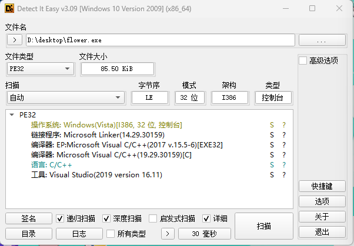
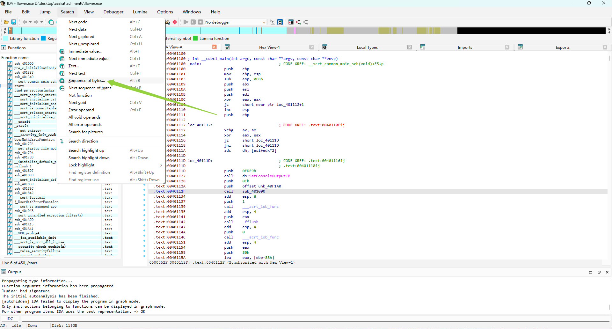
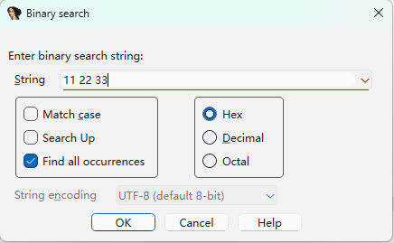
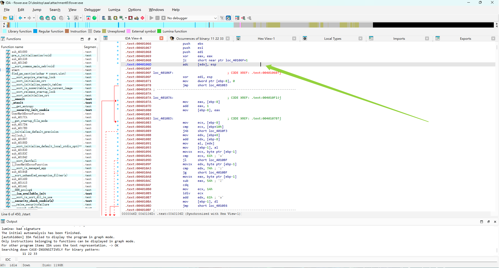

# 0xGame 2026 Re ez_flower wp

> 发布于 2026-10-09 05:30:00

```
# 花指令入

附件是一个 Windows x86 控制台程序。程序里有三处花指令，尝试恢复正常控制流并找到 flag 校验逻辑。

提示：三组垃圾字节分别是 `11 22 33`、`44 55 66`、`12 34 56`；提示字符串和加密目标不会直接出现在 `strings` 中。flag 加密是简单的凯撒密码，字母移动 7 位。

运行程序并输入 flag：

```text
Input flag: <your flag>
```
```

先去DIE



F5发现会报错，删掉花指令



搜索字节11 22 33



注意勾上Find all occurrences



找到了花指令

- 按键盘上的 `U` 键（取消定义）。你会看到它变成 `db 11h, 22h, 33h`。

- 接着按键盘上的 `C` 键（转为代码）。如果后面的代码显示乱了，在花指令之后的第一条正常指令处按 `P` 键（创建函数），让 IDA 重新分析。

再依次找44 55 66和 12 34 56

删完后成功反编译成伪c代码

```
int __usercall sub_401110@<eax>(int a1@<ebp>)
{
  FILE *v1; // eax
  FILE *v2; // eax

  SetConsoleOutputCP(0xFDE9u);
  sub_401000(&unk_40F1A0, 12);
  v1 = __acrt_iob_func(1u);
  fflush(v1);
  v2 = __acrt_iob_func(0);
  if ( fgets((char *)(a1 - 136), 128, v2) )
  {
    for ( *(_DWORD *)(a1 - 4) = 0;
          *(_BYTE *)(a1 + *(_DWORD *)(a1 - 4) - 136)
       && *(_BYTE *)(a1 + *(_DWORD *)(a1 - 4) - 136) != 13
       && *(_BYTE *)(a1 + *(_DWORD *)(a1 - 4) - 136) != 10;
          ++*(_DWORD *)(a1 - 4) )
    {
      ;
    }
    *(_BYTE *)(a1 + *(_DWORD *)(a1 - 4) - 136) = 0;
    if ( *(_DWORD *)(a1 - 4) != 47 )
      goto LABEL_14;
    for ( *(_DWORD *)(a1 - 8) = 0; *(_DWORD *)(a1 - 8) < 0x2Fu; ++*(_DWORD *)(a1 - 8) )
      *(_BYTE *)(a1 + *(_DWORD *)(a1 - 8) - 184) = byte_40F170[*(_DWORD *)(a1 - 8)] ^ 0x80;
    ((void (__cdecl *)(int, int, int))sub_401060)(a1 - 136, a1 - 232, 47);
    if ( !memcmp((const void *)(a1 - 232), (const void *)(a1 - 184), 0x2Fu) )
    {
      sub_401000(&unk_40F1B8, 32);
      putchar(10);
      return 0;
    }
    else
    {
LABEL_14:
      sub_401000("\r(54=z<6;=t", 11);
      putchar(10);
      return 0;
    }
  }
  else
  {
    sub_401000(&unk_40F1AC, 12);
    putchar(10);
    return 1;
  }
}
```

打开byte_40F170（目前不知道为啥要打开他，等我去学习），

以下是AI解释

```
逻辑还原（为什么是它？）
目标字符串的生成：程序里有一个循环，遍历 47 次。每次从 byte_40F170 取一个字节，和 0x80 做异或（^ 0x80），结果存到栈上的缓冲区 (a1 - 184) 里。

比对输入：紧接着，程序调用了 memcmp，拿你的输入 (a1 - 232) 和刚刚生成的缓冲区 (a1 - 184) 进行比较，要求完全相等（长度 0x2F 即 47 个字节）。

结合题目提示：题目说“flag 加密是简单的凯撒密码，字母移动 7 位”。这说明你的输入是加密后的 flag，程序把它（或者它生成的对照数据）与 byte_40F170 生成的字节流进行比对。所以 byte_40F170 就是加密后的目标密文。
```

```
rdata:0040F170 byte_40F170     db 0B0h                 ; DATA XREF: sub_401110+F1↑r
.rdata:0040F171                 db 0E5h
.rdata:0040F172                 db 0CEh
.rdata:0040F173                 db 0E8h
.rdata:0040F174                 db 0F4h
.rdata:0040F175                 db 0ECh
.rdata:0040F176                 db 0FBh
.rdata:0040F177                 db 0C4h
.rdata:0040F178                 db 0F6h
.rdata:0040F179                 db 0C4h
.rdata:0040F17A                 db 0DFh
.rdata:0040F17B                 db 0C1h
.rdata:0040F17C                 db 0EFh
.rdata:0040F17D                 db 0B3h
.rdata:0040F17E                 db 0DFh
.rdata:0040F17F                 db 0EDh
.rdata:0040F180                 db 0B1h
.rdata:0040F181                 db 0F6h
.rdata:0040F182                 db 0E4h
.rdata:0040F183                 db 0B3h
.rdata:0040F184                 db 0F9h
.rdata:0040F185                 db 0A4h
.rdata:0040F186                 db 0DFh
.rdata:0040F187                 db 0C0h
.rdata:0040F188                 db 0F9h
.rdata:0040F189                 db 0ECh
.rdata:0040F18A                 db 0DFh
.rdata:0040F18B                 db 0DAh
.rdata:0040F18C                 db 0D6h
.rdata:0040F18D                 db 0F6h
.rdata:0040F18E                 db 0B0h
.rdata:0040F18F                 db 0F6h
.rdata:0040F190                 db 0F6h
.rdata:0040F191                 db 0A0h
.rdata:0040F192                 db 0E9h
.rdata:0040F193                 db 0B3h
.rdata:0040F194                 db 0C0h
.rdata:0040F195                 db 0E2h
.rdata:0040F196                 db 0B7h
.rdata:0040F197                 db 0F0h
.rdata:0040F198                 db 0EDh
.rdata:0040F199                 db 0E2h
.rdata:0040F19A                 db 0F3h
.rdata:0040F19B                 db 0F3h
.rdata:0040F19C                 db 0A1h
.rdata:0040F19D                 db 0A1h
.rdata:0040F19E                 db 0FDh
```

最后，异或，以撒解密

```
data = [0x0B0, 0x0E5, 0x0CE, 0x0E8, 0x0F4, 0x0EC, 0x0FB, 0x0C4, 0x0F6, 0x0C4, 0x0DF, 0x0C1, 0x0EF, 0x0B3, 0x0DF, 0x0ED, 0x0B1, 0x0F6, 0x0E4, 0x0B3, 0x0F9, 0x0A4, 0x0DF, 0x0C0, 0x0F9, 0x0EC, 0x0DF, 0x0DA, 0x0D6, 0x0F6, 0x0B0, 0x0F6, 0x0F6, 0x0A0, 0x0E9, 0x0B3, 0x0C0, 0x0E2, 0x0B7, 0x0F0, 0x0ED, 0x0E2, 0x0F3, 0x0F3, 0x0A1, 0x0A1, 0x0FD]

# 1. 异或 0x80
s = ''.join(chr(b ^ 0x80) for b in data)
print("异或后:", s)

# 2. 凯撒解密（字母反向移动7位）
def caesar_decrypt(text, shift=7):
    res = ""
    for ch in text:
        if 'a' <= ch <= 'z':
            res += chr((ord(ch) - ord('a') - shift) % 26 + ord('a'))
        elif 'A' <= ch <= 'Z':
            res += chr((ord(ch) - ord('A') - shift) % 26 + ord('A'))
        else:
            res += ch
    return res

flag = caesar_decrypt(s, 7)
print("Flag:", flag)
```

```
PS D:\xiangmu> & C:\Users\qinyuanxin132\AppData\Local\Programs\Python\Python312\python.exe d:/xiangmu/tool/凯撒异或.py
异或后: 0eNhtl{DvD_Ao3_m1vd3y$_@yl_ZVv0vv i3@b7pmbss!!}
Flag: 0xGame{WoW_Th3_f1ow3r$_@re_SOo0oo b3@u7ifull!!}
```

```
# 花指令入

附件是一个 Windows x86 控制台程序。程序里有三处花指令，尝试恢复正常控制流并找到 flag 校验逻辑。

提示：三组垃圾字节分别是 `11 22 33`、`44 55 66`、`12 34 56`；提示字符串和加密目标不会直接出现在 `strings` 中。flag 加密是简单的凯撒密码，字母移动 7 位。

运行程序并输入 flag：

```text
Input flag: <your flag>
```
```

先去DIE


F5发现会报错，删掉花指令


搜索字节11 22 33


注意勾上Find all occurrences


找到了花指令

- 按键盘上的 `U` 键（取消定义）。你会看到它变成 `db 11h, 22h, 33h`。

- 接着按键盘上的 `C` 键（转为代码）。如果后面的代码显示乱了，在花指令之后的第一条正常指令处按 `P` 键（创建函数），让 IDA 重新分析。

再依次找44 55 66和 12 34 56

删完后成功反编译成伪c代码

```
int __usercall sub_401110@<eax>(int a1@<ebp>)
{
  FILE *v1; // eax
  FILE *v2; // eax

  SetConsoleOutputCP(0xFDE9u);
  sub_401000(&unk_40F1A0, 12);
  v1 = __acrt_iob_func(1u);
  fflush(v1);
  v2 = __acrt_iob_func(0);
  if ( fgets((char *)(a1 - 136), 128, v2) )
  {
    for ( *(_DWORD *)(a1 - 4) = 0;
          *(_BYTE *)(a1 + *(_DWORD *)(a1 - 4) - 136)
       && *(_BYTE *)(a1 + *(_DWORD *)(a1 - 4) - 136) != 13
       && *(_BYTE *)(a1 + *(_DWORD *)(a1 - 4) - 136) != 10;
          ++*(_DWORD *)(a1 - 4) )
    {
      ;
    }
    *(_BYTE *)(a1 + *(_DWORD *)(a1 - 4) - 136) = 0;
    if ( *(_DWORD *)(a1 - 4) != 47 )
      goto LABEL_14;
    for ( *(_DWORD *)(a1 - 8) = 0; *(_DWORD *)(a1 - 8) < 0x2Fu; ++*(_DWORD *)(a1 - 8) )
      *(_BYTE *)(a1 + *(_DWORD *)(a1 - 8) - 184) = byte_40F170[*(_DWORD *)(a1 - 8)] ^ 0x80;
    ((void (__cdecl *)(int, int, int))sub_401060)(a1 - 136, a1 - 232, 47);
    if ( !memcmp((const void *)(a1 - 232), (const void *)(a1 - 184), 0x2Fu) )
    {
      sub_401000(&unk_40F1B8, 32);
      putchar(10);
      return 0;
    }
    else
    {
LABEL_14:
      sub_401000("\r(54=z<6;=t", 11);
      putchar(10);
      return 0;
    }
  }
  else
  {
    sub_401000(&unk_40F1AC, 12);
    putchar(10);
    return 1;
  }
}
```

打开byte_40F170（目前不知道为啥要打开他，等我去学习），

以下是AI解释

```
逻辑还原（为什么是它？）
目标字符串的生成：程序里有一个循环，遍历 47 次。每次从 byte_40F170 取一个字节，和 0x80 做异或（^ 0x80），结果存到栈上的缓冲区 (a1 - 184) 里。

比对输入：紧接着，程序调用了 memcmp，拿你的输入 (a1 - 232) 和刚刚生成的缓冲区 (a1 - 184) 进行比较，要求完全相等（长度 0x2F 即 47 个字节）。

结合题目提示：题目说“flag 加密是简单的凯撒密码，字母移动 7 位”。这说明你的输入是加密后的 flag，程序把它（或者它生成的对照数据）与 byte_40F170 生成的字节流进行比对。所以 byte_40F170 就是加密后的目标密文。
```

```
rdata:0040F170 byte_40F170     db 0B0h                 ; DATA XREF: sub_401110+F1↑r
.rdata:0040F171                 db 0E5h
.rdata:0040F172                 db 0CEh
.rdata:0040F173                 db 0E8h
.rdata:0040F174                 db 0F4h
.rdata:0040F175                 db 0ECh
.rdata:0040F176                 db 0FBh
.rdata:0040F177                 db 0C4h
.rdata:0040F178                 db 0F6h
.rdata:0040F179                 db 0C4h
.rdata:0040F17A                 db 0DFh
.rdata:0040F17B                 db 0C1h
.rdata:0040F17C                 db 0EFh
.rdata:0040F17D                 db 0B3h
.rdata:0040F17E                 db 0DFh
.rdata:0040F17F                 db 0EDh
.rdata:0040F180                 db 0B1h
.rdata:0040F181                 db 0F6h
.rdata:0040F182                 db 0E4h
.rdata:0040F183                 db 0B3h
.rdata:0040F184                 db 0F9h
.rdata:0040F185                 db 0A4h
.rdata:0040F186                 db 0DFh
.rdata:0040F187                 db 0C0h
.rdata:0040F188                 db 0F9h
.rdata:0040F189                 db 0ECh
.rdata:0040F18A                 db 0DFh
.rdata:0040F18B                 db 0DAh
.rdata:0040F18C                 db 0D6h
.rdata:0040F18D                 db 0F6h
.rdata:0040F18E                 db 0B0h
.rdata:0040F18F                 db 0F6h
.rdata:0040F190                 db 0F6h
.rdata:0040F191                 db 0A0h
.rdata:0040F192                 db 0E9h
.rdata:0040F193                 db 0B3h
.rdata:0040F194                 db 0C0h
.rdata:0040F195                 db 0E2h
.rdata:0040F196                 db 0B7h
.rdata:0040F197                 db 0F0h
.rdata:0040F198                 db 0EDh
.rdata:0040F199                 db 0E2h
.rdata:0040F19A                 db 0F3h
.rdata:0040F19B                 db 0F3h
.rdata:0040F19C                 db 0A1h
.rdata:0040F19D                 db 0A1h
.rdata:0040F19E                 db 0FDh
```

最后，异或，以撒解密

```
data = [0x0B0, 0x0E5, 0x0CE, 0x0E8, 0x0F4, 0x0EC, 0x0FB, 0x0C4, 0x0F6, 0x0C4, 0x0DF, 0x0C1, 0x0EF, 0x0B3, 0x0DF, 0x0ED, 0x0B1, 0x0F6, 0x0E4, 0x0B3, 0x0F9, 0x0A4, 0x0DF, 0x0C0, 0x0F9, 0x0EC, 0x0DF, 0x0DA, 0x0D6, 0x0F6, 0x0B0, 0x0F6, 0x0F6, 0x0A0, 0x0E9, 0x0B3, 0x0C0, 0x0E2, 0x0B7, 0x0F0, 0x0ED, 0x0E2, 0x0F3, 0x0F3, 0x0A1, 0x0A1, 0x0FD]

# 1. 异或 0x80
s = ''.join(chr(b ^ 0x80) for b in data)
print("异或后:", s)

# 2. 凯撒解密（字母反向移动7位）
def caesar_decrypt(text, shift=7):
    res = ""
    for ch in text:
        if 'a' <= ch <= 'z':
            res += chr((ord(ch) - ord('a') - shift) % 26 + ord('a'))
        elif 'A' <= ch <= 'Z':
            res += chr((ord(ch) - ord('A') - shift) % 26 + ord('A'))
        else:
            res += ch
    return res

flag = caesar_decrypt(s, 7)
print("Flag:", flag)
```

```
PS D:\xiangmu> & C:\Users\qinyuanxin132\AppData\Local\Programs\Python\Python312\python.exe d:/xiangmu/tool/凯撒异或.py
异或后: 0eNhtl{DvD_Ao3_m1vd3y$_@yl_ZVv0vv i3@b7pmbss!!}
Flag: 0xGame{WoW_Th3_f1ow3r$_@re_SOo0oo b3@u7ifull!!}
```

```
# 花指令入门

附件是一个 Windows x86 控制台程序。程序里有三处花指令，尝试恢复正常控制流并找到 flag 校验逻辑。

提示：三组垃圾字节分别是 `11 22 33`、`44 55 66`、`12 34 56`；提示字符串和加密目标不会直接出现在 `strings` 中。flag 加密是简单的凯撒密码，字母移动 7 位。

运行程序并输入 flag：

```text
Input flag: <your flag>
```
```

先去DIE


