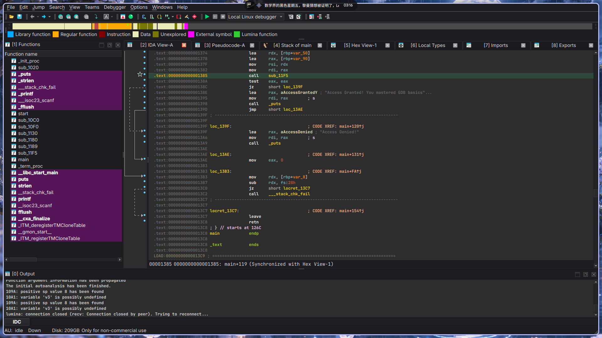

## GDB学习0-->1

> 发布于 2026-11-23 11:22:58

## 初次尝试

> 📦 **配套练习题打包下载（Level 1 ~ 7 + 结业大考，共 13KB）**：[gdb-debug-lab.tar.gz](/downloads/gdb-debug-lab.tar.gz)
>
> 下载后在 Linux（x86-64，glibc >= 2.38）终端解压即可全套复现：
>
> ```bash
> mkdir gdb-lab && tar -xzf gdb-debug-lab.tar.gz -C gdb-lab && cd gdb-lab && chmod +x *
> ```

进入目录并打开gdb

```bash
cd /home/qinyuanxin132/.gemini/antigravity/scratch/ctf-debug-lab
gdb ./level1
```

查看main的反汇编

`disas main`

```asm
pwndbg> disas main
Dump of assembler code for function main:
   0x00000000004011f0 <+0>:push   rbp
   0x00000000004011f1 <+1>:mov    rbp,rsp
   0x00000000004011f4 <+4>:sub    rsp,0x90
   0x00000000004011fb <+11>: mov    rax ,QWORD PTR fs:0x28
   0x0000000000401204 <+20>:mov    QWORD PTR [rbp-0x8],rax
   0x0000000000401208 <+24>:xor    eax,eax
   0x000000000040120a <+26>:lea    rax,[rip+0xdf7]        # 0x402008
   0x0000000000401211 <+33>:mov    rdi,rax
   0x0000000000401214 <+36>:mov    eax,0x0
   0x0000000000401219 <+41>:call   0x401050 <printf@plt>
   0x000000000040121e <+46>:mov    rax,QWORD PTR [rip+0x2e3b]        # 0x404060 <stdout@GLIBC_2.2.5>
   0x0000000000401225 <+53>:mov    rdi,rax
   0x0000000000401228 <+56>:call   0x401080 <fflush@plt>
   0x000000000040122d <+61>:lea    rax,[rbp-0x90]
   0x0000000000401234 <+68>:lea    rdx,[rip+0xddf]        # 0x40201a
   0x000000000040123b <+75>:mov    rsi,rax
   0x000000000040123e <+78>:mov    rdi,rdx
   0x0000000000401241 <+81>:mov    eax,0x0
   0x0000000000401246 <+86>:call   0x401060 <__isoc23_scanf@plt>
   0x000000000040124b <+91>:cmp    eax,0x1
   0x000000000040124e <+94>:je     0x401257 <main+103>
   0x0000000000401250 <+96>:mov    eax,0x1
   0x0000000000401255 <+101>:jmp    0x4012a2 <main+178>
   0x0000000000401257 <+103>:lea    rax,[rbp-0x50]
   0x000000000040125b <+107>:mov    rdi,rax
   0x000000000040125e <+110>:call   0x401186 <decrypt_flag>
   0x0000000000401263 <+115>:lea    rdx,[rbp-0x50]
   0x0000000000401267 <+119>:lea    rax,[rbp-0x90]
   0x000000000040126e <+126>:mov    rsi,rdx
   0x0000000000401271 <+129>:mov    rdi,rax
   0x0000000000401274 <+132>:call   0x401070 <strcmp@plt>
   0x0000000000401279 <+137>:test   eax,eax
   0x000000000040127b <+139>:jne    0x40128e <main+158>
   0x000000000040127d <+141>:lea    rax,[rip+0xd9b]        # 0x40201f
   0x0000000000401284 <+148>:mov    rdi,rax
   0x0000000000401287 <+151>:call   0x401030 <puts@plt>
   0x000000000040128c <+156>:jmp    0x40129d <main+173>
   0x000000000040128e <+158>:lea    rax,[rip+0xda5]        # 0x40203a
   0x0000000000401295 <+165>:mov    rdi,rax
   0x0000000000401298 <+168>:call   0x401030 <puts@plt>
   0x000000000040129d <+173>:mov    eax,0x0
   0x00000000004012a2 <+178>:mov    rdx,QWORD PTR [rbp-0x8]
   0x00000000004012a6 <+182>:sub    rdx,QWORD PTR fs:0x28
   0x00000000004012af <+191>:je     0x4012b6 <main+198>
   0x00000000004012b1 <+193>:call   0x401040 <__stack_chk_fail@plt>
   0x00000000004012b6 <+198>:leave
   0x00000000004012b7 <+199>:ret
End of assembler dump.
```

注意到这行`0x0000000000401274 <+132>:call   0x401070 <strcmp@plt>`是比较前后字符串是否相等，即比较flag

我们在这打断点，尝试直接读取内存

```gdb
b *0x401274
r
```

随便输一个flag让程序运行起来

### 记住 Linux 64 位程序最重要的传参规则

函数的前 6 个参数依次存放在 RDI, RSI, RDX, RCX, R8, R9 寄存器中。

所以对于 strcmp(arg1, arg2)：

RDI = 第 1 个参数（刚才输入的）
RSI = 第 2 个参数（解密后的真 Flag）

直接读第二个参数 RSI

```gdb
x/s $rdi
x/s $rsi
```

得到

`0x7fffffffe280:    "flag{gdb_1s_y0ur_sup3rp0w3r}"`

```bash
 ./level1
Input your flag: flag{gdb_1s_y0ur_sup3rp0w3r}
Correct! You got the flag!
```

## Step 2

```bash
cd /home/qinyuanxin132/.gemini/antigravity/scratch/ctf-debug-lab
gdb ./level2
```

`Debugger detected! Get out!`

程序发现了 GDB，直接退出了

`disas main` 查看主函数

```asm
pwndbg> disas main
Dump of assembler code for function main:
   0x000000000040124d <+0>:push   rbp
   0x000000000040124e <+1>:mov    rbp,rsp
   0x0000000000401251 <+4>:sub    rsp,0x10
   0x0000000000401255 <+8>:mov    rax,QWORD PTR fs:0x28
   0x000000000040125e <+17>:mov    QWORD PTR [rbp-0x8],rax
   0x0000000000401262 <+21>:xor    eax,eax
   0x0000000000401264 <+23>:mov    ecx,0x0
   0x0000000000401269 <+28>:mov    edx,0x1
   0x000000000040126e <+33>:mov    esi,0x0
   0x0000000000401273 <+38>:mov    edi,0x0
   0x0000000000401278 <+43>:mov    eax,0x0
   0x000000000040127d <+48>:call   0x401080 <ptrace@plt>
   0x0000000000401282 <+53>:test   rax,rax
   0x0000000000401285 <+56>:jns    0x40129d <main+80>
   0x0000000000401287 <+58>:lea    rax,[rip+0xda6]        # 0x402034
   0x000000000040128e <+65>:mov    rdi,rax
   0x0000000000401291 <+68>:call   0x401030 <puts@plt>
   0x0000000000401296 <+73>:mov    eax,0x1
   0x000000000040129b <+78>:jmp    0x401317 <main+202>
   0x000000000040129d <+80>:mov    DWORD PTR [rbp-0xc],0x0
   0x00000000004012a4 <+87>:lea    rax,[rip+0xda5]        # 0x402050
   0x00000000004012ab <+94>:mov    rdi,rax
   0x00000000004012ae <+97>:mov    eax,0x0
   0x00000000004012b3 <+102>:call   0x401050 <printf@plt>
   0x00000000004012b8 <+107>:mov    rax,QWORD PTR [rip+0x2dc9]        # 0x404088 <stdout@GLIBC_2.2.5>
   0x00000000004012bf <+114>:mov    rdi,rax
   0x00000000004012c2 <+117>:call   0x401070 <fflush@plt>
   0x00000000004012c7 <+122>:lea    rax,[rbp-0xc]
   0x00000000004012cb <+126>:lea    rdx,[rip+0xd99]        # 0x40206b
   0x00000000004012d2 <+133>:mov    rsi,rax
   0x00000000004012d5 <+136>:mov    rdi,rdx
   0x00000000004012d8 <+139>:mov    eax,0x0
   0x00000000004012dd <+144>:call   0x401060 <__isoc23_scanf@plt>
   0x00000000004012e2 <+149>:cmp    eax,0x1
   0x00000000004012e5 <+152>:je     0x4012ee <main+161>
   0x00000000004012e7 <+154>:mov    eax,0x1
   0x00000000004012ec <+159>:jmp    0x401317 <main+202>
   0x00000000004012ee <+161>:mov    eax,DWORD PTR [rbp-0xc]
   0x00000000004012f1 <+164>:mov    edi,eax
   0x00000000004012f3 <+166>:call   0x401186 <check_license>
   0x00000000004012f8 <+171>:test   eax,eax
   0x00000000004012fa <+173>:je     0x401303 <main+182>
   0x00000000004012fc <+175>:call   0x4011af <print_secret_flag>
   0x0000000000401301 <+180>:jmp    0x401312 <main+197>
   0x0000000000401303 <+182>:lea    rax,[rip+0xd66]        # 0x402070
   0x000000000040130a <+189>:mov    rdi,rax
   0x000000000040130d <+192>:call   0x401030 <puts@plt>
   0x0000000000401312 <+197>:mov    eax,0x0
   0x0000000000401317 <+202>:mov    rdx,QWORD PTR [rbp-0x8]
   0x000000000040131b <+206>:sub    rdx,QWORD PTR fs:0x28
   0x0000000000401324 <+215>:je     0x40132b <main+222>
   0x0000000000401326 <+217>:call   0x401040 <__stack_chk_fail@plt>
   0x000000000040132b <+222>:leave
   0x000000000040132c <+223>:ret
End of assembler dump.
```

### 反调试

```asm
0x40127d <+48>:  call   0x401080 <ptrace@plt>
0x401282 <+53>:  test   rax,rax
0x401285 <+56>:  jns    0x40129d <main+80>
```

GDB 先获得了目标进程的跟踪权，目标程序再申请 PTRACE_TRACEME 时失败，于是程序通过失败的返回值推断自己可能被调试。

原理：Linux 里的 ptrace(PTRACE_TRACEME, ...) 是最经典的反调试手段。一个进程同时只能被一个调试器附加：正常运行时它返回 0；在 GDB 里运行时它返回 -1（0xffffffffffffffff）。下一行的 test rax, rax + jns 会判断 rax >= 0 才放行。

### 骗过 ptrace 反调试

`b *0x401282`

程序会停在 0x401282（test rax, rax），看一眼顶部的 RAX，此时是 0xffffffffffffffff（也就是 -1）。

我们直接把 RAX 改成 0，然后放行：

```gdb
set $rax = 0
c
```

### 第二道门（VIP 密钥校验）

```asm
0x4012f3 <+166>: call   0x401186 <check_license>
0x4012f8 <+171>: test   eax,eax
0x4012fa <+173>: je     0x401303 <main+182>
0x4012fc <+175>: call   0x4011af <print_secret_flag>
```

je检查零标志位zf，eax为0时zf为1，je会跳转，所以到这我们得让eax非零

`b *0x4012f8`

运行到这的时候

`set $eax = 1`

`c`放行

输出

`Welcome VIP! Here is your flag: flag{p4tch_r3g1st3r_byp4ss_ptr4c3}`

### 方法2

直接改指令指针寄存器到打印flag的位置

`set $rip = 0x4012fc`

```sam
pwndbg> set $rip = 0x4012fc
pwndbg> c
Continuing.
Welcome VIP! Here is your flag: flag{p4tch_r3g1st3r_byp4ss_ptr4c3}
```

## Step 3

去符号表（stripped）：main、decrypt 这些函数名全被抹掉了，进 GDB 敲 disas main 会直接报错 No symbol "main"。

开启 PIE：程序在 IDA 或 objdump 里看到的地址只是相对偏移（比如 0x1385），真正运行时会被加载到随机基址（比如 0x555555554000），真实地址 = 基址 + 偏移。

```bash
  file ./level3
./level3: ELF 64-bit LSB pie executable, x86-64, version 1 (SYSV), dynamically linked, interpreter /lib64/ld-linux-x86-64.so.2, BuildID[sha1]=6e0620948145b79e02ea2c9c0e38a581dac00cf9, for GNU/Linux 4.4.0, stripped
```

打开IDA看一下反编译

```cpp
__int64 __fastcall main(int a1, char **a2, char **a3)
{
  __int64 v3; // rdx
  __int64 v4; // rcx
  __int64 v5; // r8
  __int64 v6; // r9
  __int64 v8; // [rsp+0h] [rbp-90h] BYREF
  __int64 v9; // [rsp+8h] [rbp-88h]
  __int64 v10; // [rsp+10h] [rbp-80h]
  __int64 v11; // [rsp+18h] [rbp-78h]
  __int64 v12; // [rsp+20h] [rbp-70h]
  __int64 v13; // [rsp+28h] [rbp-68h]
  __int64 v14; // [rsp+30h] [rbp-60h]
  __int64 v15; // [rsp+38h] [rbp-58h]
  _QWORD v16[10]; // [rsp+40h] [rbp-50h] BYREF

  v16[9] = __readfsqword(0x28u);
  v8 = 0;
  v9 = 0;
  v10 = 0;
  v11 = 0;
  v12 = 0;
  v13 = 0;
  v14 = 0;
  v15 = 0;
  memset(v16, 0, 64);
  puts("=== Level 3: PIE + Stripped ===");
  printf("Password: ");
  fflush(stdout);
  if ( (unsigned int)__isoc23_scanf("%63s", &v8) != 1 )
    return 1;
  ((void (__fastcall *)(_QWORD *, __int64 *, __int64, __int64, __int64, __int64, __int64, __int64, __int64, __int64, __int64, __int64, __int64, __int64))sub_1189)(
    v16,
    &v8,
    v3,
    v4,
    v5,
    v6,
    v8,
    v9,
    v10,
    v11,
    v12,
    v13,
    v14,
    v15);
  if ( (unsigned int)sub_11F5(&v8, v16) )
    puts("Access Granted! You mastered GDB basics!");
  else
    puts("Access Denied!");
  return 0;
}
```

貌似`sub_11F5`是来进行效验的

```cpp
__int64 __fastcall sub_11F5(const char *a1, __int64 a2)
{
  int i; // [rsp+1Ch] [rbp-4h]

  if ( (unsigned int)strlen(a1) != 29 )
    return 0;
  for ( i = 0; i < 29; ++i )
  {
    if ( a1[i] != *(_BYTE *)(i + a2) )
      return 0;
  }
  return 1;
}
```

没有对a1和a2进行改动

找到函数的偏移地址



启动 GDB：

```bash
gdb ./level3
```

### 记住下面这套黄金三连

先把程序跑到入口停住（让系统先把 PIE 基址映射进内存）：

```gdb
entry
```

查看加载基址（GDB 默认关闭 ASLR，通常固定在 0x555555554000）：

```gdb
piebase
```

用 $rebase(偏移) 一键下断点（pwndbg 神器，自动帮你算 基址 + 偏移）：

```gdb
b *$rebase(0x1385)
c
```

查看两个参数的寄存器

``` gdb
pwndbg> x/s $rdi
0x7fffffffe240: "aaa"
pwndbg> x/s $rsi
0x7fffffffe280: "flag{p1e_str1pp3d_n0_pr0bl3m}"
```

成功拿到flag

## GDB + pwndbg 常用动调指令速查表

### 1. 启动与流程控制

| 指令 | 简写 / 示例 | 说明 |
| :--- | :--- | :--- |
| `gdb ./prog` | - | 用 GDB 加载目标程序 |
| `run` | `r` | 从头运行程序（可跟参数，如 `r arg1`） |
| `entry` | - | **pwndbg 专属**：运行并停在程序入口（PIE 程序必用，用来先加载基址） |
| `continue` | `c` | 从当前断点继续运行，直到遇到下一个断点或程序结束 |
| `nexti` | `ni` | 汇编级**单步步过**（遇到 `call` 不进入函数内部，对应 IDA 的 `F8`） |
| `stepi` | `si` | 汇编级**单步步入**（钻进 `call` 函数内部，对应 IDA 的 `F7`） |
| `finish` | `fin` | 直接运行完当前函数并返回到上一层调用处 |
| `quit` | `q` | 退出 GDB |

### 2. 断点管理

| 指令 | 示例 | 说明 |
| :--- | :--- | :--- |
| `b 函数名` | `b main` / `b strcmp` | 在指定函数入口下断点（需有符号表） |
| `b *地址` | `b *0x401274` | 在指定内存地址下断点（非 PIE 程序常用） |
| `b *$rebase(偏移)` | `b *$rebase(0x1385)` | **pwndbg 专属**：PIE 程序直接用 IDA 看到的偏移下断点 |
| `info breakpoints` | `i b` | 查看当前所有断点及编号 |
| `delete 编号` | `d 1` / `d` | 删除指定编号的断点（不加编号则删除全部断点） |
| `disable / enable 编号` | `disable 1` | 临时禁用 / 重新启用某个断点 |
| `watch *地址` | `watch *0x404040` | 硬件写入断点：当该内存地址的值被修改时自动暂停 |

### 3. 查看反汇编、寄存器与内存

| 指令 | 示例 | 说明 |
| :--- | :--- | :--- |
| `disas 函数名` | `disas main` | 反汇编指定函数（无符号表时不可用） |
| `x/Ni 地址` | `x/20i $rip` | 从指定地址开始反汇编 `N` 条指令 |
| `x/s 地址或寄存器` | `x/s $rsi` | 将地址指向的内容按**字符串**打印（偷看明文 Flag 神器） |
| `x/Ngx 地址` | `x/16gx $rsp` | 按 8 字节（`g`）十六进制（`x`）查看 `N` 个数据 |
| `x/Nbx 地址` | `x/32bx $rsi` | 按单字节（`b`）十六进制（`x`）查看 `N` 个字节（看加密数组常用） |
| `info registers` | `i r` / `i r rax` | 查看所有寄存器（或指定寄存器）的值 |
| `print` | `p/x $rax` | 打印表达式或寄存器的值（`/x` 十六进制，`/d` 十进制） |
| `telescope 地址` | `tel $rsp 20` | **pwndbg 专属**：智能解析栈/内存中的指针链和字符串 |
| `backtrace` | `bt` | 查看当前的函数调用栈（看自己是从哪一层调进来的） |

### 4. 修改寄存器与内存（绕过反调试 / 劫持流程）

| 指令 | 示例 | 说明 |
| :--- | :--- | :--- |
| `set $寄存器 = 值` | `set $rax = 0` | 修改函数返回值（如绕过 `ptrace` 反调试、强行通过校验） |
| `set $rip = 地址` | `set $rip = 0x4012fc` | 修改指令指针，强行“瞬移”到目标代码位置执行 |
| `set *(类型*)地址 = 值` | `set *(int*)0x404040 = 1` | 直接修改内存中某个变量的值 |

### 5. PIE 与进程信息（pwndbg 常用）

| 指令 | 说明 |
| :--- | :--- |
| `piebase` | 查看当前 PIE 程序的加载基址 |
| `vmmap` | 查看进程的内存映射分布（代码段、堆、栈、libc 基址及读写执行权限） |
| `checksec` | 查看二进制文件的安全保护机制（PIE、Canary、NX、RELRO 等） |
| `search -s "字符串"` | 在整个进程内存中搜索指定字符串（如 `search -s "flag{"`） |

### 6. 附：Linux x64 函数调用约定速记

- **前 6 个参数依次存放于**：`RDI` → `RSI` → `RDX` → `RCX` → `R8` → `R9`
- **第 7 个及以后参数**：通过栈传递
- **函数返回值**：存放在 `RAX`（32 位为 `EAX`）

## Setp 4

尝试dbg运行下试试

`[!] Nice try, debugger detected!`

打开IDA找到了

```asm
.text:0000000000001335                 call    _ptrace
.text:000000000000133A                 test    rax, rax
```

下断点：

`entry` 先把程序启动并停在入口，让系统把 PIE 基址加载出来；

`b *$rebase(0x133A)` 下断点

```dbg
pwndbg> x/s $rax
0xffffffffffffffff:
```

rax寄存器果然是-1

我们改成0

```dbg
pwndbg> set $rax = 0x0
pwndbg> x/s $rax
0x0:  <error: Cannot access memory at address 0x0>
pwndbg> c
Continuing.
=== Level 4: Mini Boss (PIE + Stripped + Anti-Debug) ===
Step 1 - Enter Admin PIN: 
```

也是把反调试过了

继续看反编译

```c++
__int64 __fastcall sub_128E(const char *a1, __int64 a2)
{
  int i; // [rsp+1Ch] [rbp-4h]

  if ( (unsigned int)strlen(a1) != 31 )
    return 0;
  for ( i = 0; i < 31; ++i )
  {
    if ( a1[i] != *(_BYTE *)(i + a2) )
      return 0;
  }
  return 1;
}
```

sub_128E是纯比较

`.text:000000000000149E                 call    sub_128E`

在这下断点，去寄存器拿flag

不行，前面还有一个效验pin的，我们尝试跳过去

打断点

`printf("Step 1 - Enter Admin PIN: ");`

`.text:000000000000137D                 call    _printf`

`b *$rebase(0x137D)`

我们不进pin，知己跳到pin成功后的分支

`.text:00000000000013EC                 call    _puts`

```dbg
pwndbg> set $rip = $rebase(0x13e2)
pwndbg> c
Continuing.
[+] PIN accepted! Unlocking vault...
Step 2 - Enter Flag: 
```

还要在效验flag前下断点来拿寄存器的数据

`b *$rebase(0x149E)`

整理顺序

entry

b *$rebase(0x133A)

b *$rebase(0x149E)

b *$rebase(0x137D)

set $rax = 0x0

c

set $rip = $rebase(0x13e2)

终于到效验函数前了

直接拿寄存器

```gdb
pwndbg> x/s $rsi
0x555555559420:"flag{b0ss_cl3ar3d_y0u_kn0w_gdb}"
```

## Setp 5

### watch

在真实 CTF 题里，经常遇到这种诡异情况： 你在 IDA 里打开 main()，发现逻辑极其简单： if (hash(你的输入) == 某个全局变量) puts("Correct!"); 但你点进那个全局变量一看，里面居然是 0，而且整个 main() 里根本没地方给它赋值！ 不仅如此，你在 main() 里下断点搜内存，也完全找不到明文 Flag（因为程序早就把它擦掉了）。

幕后真相：Linux ELF 程序在执行 main() 之前，会先自动执行 .init_array 段里的初始化函数（C 语言里的 `__attribute__`((constructor))）。很多 CTF 题会把反调试、改密钥、算哈希偷偷藏在这里！

如果靠人肉找，很容易漏掉；但用 硬件写入断点 watch，只要有代码敢改写那个全局变量，CPU 会在修改的那一瞬间立刻暂停，当场抓现行！

### IDA

```c++
__int64 __fastcall main(int a1, char **a2, char **a3)
{
  _QWORD v4[10]; // [rsp+0h] [rbp-50h] BYREF

  v4[9] = __readfsqword(0x28u);
  memset(v4, 0, 64);
  puts("=== Level 5: Who modified target_hash? ===");
  printf("Enter flag: ");
  fflush(stdout);
  if ( (unsigned int)__isoc23_scanf("%63s", v4) != 1 )
    return 1;
  if ( (unsigned int)((__int64 (__fastcall *)(_QWORD *))sub_1189)(v4) == dword_4094 )
    puts("[*] Correct! Watchpoint master!");
  else
    puts("[-] Wrong flag!");
  return 0;
}
```

可以看到效验逻辑在`if ( (unsigned int)((__int64 (__fastcall *)(_QWORD *))sub_1189)(v4) == dword_4094 )`

但是打开dword_4094，发现是空的，在bss段

`.bss:0000000000004094 dword_4094      dd ?                    ; DATA XREF: sub_11CD+76↑w`

记下这个全局变量的偏移地址

注意指的是数据的地址：

b（普通断点）盯的是「代码」（.text）：CPU 执行到这条指令时停下 → 用 0x1334。

watch（写入断点）盯的是「数据」（.bss / .data / 栈 / 堆）：这个变量里的数值被修改时停下 → 用变量自己的地址 0x4094。

`.bss:0000000000004094 dword_4094      dd ?                    ; DATA XREF: sub_11CD+76↑w`

### dbg

`entry` 把基地址先加载

`watch *(int*)$rebase(0x4094)`

watch *(int*)地址 表示“监控这个地址开始的 4 字节整数，只要它的值发生任何变化，立刻中断！

`c` 继续

停下后我们在rdi寄存器中发现了flag

`02:0010│ rdi   0x7fffffffe3a0 ◂— 'flag{w4tchp01nt_c4ught_1n1t_4rr4y}'`

当然，如果找不到可以使用全内存搜索

`search "flag{"`

```dbg
pwndbg> search "flag{"
Searching for byte: b'flag{'
[stack]         0x7fffffffe3a0 'flag{w4tchp01nt_c4ught_1n1t_4rr4y}'
```

## Setp 6

- 每一轮都会对一个缓冲区 buf 做一次异或变换，然后计算它的哈希值和你输入的哈希比对；
- 在这 300 轮里，只有神秘的某一轮，buf 会短暂变成明文 flag{...}，紧接着下一轮又会被彻底打乱成乱码！
- 代码里没有任何提示告诉你到底是第几轮。

### ida

```c++
__int64 __fastcall main(int a1, char **a2, char **a3)
{
  int v4; // [rsp+4h] [rbp-9Ch]
  int i; // [rsp+8h] [rbp-98h]
  int v6; // [rsp+Ch] [rbp-94h]
  _QWORD v7[8]; // [rsp+10h] [rbp-90h] BYREF
  _QWORD dest[10]; // [rsp+50h] [rbp-50h] BYREF

  dest[9] = __readfsqword(0x28u);
  memset(v7, 0, sizeof(v7));
  memset(dest, 0, 64);
  memcpy(dest, &unk_4040, 0x1Du);
  puts("=== Level 6: 300 Rounds Mystery ===");
  printf("Enter flag: ");
  fflush(stdout);
  if ( (unsigned int)__isoc23_scanf("%63s", v7) != 1 )
    return 1;
  v6 = sub_1189(v7);
  v4 = 0;
  for ( i = 0; i <= 299; ++i )
  {
    sub_11CD((unsigned int)i, dest);
    if ( v6 == (unsigned int)sub_1189(dest) )
      v4 = 1;
  }
  if ( v4 )
    puts("[*] Correct! Conditional breakpoint nailed it!");
  else
    puts("[-] Wrong flag!");
  return 0;
}
```

根据题目提示，应该是在三百次效验中有一次用来效验的数组是`flag`开头，然后和输入的对上

语法 `b *地址 if 条件`

`if ( v6 == (unsigned int)sub_1189(dest) )`

对照 Linux x64 传参规则

第 1 个参数 (unsigned int)dest（32 位整数） → 一定在 $edi 里

`b *$rebase(偏移) if *(char*)$rdi == 'f' && *((char*)$rdi+1) == 'l' && *((char*)$rdi+2) == 'a'`

or

`b *$rebase(偏移) if *(int*)$rdi == 0x67616c66`

找到函数的偏移

`.text:00000000000013AD                 call    sub_1189`

实操：

`entry`

`b *$rebase(0x13AD) if *(char*)$rdi == 'f' && *((char*)$rdi+1) == 'l' && *((char*)$rdi+2) == 'a'`

`c`

在RDI指针中找到了flag

`*RDI  0x7fffffffe2f0 ◂— 'flag{c0nd1t10n4l_bp_1s_m4g1c}'`

## Setp 7

破解“IDA 看不懂的加密代码（SMC）

### 什么是 SMC（Self-Modifying Code）

出题人把核心校验函数的机器码提前加密了，所以在磁盘文件里它是一堆乱码。程序运行起来后，先调用 mprotect 把那块代码段改成可读可写可执行（RWX，权限值 7），自己用循环把机器码在内存里解密还原，再去调用它！

静态分析的痛点：你现在用 IDA 打开 level7，会发现 main 里有 mprotect + 异或循环 + 调用一个无名函数（偏移 0x1348）；你点进 0x1348，里面全是乱码，根本按不了 F5！

### 打开IDA

```c++
__int64 __fastcall main(int a1, char **a2, char **a3)
{
  unsigned __int64 i; // [rsp+0h] [rbp-80h]
  _QWORD v5[10]; // [rsp+30h] [rbp-50h] BYREF

  v5[9] = __readfsqword(0x28u);
  memset(v5, 0, 64);
  puts("=== Level 7 v2: Real SMC Practice ===");
  printf("Input flag: ");
  fflush(stdout);
  if ( (unsigned int)__isoc23_scanf("%63s", v5) != 1 )
    return 1;
  if ( mprotect(
         (void *)((unsigned __int64)&loc_1348 & 0xFFFFFFFFFFFFF000LL),
         (unsigned __int64)&byte_1453[-((unsigned __int64)&loc_1348 & 0xFFFFFFFFFFFFF000LL) + 4095]
       & 0xFFFFFFFFFFFFF000LL,
         7) )
  {
    perror("mprotect");
    return 1;
  }
  else
  {
    for ( i = 0; i < byte_1453 - (char *)&loc_1348; ++i )
      *((_BYTE *)&loc_1348 + i) ^= 0x55u;
    if ( (unsigned int)((__int64 (__fastcall *)(_QWORD *))loc_1348)(v5) )
      puts("[*] Correct! You truly understand SMC!");
    else
      puts("[-] Wrong!");
    return 0;
  }
}
```

注意到这行`for ( i = 0; i < byte_1453 - (char *)&loc_1348; ++i )`

### SMC加密特征

只要是 SMC，程序自己必须写一个循环去把加密代码还原。你在 main 的 F5 伪代码里一定能看到类似这样的一段：

```c
for ( i = 0; i < 终点 - 起点; ++i )
  *(起点 + i) ^= 0x55;
```

### 动调

`entry`

我们在for循环结束后（即if那）打断点

`.text:0000000000001304                 call    loc_1348`

`b *$rebase(0x1304)`

`c`

### 保存

| 部分 | 含义 |
| --- | --- |
| `dump` | GDB 的导出命令，把调试进程里的内容保存到本地文件 |
| `binary` | 按纯原始二进制字节保存（内存里是什么字节，文件里就原封不动写什么，方便直接丢给 IDA 或 Python） |
| `memory` | 表示要导出的是一段连续的内存区间 |
| `dec.bin` | 保存的文件名（会生成在当前目录下，名字随便取） |
| `$rebase(0x1348)` | 起始地址：PIE 程序自动算成 `基址 + 0x1348`（比如 `0x555555555348`） |
| `$rebase(0x1453)` | 结束地址：PIE 程序自动算成 `基址 + 0x1453`（导出范围是 `[起点, 终点)`，共 `0x10b` = 267 字节） |

`dump binary memory <文件名> <起始地址> <结束地址>`

`dump binary memory dec.bin $rebase(0x1348) $rebase(0x1453)`

### ida打开

```c++
__int64 __fastcall sub_0(__int64 a1)
{
  __int64 result; // rax
  char v2; // [rsp+1Bh] [rbp-35h]
  int i; // [rsp+1Ch] [rbp-34h]
  _BYTE v4[25]; // [rsp+20h] [rbp-30h] BYREF
  _BYTE v5[2]; // [rsp+39h] [rbp-17h] BYREF
  unsigned __int64 v6; // [rsp+48h] [rbp-8h]

  v6 = __readfsqword(0x28u);
  qmemcpy(v4, "JTGI]_", 6);
  v4[6] = 24;
  v4[7] = 91;
  v4[8] = -127;
  v4[9] = 92;
  v4[10] = 86;
  v4[11] = 91;
  v4[12] = 84;
  v4[13] = 95;
  v4[14] = -127;
  v4[15] = 73;
  v4[16] = 24;
  v4[17] = 92;
  v4[18] = -127;
  v4[19] = 85;
  v4[20] = 83;
  v4[21] = 69;
  v4[22] = -127;
  v4[23] = 82;
  v4[24] = 24;
  qmemcpy(v5, "Yc", sizeof(v5));
  for ( i = 0; i <= 26; ++i )
  {
    v2 = *(_BYTE *)(i + a1);
    if ( !v2 )
    {
      result = 0;
      goto LABEL_9;
    }
    if ( (unsigned __int8)((v2 ^ 0x23) + 5) != (unsigned __int8)v4[i] )
    {
      result = 0;
      goto LABEL_9;
    }
  }
  result = *(_BYTE *)(a1 + 27) == 0;
LABEL_9:
  if ( v6 != __readfsqword(0x28u) )
    return MEMORY[0xFFFFFFFFFFFFFCF8]();
  return result;
}
```

`(unsigned __int8)((v2 ^ 0x23) + 5) != (unsigned __int8)v4[i]`

求v2

v2 = (((v4[i] & 0xff) - 5)&0xff) ^ 0x23

```asm
-0000000000000035     _BYTE var_35;
-0000000000000034     _DWORD var_34;
-0000000000000030     _BYTE var_30;
-000000000000002F     _BYTE var_2F;
-000000000000002E     _BYTE var_2E;
-000000000000002D     _BYTE var_2D;
-000000000000002C     _BYTE var_2C;
-000000000000002B     _BYTE var_2B;
-000000000000002A     _BYTE var_2A;
-0000000000000029     _BYTE var_29;
-0000000000000028     _BYTE var_28;
-0000000000000027     _BYTE var_27;
-0000000000000026     _BYTE var_26;
-0000000000000025     _BYTE var_25;
-0000000000000024     _BYTE var_24;
-0000000000000023     _BYTE var_23;
-0000000000000022     _BYTE var_22;
-0000000000000021     _BYTE var_21;
-0000000000000020     _BYTE var_20;
-000000000000001F     _BYTE var_1F;
-000000000000001E     _BYTE var_1E;
-000000000000001D     _BYTE var_1D;
-000000000000001C     _BYTE var_1C;
-000000000000001B     _BYTE var_1B;
-000000000000001A     _BYTE var_1A;
-0000000000000019     _BYTE var_19;
-0000000000000018     _BYTE var_18;
-0000000000000017     _BYTE var_17;
-0000000000000016     _BYTE var_16;
```

注意到，v4数组和v5是连续的

所以 v4[25] V4[26] 分别是 'Y' 'c'

`qmemcpy(v4, "JTGI]_", 6);`

```python
enc = list(b"JTGI]_") + [
    24, 91, -127, 92, 86, 91, 84, 95, -127,
    73, 24, 92, -127, 85, 83, 69, -127, 82, 24
] + list(b"Yc")

flag = "".join(chr((((x & 0xFF) - 5) & 0xFF) ^ 0x23) for x in enc)
print(flag)
```

得到flag

`flag{y0u_truly_g0t_smc_n0w}`

## AI总结：CTF 逆向动调实战全指南（Level 1 ~ 7 复盘）

### 一、 7 大常见题型与动调破局思路

| 题型特征 | 核心思路 | 关键操作 |
| :--- | :--- | :--- |
| **1. 明文解密后比对**（有 `strcmp` / 自定义比对） | 懒得逆向算法，直接等解密完偷看参数 | 断在比对函数 `call` 处 → `x/s $rsi` |
| **2. `ptrace` 反调试 / 复杂校验分支** | 手动篡改返回值或强行劫持执行流 | 断在 `call` 下一行 → `set $rax = 0`（或 `set $rip = 地址`） |
| **3. 开启 PIE + 去符号表（`stripped`）** | 先加载基址，再用相对偏移下断点 | `entry` → `piebase` → `b *$rebase(偏移)` → `c` |
| **4. 隐藏初始化（`.init_array`）改全局变量** | 在 `main` 之前监控数据地址，抓写入现行 | `entry` → `watch *(int*)$rebase(数据偏移)` → `c` → `bt` / `search "flag{"` |
| **5. 大循环里只有某一轮出现明文** | 用条件断点让 GDB 自动跳过无效轮次 | `b *$rebase(偏移) if *(int*)$rdi == 0x67616c66` |
| **6. SMC 自修改代码（`mprotect` + 解密循环）** | 等程序自己解密完代码，导出内存交给 IDA 反编译 | 断在循环后的 `call` → `dump binary memory dec.bin 起点 终点` → 拖进 IDA 按 `C` → `P` → `F5` |
| **7. 花指令干扰静态分析** | 静态去花或直接动调跟真执行流 | IDA 按 `U` → 垃圾字节改 `0x90` → `C`/`P`/`F5`；GDB 动调天然免疫花指令 |

---

### 二、 进阶高频指令补充（接前文速查表）

| 指令 | 示例 | 说明 |
| :--- | :--- | :--- |
| `ni N` | `ni 35` | 一次性单步步过 `N` 条汇编指令 |
| `watch *(类型*)地址` | `watch *(int*)$rebase(0x4094)` | 硬件写入断点：监控数据内存，一旦被修改立刻暂停 |
| `b *地址 if 条件` | `b *$rebase(0x13ad) if *(int*)$rdi == 0x67616c66` | 条件断点：支持寄存器、指针解引用、小端序常量（`"flag"` = `0x67616c66`） |
| `search "字符串"` | `search "flag{"` | **新版 pwndbg**：全进程内存搜索指定字符串 |
| `dump binary memory` | `dump binary memory dec.bin $rebase(0x1348) $rebase(0x1453)` | 将指定内存区间按原始二进制导出到本地文件（破解 SMC 必备） |
| `p *(int*)($rbp-偏移)` | `p *(int*)($rbp - 0x98)` | 直接读取栈上某个局部变量的值（如查看当前循环到第几轮） |
| `pwd` / `shell 命令` | `pwd` / `shell ls -lh dec.bin` | 在 GDB 内查看当前工作目录或执行终端命令 |

---

### 三、 新手必背 6 条避坑铁律

1. **PIE 铁律：先 `entry`，再 `$rebase()`**
   PIE 程序在启动前没有加载基址，直接 `b *$rebase(...)` 会报错；必须先 `entry` 跑起来，再下断点并用 `c` 继续。**改 `$rip` 时同样必须套 `$rebase()`**，直接填偏移会触发 `SIGSEGV` 段错误。
2. **断点位置铁律：看参数断 `call`，看返回值断下一行**
   - 断在 `call xxx` **这一行**：参数刚装进 `RDI / RSI / RDX...`，还没进函数，适合偷看参数。
   - 断在 `call xxx` **下一行**：函数刚跑完，返回值正躺在 `RAX / EAX` 里，适合查看或 `set $rax = ...` 修改。
3. **`b` 盯代码，`watch` 盯数据**
   普通断点 `b` 下在 `.text` 指令地址上；硬件写入断点 `watch` 下在 `.bss / .data / 栈 / 堆` 的**变量自身地址**上。
4. **`x/s` 看字符串，`p` 看数值**
   寄存器里是指针（地址）才用 `x/s $rsi` 读字符串；如果寄存器里只是普通整数（如 `ptrace` 返回的 `-1` / `0`），用 `p $rax` 或 `p/x $rax` 查看。
5. **寄存器是“复用的托盘”**
   同一个 `$rdi` 在不同 `call` 之前装的是不同函数的第 1 个参数，永远看对应 `call` 前面的传参或 F5 里的函数形参列表，不要把上一行的变量名张冠李戴。
6. **遇到 SMC / 混淆，别轻信 F5**
   当 IDA 反编译出现莫名其妙的函数调用或数组被拆成相邻变量（如 `v4[25]` + `v5[2]` + `qmemcpy`）时，随时按 **`Tab`** 对照汇编和栈偏移，必要时用 GDB 动调 `dump` 还原真相。

## 结业大考

考点覆盖：PIE + 去符号表 + 反调试 + .init_array 隐藏变量 + SMC 自修改代码 + 内存 dump + IDA 二次反编译 + 逆向写脚本。

### 尝试打开IDA看main

```c++
__int64 __fastcall main(int a1, char **a2, char **a3)
{
  unsigned __int64 i; // [rsp+0h] [rbp-80h]
  _QWORD v5[10]; // [rsp+30h] [rbp-50h] BYREF

  v5[9] = __readfsqword(0x28u);
  if ( ptrace(PTRACE_TRACEME, 0, 1, 0) >= 0 )
  {
    memset(v5, 0, 64);
    puts("==========================================");
    puts("   CTF Reverse Dynamic Debugging Exam");
    puts("==========================================");
    printf("Submit your flag: ");
    fflush(stdout);
    if ( (unsigned int)__isoc23_scanf("%63s", v5) == 1 )
    {
      if ( mprotect(
             (void *)((unsigned __int64)byte_13CB & 0xFFFFFFFFFFFFF000LL),
             (unsigned __int64)&byte_14E9[-((unsigned __int64)byte_13CB & 0xFFFFFFFFFFFFF000LL) + 4095]
           & 0xFFFFFFFFFFFFF000LL,
             7) )
      {
        perror("mprotect");
        return 1;
      }
      else
      {
        for ( i = 0; i < byte_14E9 - byte_13CB; ++i )
          byte_13CB[i] ^= byte_4059;
        if ( (*(unsigned int (__fastcall **)(_QWORD *))byte_13CB)(v5) )
          puts("[S-RANK] Final Exam Passed! Welcome to CTF Reverse!");
        else
          puts("[FAIL] Wrong flag! Keep debugging!");
        return 0;
      }
    }
    else
    {
      return 1;
    }
  }
  else        for ( i = 0; i < byte_14E9 - byte_13CB; ++i )
          byte_13CB[i] ^= byte_4059;
  {
    puts("[!] Exam Rule: Anti-Debug triggered!");
    return 1;
  }
}
```

### 1.反调试

```asm
.text:00000000000011E7                 call    _ptrace
.text:00000000000011EC                 test    rax, rax
```

`entry`

`b *$rebase(0x11EC)`

`c`

`set $rax = 0`

`c`

### 2.SMC

```c++
        for ( i = 0; i < byte_14E9 - byte_13CB; ++i )
          byte_13CB[i] ^= byte_4059;
```

这段就是smc了，我们把断点打在for循环结束后

`.text:0000000000001387                 call    near ptr byte_13CB`

`b *$rebase(0x1387)`

`dump binary memory /home/qinyuanxin132/Downloads/aaadec.bin $rebase(0x13CB) $rebase(0x14E9)`

打开ida看反编译

```c++
__int64 __fastcall sub_0(__int64 a1)
{
  __int64 result; // rax
  char v2; // [rsp+1Bh] [rbp-35h]
  int i; // [rsp+1Ch] [rbp-34h]
  _BYTE v4[40]; // [rsp+20h] [rbp-30h] BYREF
  unsigned __int64 v5; // [rsp+48h] [rbp-8h]

  v5 = __readfsqword(0x28u);
  qmemcpy(v4, "\\U]J", 4);
  v4[4] = -67;
  v4[5] = 76;
  v4[6] = 76;
  v4[7] = 77;
  v4[8] = 77;
  v4[9] = -72;
  v4[10] = -86;
  v4[11] = 111;
  v4[12] = -78;
  v4[13] = -90;
  v4[14] = 100;
  v4[15] = -101;
  v4[16] = 89;
  v4[17] = -88;
  v4[18] = -109;
  v4[19] = -94;
  v4[20] = -108;
  v4[21] = 73;
  v4[22] = -118;
  v4[23] = -118;
  v4[24] = -99;
  v4[25] = 71;
  v4[26] = 68;
  v4[27] = -71;
  v4[28] = -80;
  v4[29] = -18;
  for ( i = 0; i <= 29; ++i )
  {
    v2 = *(_BYTE *)(i + a1);
    if ( !v2 )
    {
      result = 0;
      goto LABEL_9;
    }
    if ( ((unsigned __int8)(v2 + 3 * i) ^ 0x3A) != (unsigned __int8)v4[i] )
    {
      result = 0;
      goto LABEL_9;
    }
  }
  result = *(_BYTE *)(a1 + 30) == 0;
LABEL_9:
  if ( v5 != __readfsqword(0x28u) )
    return MEMORY[0xFFFFFFFFFFFFFC75]();
  return result;
}
```

依旧找v2

`(v2 + 3 * i) ^ 0x3A) != (unsigned __int8)v4[i]`

v2[i] = ((v4[i])&0xff)^0x3A - (3 * i)

写python脚本

```python
enc = list(b"\\U]J") + [
    -67, 76, 76, 77, 77, -72, -86, 111, -78,
    -90,100,-101,89,-88,-109,-94,-108,73,-118,-118,-99,71,68,-71,-80,-18
]

v2 = [0,0,0,0,0,0,0,0,0,0,0,0,0,0,0,0,0,0,0,0,0,0,0,0,0,0,0,0,0,0]

for i in range(29,-1,-1):
    v2[i] = (((enc[i] & 0xff) ^ 0x3A) - 3 * i) & 0xff
# flag = "".join(chr((((x & 0xFF) - 5) & 0xFF) ^ 0x23) for x in enc)
# print(flag)
flag = "".join(chr(x) for x in v2)
print(flag)
```

`flag{gdb_gr4du4t3_s_r4nk_2026}`

## 完结撒花
