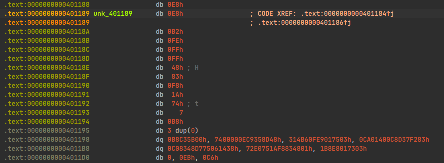

## leave 1

打开ida

```c++
__int64 __fastcall main(int a1, char **a2, char **a3)
{
  size_t v3; // rax
  char *v4; // rax
  unsigned int v5; // ebx
  char v8[128]; // [rsp+2h] [rbp-88h] BYREF
  char v9; // [rsp+82h] [rbp-8h] BYREF

  puts(s: "=== Junk Code Lab - Level 1 ===");
  printf(format: "Input flag: ");
  fflush(stream: stdout);
  if ( fgets(s: v8, n: 128, stream: stdin) != nullptr )
  {
    v3 = strlen(s: v8);
    if ( v3 != 0 )
    {
      v4 = &v8[v3 - 1];
      do
      {
        if ( *v4 != 10 && *v4 != 13 )
          break;
        *v4-- = 0;
      }
      while ( &v4[129LL - (_QWORD)&v9] != nullptr );
    }
    v5 = ((__int64 (__fastcall *)(char *))loc_401180)(a1: v8);
    if ( v5 != 0 )
    {
      puts(s: "[+] Correct! Level 1 cleared!");
      return 0;
    }
    else
    {
      puts(s: "[-] Wrong flag.");
    }
  }
  else
  {
    return 1;
  }
  return v5;
}
```

`v5 = ((__int64 (__fastcall *)(char *))loc_401180)(a1: v8);`

这里是在效验flag

打开`loc_401180`

```asm
.text:0000000000401180                 push    rbx
.text:0000000000401181                 mov     rbx, rdi
.text:0000000000401184                 jz      short near ptr loc_401188+1
.text:0000000000401186                 jnz     short near ptr loc_401188+1
.text:0000000000401188
.text:0000000000401188 loc_401188:                             ; CODE XREF: .text:0000000000401184↑j
.text:0000000000401188                                         ; .text:0000000000401186↑j
.text:0000000000401188                 call    near ptr 3EC475h
```

.text:0000000000401184                 jz      short near ptr loc_401188+1

.text:0000000000401186                 jnz     short near ptr loc_401188+1

会强制跳转

我们把`call    near ptr 3EC475h`拆开

按u



第一个是干扰字节

我们把他改成0x90 （空）

编辑 --> 修补程序 --> 修改字节

改完之后按c重新编辑成函数

继续

```asm
.text:00000000004011A7                 jz      short near ptr loc_4011AB+1
.text:00000000004011A9                 jnz     short near ptr loc_4011AB+1
.text:00000000004011AB
.text:00000000004011AB loc_4011AB:                             ; CODE XREF: .text:00000000004011A7↑j
.text:00000000004011AB                                         ; .text:00000000004011A9↑j
.text:00000000004011AB                 jmp     near ptr 354C7BFh
```

继续

```asm
.text:00000000004011C7                 jb      short near ptr loc_4011CB+1
.text:00000000004011C9                 jnb     short near ptr loc_4011CB+1
.text:00000000004011CB
.text:00000000004011CB loc_4011CB:                             ; CODE XREF: .text:00000000004011C7↑j
.text:00000000004011CB                                         ; .text:00000000004011C9↑j
.text:00000000004011CB                 call    near ptr 401388h
```

现在花指令应该是消完了，我们尝试反编译

```c++
__int64 __fastcall sub_401180(const char *a1)
{
  __int64 v3; // rax

  if ( strlen(s: a1) == 26 )
  {
    v3 = 0;
    while ( byte_402070[v3] == 3 * (_BYTE)v3 + (a1[v3] ^ 0x37) )
    {
      if ( ++v3 == 26 )
        return 1;
    }
  }
  return 0;
}
```

```python
byte_402070 = [0x51,0x5E,0x5C,0x59,0x58,0x61,0x21,0x7D,0x75,0x74,0x6B,0x89,0x81,0x74,0x92,0x86,0x88,0x7A,0x9E,0x97,0x7F,0xA7,0x98,0xA0,0xA3,0x95]
a1 = [0,0,0,0,0,0,0,0,0,0,0,0,0,0,0,0,0,0,0,0,0,0,0,0,0,0]
for i in [25,24,23,22,21,20,19,18,17,16,15,14,13,12,11,10,9,8,7,6,5,4,3,2,1,0]:
    a1[i] = (((((byte_402070[i] & 0xff) - (3 * i)))&0xff) ^ 0x37)
flag = "".join(chr(b) for i, b in enumerate(a1))
print(flag)
```

flag{e8_jnz_jz_nop_it_all}

## Level 2：假 call 篡改返回地址 / 破坏栈平衡

### 底层破坏原理

1. 套路 A（call + 修改 [rsp] + ret）：
   - call 干两件事：把下一条指令的地址压栈，然后跳过去。
   - 如果 call 跳到紧挨着的下一行（call $+5），栈顶 [rsp] 里放的就是当前地址；紧接着程序手动 add qword ptr [rsp], N 把栈顶返回地址往后挪几个字节，再执行 ret——CPU 就会“精准跳过”ret 后面藏着的垃圾字节，继续往下执行真代码。
   - 对 IDA 的杀伤力：IDA 看到 ret 就以为“这个函数在这里结束了！”，后面的真代码全被截断成孤儿字节，甚至还被紧跟的垃圾字节搅成乱码。
2. 套路 B（假 call + add rsp, 8 强行平栈）：
   - call 跳过去跳过几个垃圾字节后，根本不 ret，而是直接用 add rsp, 8（或 pop reg）把压进去的返回地址扔掉。
   - 对 IDA 的杀伤力：IDA 以为 call 会配对返回，结果突然多出个 add rsp, 8，栈指针账本瞬间对不上，按 F5 直接给你甩一句经典的 sp-analysis failed！

### 尝试

打开IDA后我们发现`sub_401180();`很奇怪，啥都没孤零零站在这

打开之后

```c++
void sub_401180()
{
  ;
}
```

看汇编

