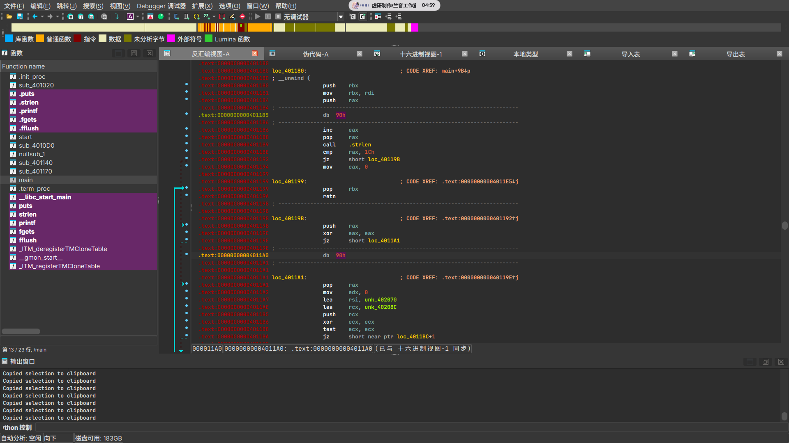
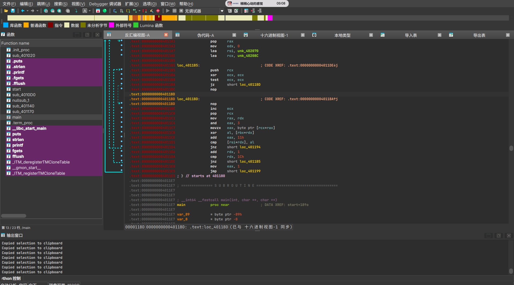

> 📦 **配套练习题打包下载（Level 1 ~ 4 + 结业大考 `final_exam`，共 5.2KB）**：[junk-code-lab.tar.gz](/downloads/junk-code-lab.tar.gz)
>
> 下载后在 Linux（x86-64）终端解压即可全套复现（均为去符号 ELF，不含源码防剧透）：
>
> ```bash
> mkdir junk-lab && tar -xzf junk-code-lab.tar.gz -C junk-lab && cd junk-lab && chmod +x *
> ```

## leave 1

打开ida

```c++
__int64 __fastcall main(int a1, char **a2, char **a3)
{
  size_t v3; // rax
  char *v4; // rax
  unsigned int v5; // ebx
  char v8[128]; // [rsp+2h] [rbp-88h] BYREF
  char v9; // [rsp+82h] [rbp-8h] BYREF

  puts(s: "=== Junk Code Lab - Level 1 ===");
  printf(format: "Input flag: ");
  fflush(stream: stdout);
  if ( fgets(s: v8, n: 128, stream: stdin) != nullptr )
  {
    v3 = strlen(s: v8);
    if ( v3 != 0 )
    {
      v4 = &v8[v3 - 1];
      do
      {
        if ( *v4 != 10 && *v4 != 13 )
          break;
        *v4-- = 0;
      }
      while ( &v4[129LL - (_QWORD)&v9] != nullptr );
    }
    v5 = ((__int64 (__fastcall *)(char *))loc_401180)(a1: v8);
    if ( v5 != 0 )
    {
      puts(s: "[+] Correct! Level 1 cleared!");
      return 0;
    }
    else
    {
      puts(s: "[-] Wrong flag.");
    }
  }
  else
  {
    return 1;
  }
  return v5;
}
```

`v5 = ((__int64 (__fastcall *)(char *))loc_401180)(a1: v8);`

这里是在效验flag

打开`loc_401180`

```asm
.text:0000000000401180                 push    rbx
.text:0000000000401181                 mov     rbx, rdi
.text:0000000000401184                 jz      short near ptr loc_401188+1
.text:0000000000401186                 jnz     short near ptr loc_401188+1
.text:0000000000401188
.text:0000000000401188 loc_401188:                             ; CODE XREF: .text:0000000000401184↑j
.text:0000000000401188                                         ; .text:0000000000401186↑j
.text:0000000000401188                 call    near ptr 3EC475h
```

.text:0000000000401184                 jz      short near ptr loc_401188+1

.text:0000000000401186                 jnz     short near ptr loc_401188+1

会强制跳转

我们把`call    near ptr 3EC475h`拆开

按u


第一个是干扰字节

我们把他改成0x90 （空）

编辑 --> 修补程序 --> 修改字节

改完之后按c重新编辑成函数

继续

```asm
.text:00000000004011A7                 jz      short near ptr loc_4011AB+1
.text:00000000004011A9                 jnz     short near ptr loc_4011AB+1
.text:00000000004011AB
.text:00000000004011AB loc_4011AB:                             ; CODE XREF: .text:00000000004011A7↑j
.text:00000000004011AB                                         ; .text:00000000004011A9↑j
.text:00000000004011AB                 jmp     near ptr 354C7BFh
```

继续

```asm
.text:00000000004011C7                 jb      short near ptr loc_4011CB+1
.text:00000000004011C9                 jnb     short near ptr loc_4011CB+1
.text:00000000004011CB
.text:00000000004011CB loc_4011CB:                             ; CODE XREF: .text:00000000004011C7↑j
.text:00000000004011CB                                         ; .text:00000000004011C9↑j
.text:00000000004011CB                 call    near ptr 401388h
```

现在花指令应该是消完了，我们尝试反编译

```c++
__int64 __fastcall sub_401180(const char *a1)
{
  __int64 v3; // rax

  if ( strlen(s: a1) == 26 )
  {
    v3 = 0;
    while ( byte_402070[v3] == 3 * (_BYTE)v3 + (a1[v3] ^ 0x37) )
    {
      if ( ++v3 == 26 )
        return 1;
    }
  }
  return 0;
}
```

```python
byte_402070 = [0x51,0x5E,0x5C,0x59,0x58,0x61,0x21,0x7D,0x75,0x74,0x6B,0x89,0x81,0x74,0x92,0x86,0x88,0x7A,0x9E,0x97,0x7F,0xA7,0x98,0xA0,0xA3,0x95]
a1 = [0,0,0,0,0,0,0,0,0,0,0,0,0,0,0,0,0,0,0,0,0,0,0,0,0,0]
for i in [25,24,23,22,21,20,19,18,17,16,15,14,13,12,11,10,9,8,7,6,5,4,3,2,1,0]:
    a1[i] = (((((byte_402070[i] & 0xff) - (3 * i)))&0xff) ^ 0x37)
flag = "".join(chr(b) for i, b in enumerate(a1))
print(flag)
```

flag{e8_jnz_jz_nop_it_all}

## Level 2：假 call 篡改返回地址 / 破坏栈平衡

### 底层破坏原理

1. 套路 A（call + 修改 [rsp] + ret）：
   - call 干两件事：把下一条指令的地址压栈，然后跳过去。
   - 如果 call 跳到紧挨着的下一行（call $+5），栈顶 [rsp] 里放的就是当前地址；紧接着程序手动 add qword ptr [rsp], N 把栈顶返回地址往后挪几个字节，再执行 ret——CPU 就会“精准跳过”ret 后面藏着的垃圾字节，继续往下执行真代码。
   - 对 IDA 的杀伤力：IDA 看到 ret 就以为“这个函数在这里结束了！”，后面的真代码全被截断成孤儿字节，甚至还被紧跟的垃圾字节搅成乱码。
2. 套路 B（假 call + add rsp, 8 强行平栈）：
   - call 跳过去跳过几个垃圾字节后，根本不 ret，而是直接用 add rsp, 8（或 pop reg）把压进去的返回地址扔掉。
   - 对 IDA 的杀伤力：IDA 以为 call 会配对返回，结果突然多出个 add rsp, 8，栈指针账本瞬间对不上，按 F5 直接给你甩一句经典的 sp-analysis failed！

### 尝试

打开IDA后我们发现`sub_401180();`很奇怪，啥都没孤零零站在这

打开之后

```c++
void sub_401180()
{
  ;
}
```

看汇编

```asm
.text:0000000000401180                 push    rbx
.text:0000000000401181                 mov     rbx, rdi
.text:0000000000401184                 call    $+5
.text:0000000000401189                 add     qword ptr [rsp], 0Ah
.text:0000000000401191                 retn
.text:0000000000401191 sub_401180      endp ; sp-analysis failed
.text:0000000000401191
.text:0000000000401191 ; ---------------------------------------------------------------------------
.text:0000000000401192                 dw 0E8E8h, 0FEA8h, 0FFFFh
```

call 把0x401189的位置压入栈，add又把这个数加了0xa，retn跳转回这个地址即 0x401193

那这一段都是多余的，纯干扰，我们给空 0x90

```asm
.text:0000000000401184                 call    $+5
.text:0000000000401189                 add     qword ptr [rsp], 0Ah
.text:0000000000401191                 retn
.text:0000000000401191 sub_401180      endp ; sp-analysis failed
.text:0000000000401191
.text:0000000000401191 ; ---------------------------------------------------------------------------
.text:0000000000401192                 db 0E8h
```

继续

```asm
.text:00000000004011A5                 call    loc_4011AB
.text:00000000004011A5 ; ---------------------------------------------------------------------------
.text:00000000004011AA                 db 0E9h
.text:00000000004011AB ; ---------------------------------------------------------------------------
.text:00000000004011AB
.text:00000000004011AB loc_4011AB:                             ; CODE XREF: .text:loc_4011A5↑j
.text:00000000004011AB                 add     rsp, 8
```

call压8字节

add rsp,8 弹出8字节

对汇编程序来说不影响，但会给ida干扰

我们删掉这段

继续

```asm
.text:00000000004011C0                 call    $+5
.text:00000000004011C5                 add     qword ptr [rsp], 0Ah
.text:00000000004011CD                 retn
.text:00000000004011CD ; ---------------------------------------------------------------------------
.text:00000000004011CE                 db 0E9h
```

同第一种

完成后找不到花指令了

用u全部打散

然后按c组装，再f5

```c++
__int64 __fastcall sub_401180(const char *a1)
{
  char v3; // cl
  __int64 v4; // rdx

  if ( strlen(s: a1) == 29 )
  {
    v3 = 37;
    v4 = 0;
    while ( byte_402070[v4] == ((unsigned __int8)v3 ^ __builtin_rotateleft8(a1[v4], 3)) )
    {
      ++v4;
      v3 += 7;
      if ( v4 == 29 )
        return 1;
    }
  }
  return 0;
}
```

写逆向脚本

```python
byte_402070 = [0x16,0x4F,0x38,0x1,0x9A,0x7B,0xEE,0xD,0xC4,0x9E,0x70,0xD3,0x1A,0xE3,0x7D,0x1D,0xC,0x3F,0x59,0x31,0x12,0x19,0xA4,0x9D,0x37,0xE7,0x52,0x21,0x2]
a1 = [0,0,0,0,0,0,0,0,0,0,0,0,0,0,0,0,0,0,0,0,0,0,0,0,0,0,0,0,0]
v3 = 240
for i in range(28,-1,-1):
    v3 -= 7
    a1[i] = ((((byte_402070[i] ^ (v3&0xff))&0xff) >> 3) | (((byte_402070[i] ^ (v3&0xff))&0xff) << 5)) & 0xff
print(bytes(a1).decode())
#__builtin_rotateleft8(a1[i], 3))
```

flag{f4k3_c4ll_r3t_st4ck_f1x}

## level 3

打开ida，我们找到了`loc_401180`

第一处异常：

```asm
.text:0000000000401185                 jmp     short near ptr loc_401185+1
.text:0000000000401185 ; ---------------------------------------------------------------------------
.text:0000000000401187                 db 0C0h
```

jmp让强制跳转到0x401186

我们u拆开jmp，从0x401186开始按c

再把没用的0x401185改成0x90

第二处：

```asm
.text:000000000040119C                 xor     eax, eax
.text:000000000040119E                 jz      short near ptr loc_4011A0+1
```

这也是一处强制跳转

我们把中间跳过去的代码改成0x90



第三处：

```asm
.text:00000000004011B6                 xor     ecx, ecx
.text:00000000004011B8                 test    ecx, ecx
.text:00000000004011BA                 jz      short near ptr loc_4011BC+1
```

跟第一处类似

要跳转到4011bd

删掉中间的干扰

```asm
.text:00000000004011BD                 jmp     short near ptr loc_4011BD+1
.text:00000000004011BD ; ---------------------------------------------------------------------------
.text:00000000004011BF                 db 0C1h
```

然后又出现了一处

处理好



删掉函数重新反编译

```c++
__int64 __fastcall sub_401180(const char *a1)
{
  __int64 v3; // rdx

  if ( strlen(s: a1) == 28 )
  {
    v3 = 0;
    while ( byte_402070[v3] == (a1[v3] ^ byte_40208C[v3 & 3]) + 17 )
    {
      if ( ++v3 == 28 )
        return 1;
    }
  }
  return 0;
}
```

写逆向脚本

```python
byte_402070 = [0x35,0x86,0x30,0xD3,0x4A,0x3A,0x19,0xA7,0x41,0x86,0x5B,0xE6,0x2E,0x84,0x24,0xE6,0x2E,0x3E,0x21,0xD2,0x2E,0x3A,0x1F,0xA2,0x44,0x7D,0x5E,0xE9]
byte_40208C = [0x42,0x19,0x7E,0xA5]
a1 = [0,0,0,0,0,0,0,0,0,0,0,0,0,0,0,0,0,0,0,0,0,0,0,0,0,0,0,0]
for v3 in range(27,-1,-1):
    a1[v3] = (((byte_402070[v3]&0xff) - 17)&0xff) ^ (byte_40208C[v3 & 3]&0xff)
print(bytes(a1).decode())
```

`flag{0v3rl4p_jmp_4nd_0p4qu3}`

## level 4 Python 批量自动化去花

### 思路

真实 CTF 里的批量花指令，通常都是用固定宏反复插入的，机器码特征高度重复。与其在 IDA 里手工改，不如直接用 Python 对 ELF 文件做“外科手术”：

抽样取特征（在 IDA 里只看一两处）：

把 level4 拖进 IDA，随便挑出里面出现的不同种类的花指令，各看 1 处；

切到十六进制视图，抄出整块花指令的连续字节序列（⚠️ 切记抄整块特征，比如 5 字节或十几个字节，绝对不要只替换单独的 0xE8/0xE9，否则会把程序正常的 call/jmp 全毁了！）。

写 10 行 Python 批量替换成等长 0x90：

思路骨架：

```python
data = open("level4", "rb").read()
# patterns = [bytes.fromhex("..."), bytes.fromhex("...")]
for pat in patterns:
    print("命中次数:", data.count(pat))
    data = data.replace(pat, b"\x90" * len(pat))
open("level4_patched", "wb").write(data)
```

替换完给 level4_patched 加上可执行权限 chmod +x level4_patched 跑一下，确认程序没被改坏。

把 level4_patched 拖进 IDA：

因为花指令在 IDA 加载之前就已经全被扫平了，IDA 会一次性自动识别所有函数，直接按 F5 就能丝滑看完整算法，连 U / C / P 都省了！

### 开始尝试

打开ida，一眼看到`loc_40121E`

进入找

#### 第一处

```asm
.text:0000000000401226                 jz      short near ptr unk_40122B
.text:0000000000401228                 jnz     short near ptr unk_40122B
.text:0000000000401228 ; ---------------------------------------------------------------------------
.text:000000000040122A                 db 0E8h
.text:000000000040122B unk_40122B      db 0E8h                 ; CODE XREF: .text:0000000000401226↑j
```

花指令是这段

```asm
.text:0000000000401226                 db  74h ; t
.text:0000000000401227                 db    3
.text:0000000000401228                 db  75h ; u
.text:0000000000401229                 db    1
.text:000000000040122A                 db 0E8h
```

#### 第二处

```asm
.text:0000000000401241                 call    $+5
.text:0000000000401246                 add     qword ptr [rsp], 0Ah
.text:000000000040124E                 retn
.text:000000000040124E ; ---------------------------------------------------------------------------
.text:000000000040124F                 db 0E9h
```

```python
with open("level4", "rb") as f:
    data = f.read()

patterns = [
    bytes([0x74, 0x03, 0x75, 0x01, 0xE8]),
    # 后面如果发现第二种花指令，直接往列表里追加一行！
    bytes.fromhex("E8 00 00 00 00 48 81 04 24 0A 00 00 00 C3 E9"),
]

for i, pat in enumerate(patterns, 1):
    cnt = data.count(pat)
    print(f"Pattern {i} ({len(pat)} bytes): 命中 {cnt} 次")
    data = data.replace(pat, b"\x90" * len(pat))

with open("level4_patched", "wb") as f:
    f.write(data)
```

```python
Pattern 1 (5 bytes): 命中 9 次
Pattern 2 (15 bytes): 命中 6 次
```

#### 再次IDA

```c++
__int64 __fastcall sub_40121E(const char *a1)
{
  _BYTE *v3; // rax
  _BYTE *i; // rdx
  _BYTE v5[29]; // [rsp+0h] [rbp-48h] BYREF
  char v6; // [rsp+1Dh] [rbp-2Bh] BYREF

  if ( strlen(s: a1) == 29 )
  {
    sub_401180(a1, a2: v5, a3: 29);
    sub_4011D3(a1: v5, a2: 29);
    v3 = v5;
    for ( i = &unk_402070; *v3 == *i; ++i )
    {
      if ( ++v3 == &v6 )
        return 1;
    }
  }
  return 0;
}
```

先看`sub_401180`

```c++
void __fastcall __spoils<> sub_401180(__int64 a1, __int64 a2, __int64 a3)
{
  __int64 i; // rax

  if ( a3 != 0 )
  {
    for ( i = 0; i != a3; ++i )
      *(_BYTE *)(a2 + i) = (*(_BYTE *)(a1 + i) ^ 0x55) + 5 * i;
  }
}
```

写python逆向脚本

```python
'''
void __fastcall sub_4011D3(char *a1, __int64 a2)
{
  char *v2; // rax
  char *v3; // rdi
  char v4; // dl

  if ( a2 != 0 )
  {
    v2 = a1;
    v3 = &a1[a2];
    v4 = -93;
    do
    {
      v4 ^= *v2;
      *v2++ = v4;
    }
    while ( v2 != v3 );
  }
}
'''
v2t = [0x90, 0xAE, 0x90, 0xD1, 0x93, 0xAD, 0xE7, 0xA3, 0xC6, 0x54,0x39, 0x78, 0x0B, 0xA9, 0xCE, 0x4F, 0xC2, 0x9D, 0x16, 0xD3,0x70, 0xF9, 0x50, 0xE1, 0x63, 0xC1, 0x68, 0x84, 0x30]
a2 = 29

v2 = [0,0,0,0,0,0,0,0,0,0,0,0,0,0,0,0,0,0,0,0,0,0,0,0,0,0,0,0,0]
for i in range(28,0,-1):
    v4 = v2t[i]
    v2[i] = v4 ^ v2t[i-1]    
v2[0] = ((-93)&0xff) ^ v2t[0]

'''
void __fastcall __spoils<> sub_401180(__int64 a1, __int64 a2, __int64 a3)
{
  __int64 i; // rax

  if ( a3 != 0 )
  {
    for ( i = 0; i != a3; ++i )
      *(_BYTE *)(a2 + i) = (*(_BYTE *)(a1 + i) ^ 0x55) + 5 * i;
  }
}
'''

a1 = [0,0,0,0,0,0,0,0,0,0,0,0,0,0,0,0,0,0,0,0,0,0,0,0,0,0,0,0,0]
for i in range(28,-1,-1):
    a1[i] = (((v2[i] - ((5 * i)&0xff))^ 0x55)&0xff)
print(bytes(a1).decode())
```

## level 5 综合大考

```python
with open("final_exam", "rb") as f:
    data = f.read()

patterns = [
    bytes.fromhex("50 EB FF C0 58"),
    bytes.fromhex("74 03 75 01 E8"),
    bytes.fromhex("E8 00 00 00 00 48 81 04 24 0A 00 00 00 C3 E8"),
    bytes.fromhex("72 03 73 01 E9"),
    bytes.fromhex("31 C9 74 01 E8"),
    bytes.fromhex("E8 01 00 00 00 E9 48 83 C4 08"),

]

for i, pat in enumerate(patterns, 1):
    cnt = data.count(pat)
    print(f"Pattern {i} ({len(pat)} bytes): 命中 {cnt} 次")
    data = data.replace(pat, b"\x90" * len(pat))
with open("final_exam_tt5", "wb") as f:
    f.write(data)
```

解完花指令后：

```c++
__int64 __fastcall sub_120C(const char *a1)
{
  char *v3; // rax
  _BYTE *v4; // rcx
  char v5; // dl
  _BYTE v6[31]; // [rsp+0h] [rbp-48h] BYREF
  char v7; // [rsp+1Fh] [rbp-29h] BYREF

  if ( strlen(s: a1) == 31 )
  {
    sub_1180(a1, a2: v6, a3: 31);
    v3 = v6;
    v4 = &unk_2090;
    v5 = 109;
    while ( 1 )
    {
      v5 ^= *v3;
      if ( *v4 != v5 )
        break;
      ++v3;
      ++v4;
      if ( v3 == &v7 )
        return 1;
    }
  }
  return 0;
}
```

```python
enc = [  0x87, 0x0E, 0x01, 0xBD, 0x75, 0x60, 0x2F, 0x29, 0x0E, 0x19, 
  0x25, 0x26, 0x63, 0x2C, 0x02, 0x19, 0x8C, 0xA0, 0xA5, 0xF4, 
  0x26, 0x9B, 0xF3, 0x9F, 0x0B, 0xFE, 0x21, 0x5A, 0xFA, 0x78, 
  0xD8]   # unk_2090 (31 bytes)
key = [0x13, 0x37, 0x5A, 0xC3, 0x9E]   # byte_20AF (5 bytes)

# 1. 逆 sub_120C（CBC 链式异或）
v6 = [enc[0] ^ 109] + [enc[i] ^ enc[i - 1] for i in range(1, len(enc))]

# 2. 逆 sub_1180（减 (21 + 7*i) -> ror8(..., 2) -> xor key[i % 5]）
def ror8(x, r): return ((x >> r) | (x << (8 - r))) & 0xff
flag = bytes(ror8((v6[i] - (21 + 7 * i)) & 0xff, 2) ^ key[i % 5] for i in range(len(v6)))
print(flag.decode())
```

`flag{d3junk_m4st3r_s_r4nk_2026}`

---

## 📋 花指令特征与去花速查表（实战可直接对照）

### 1. 在 IDA 里一眼嗅出花指令的 5 个信号

- 调用处出现函数指针强转：`((... )loc_XXXXXX)(...)`（函数已被花指令干碎，未识别成 `sub_`）
- 跳转目标带 **`+1` / `+N`**：如 `jz short near ptr loc_XXXX+1`（跳进指令中间）
- 跳到荒郊野外的非法 `call`/`jmp`、大段 `dq/db` 数据块，或 `enter`/`in`/`out`/`clc` 等怪异指令
- 函数提前截断并报 **`endp ; sp-analysis failed`**
- 按 F5 出现 **`JUMPOUT(0x...)`** 或直接反编译失败

### 2. 四大经典花指令特征与拆解对照表

| 类型 | 典型汇编特征 | 破坏原理 | 去花做法 |
| --- | --- | --- | --- |
| **互补永恒跳转** | `jz/jnz`、`jb/jae`、`js/jns` 跳同一目标，中间夹 `E8`/`E9` | IDA 仍会解码永不执行的假分支，垃圾字节吞掉真指令开头 | 只 NOP 垃圾字节，或整块（双跳转 + 垃圾字节）全改 `90`，目标处按 `C` |
| **假 `call` 改返回地址** | `call $+5` → `add [rsp], N` → `retn` + 垃圾字节 | IDA 看到 `retn` 误判函数提前结束 | 算落点：`下一行地址 + N`，把 **`call` 到落点前 1 字节整块改 `90`** |
| **假 `call` 强行平栈** | `call loc_X` + 垃圾字节 + `add rsp, 8`（或 `pop reg`） | 栈指针账本失衡，触发 `sp-analysis failed` | **`call` + 垃圾字节 + `add rsp, 8` 整块成对改 `90`** |
| **重叠指令 + 不透明谓词** | `jmp loc+1`（`EB FF ...`）或 `xor reg, reg; jz ...`，常带 `push/pop` 壳 | 同一串字节错位解码出两套指令 | **不用背机器码**：对原跳转按 `U`，光标移到 `+1` 目标按 `C` 让 IDA 自己翻译，看清后连同 `push/pop` 壳成对改 `90` |

### 3. 两条铁律 & 常用快捷键

- **栈操作成对消除铁律**：`push`/`pop`、`call`/`add rsp, 8`、`call`/`retn` 必须成对留或成对改 `90`。
- **修完仍不能 F5**：回到函数头 → **`编辑 -> 函数 -> 删除函数`** → 按 **`P`** 重建函数 → 按 **`F5`**。
- **高效快捷键**：`U` 打散、`C` 转代码、`P` 建函数、`F2` 十六进制视图改字节、**`Shift+E`** 一键导出数组、`选项 -> 常规 -> 反汇编 -> 操作码字节数 = 8` 直接显示机器码。

### 4. Python 增量批量去花通用模板（遇到 10+ 处重复花直接上）

```python
with open("target", "rb") as f:
    data = f.read()

patterns = [
    bytes.fromhex("74 03 75 01 E8"),  # 永远用整块多字节特征，禁止单字节替换
]

for i, pat in enumerate(patterns, 1):
    print(f"Pattern {i} ({len(pat)}B): 命中 {data.count(pat)} 次")
    data = data.replace(pat, b"\x90" * len(pat))

with open("target_patched", "wb") as f:
    f.write(data)
```
