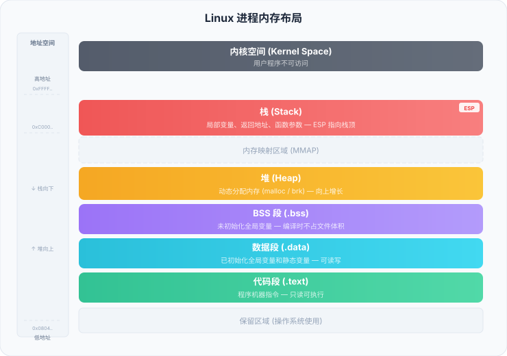
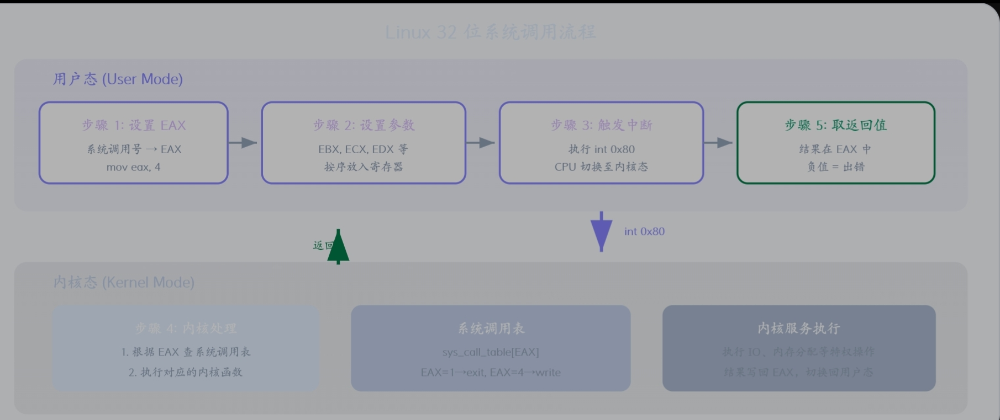

# 汇编语言学习

> 发布于 2026-10-10 12:11:10

参考[菜鸟教程](https://www.runoob.com/assembly/assembly-tutorial.html)

# 1.基础语法

汇编语言与机器码的关系

汇编指令和机器指令之间存在 一一对应 的关系。

每一条汇编指令都精确映射到一条 CPU 机器指令，不存在中间抽象层。

## 汇编程序的基本结构

.data 数据段 存放已初始化的全局变量和常量

.bss BSS段 存放未初始化的数据

.text 代码段 存放程序的可执行指令（已初始化）

至少需要.text段才能构成有效汇编

## 汇编语句格式

```
[标签:]   指令助记符   [操作数1 [, 操作数2 [, 操作数3]]]   [; 注释]
```

标签 可选 代表一个内存地址的符号名，以冒号结尾

指令助记符 必须 mov，add，sub等告诉cpu要做什么

操作数 可选（部分指令无操作数） 指令操作的数据对象，可为寄存器、内存地址、立即数

注释 可选 分号开头，延续到结尾

汇编代码中注释极其重要。没有注释的汇编代码过几周连作者自己都可能看不懂。养成每条指令都写注释的习惯。

## 标识符命名规则

标识符（标签、变量名、常量名等）须遵循以下规则：

规则

说明

组成字符

字母、数字、下划线 _、点 .、问号 ?、@、$、# 等

起始字符

必须以字母、下划线、点或问号开头，不能以数字开头

大小写

默认区分大小写（可通过编译选项修改）

保留字

不能和指令助记符、寄存器名或 NASM 关键字重名

## 伪指令（Directives）

**伪指令** 是给汇编器的命令，不是给 CPU 的指令，用于控制汇编过程和定义数据结构。

伪指令

用途

示例

意思

`db`

定义字节（1 字节）

`byte_val db 0x55`

定义byte_val为0x55的字节

`dw`

定义字（2 字节）

`word_val dw 0x1234`

定义word_val为0x1234的字

`dd`

定义双字（4 字节）

`dword_val dd 0x12345678`

定义dword_val为0x12345678的双字

`equ`

定义常量

`MAX_SIZE equ 256`

定义MAX_SIZE为256的常量

`resb`

预留字节空间

`buffer resb 128`

预留128字节的空间

`resw`

预留字空间

`wbuf resw 64`

预留64字的空间（128字节）

`resd`

预留双字空间

`dbuf resd 32`

预留32双字的空间（128字节）

`%define`

宏定义常量

`%define COUNT 10`

*这里的 equ 或 %define 相当于一个“文本替换”工具。 汇编器在编译代码时，只要看到 MAX_SIZE，就会像文字替换一样，直接把它换成数字 256。*

### equ和%define区别

**1. **`%define MAX_SIZE 256`** —— 纯粹的“文本替换”**

- **处理阶段**：**预处理阶段**（类似于 C 语言的 `#define`）。

- **原理**：汇编器在正式编译代码前，会把代码里所有的 `MAX_SIZE` 像 word 里的“查找替换”一样，直接硬生生替换成 `256`。替换完之后，`MAX_SIZE` 这个名字就**彻底消失了**。

- **特点**：它可以被重新定义，比如你后面再写一句 `%define MAX_SIZE 512`，它就会变成 512。

**2. **`MAX_SIZE equ 256`** —— 真正的“符号常量”**

- **处理阶段**：**汇编阶段**。

- **原理**：汇编器会在内部的“符号表”里登记一条记录：“`MAX_SIZE` 这个符号，对应数值 256”。它不会粗暴地做文字替换。

- **特点**：一旦用 `equ` 定义，**绝对不能重新定义**（比如再写一次 `MAX_SIZE equ 512` 就会报错）。它有自己的“身份”。

NASM 默认对标签和标识符 区分大小写

指令助记符和寄存器名不区分大小写（MOV、Mov、mov 效果相同），但推荐的风格是统一小写。

## 数值表示方式

```
; NASM 中不同进制的表示方式

mov eax, 42             ; 十进制：直接写数字
mov eax, 0x2A           ; 十六进制：0x 前缀（推荐写法）
mov eax, 2Ah            ; 十六进制：h 后缀
mov eax, 0o52           ; 八进制：0o 前缀
mov eax, 52o            ; 八进制：o 后缀
mov eax, 101010b        ; 二进制：b 后缀
mov eax, 0b101010       ; 二进制：0b 前缀
```

# 2.汇编语言 - 内存分段

在 x86 实模式下，CPU 使用 16 位寄存器，但需要访问 1MB 的内存空间（20 位地址）。 16 位寄存器只能表示 64KB 范围（2^16 = 65536），远远不够。 Intel 的解决方案是将内存划分为 段（Segment），每个段有基地址和偏移量，通过 段地址 + 偏移量 的方式组合出完整的物理地址。

物理地址计算公式

```
物理地址 = 段地址 × 16 + 偏移地址
```

## 三种基本段

一个典型的汇编程序使用三个主要段：

段名称

英文名

用途

对应的 Section

代码段

Code Segment

存放可执行的机器指令

`section .text`

数据段

Data Segment

存放已初始化的全局变量

`section .data`

栈段

Stack Segment

存放函数调用信息、局部变量

操作系统自动管理

## 代码段（.text）

为了防止程序意外修改指令

代码段 只读,可执行

## 数据段（.data）

存放***已初始化的全局变量***

***可读可写，程序可以修改其中内容***

## BSS 段（.bss）

存放***未初始化的全局变量***

不占用实际空间，只在程序加载时由系统分配内存

将未初始化的数据放在 BSS 段而不是 .data 段中，可以减小可执行文件的体积。例如，一个 10KB 的未初始化缓冲区在 BSS 段中不占用文件大小，但如果放在 .data 段中则会让文件增大 10KB。

## 内存分段示意图



```
高地址
+-------------------+
|   栈 (Stack)      |  <-- SS:ESP 指向栈顶
|   向下增长         |
+-------------------+
|                   |
|   空闲内存         |
|                   |
+-------------------+
|   BSS 段 (.bss)   |  未初始化的全局变量
+-------------------+
|   数据段 (.data)   |  已初始化的全局变量
+-------------------+
|   代码段 (.text)   |  程序指令（只读）
+-------------------+
|   保留区域         |  操作系统使用
+-------------------+
低地址
```

栈顶其实是低地址，也就是压栈的时候向下移动

# 3.汇编语言 - 寄存器

## x86 32 位寄存器分类


### 通用寄存器

用于存放运算数据和临时结果

x86 提供了 8 个 32 位通用寄存器：

32位

16位

低8位

高8位（低16位）

主要用途

EAX

AX

AL

AH

累加器，存放函数返回值、算术运算结果

EBX

BX

BL

BH

基址寄存器，常用于存放内存基地址

ECX

CX

CL

CH

计数器，常用于循环计数和移位

EDX

DX

DL

DH

数据寄存器，存放乘除法的高位结果

ESI

SI

SIL

-

源变址寄存器，字符串操作的源地址

EDI

DI

DIL

-

目的变址寄存器，字符串操作的目标地址

EBP

BP

BPL

-

基址指针，指向当前栈帧的底部

ESP

SP

SPL

-

栈指针，始终指向栈顶

***修改 32 位寄存器的低 16 位（如 AX）时，高 16 位保持不变。但将 32 位寄存器作为目标操作数时，会覆盖整个 32 位。这是初学者容易出错的地方。***

### 段寄存器

寄存器

名称

用途

CS

代码段寄存器

指向当前指令所在的段

DS

数据段寄存器

指向数据所在的段

SS

栈段寄存器

指向栈所在的段

ES

附加段寄存器

额外的数据段

FS

附加段寄存器

通用，常用于线程局部存储

GS

附加段寄存器

通用，常用于线程局部存储

在 32 位保护模式下编程时，操作系统已经设置好了段寄存器，你通常不需要手动修改它们。

### 指针和变址寄存器

寄存器

全称

用途

EIP

指令指针（Instruction Pointer）

指向 CPU 下一条要执行的指令地址（不可直接访问）

ESP

栈指针（Stack Pointer）

指向栈顶，PUSH/POP 指令自动调整它

EBP

基址指针（Base Pointer）

指向当前函数栈帧的底部，用于访问函数参数和局部变量

ESI

源变址（Source Index）

字符串/内存操作的源地址

EDI

目的变址（Destination Index）

字符串/内存操作的目标地址

***ESP 和 EBP 不能当作普通通用寄存器随意使用。ESP 指向栈顶，push/pop/call/ret 都会改变它；EBP 是访问函数参数的关键。随意修改它们会导致程序崩溃。***

### 标志寄存器（EFLAGS）

标志位

名称

含义

CF

进位标志（Carry Flag）

无符号运算产生进位/借位时置 1

PF

奇偶标志（Parity Flag）

结果低 8 位中 1 的个数为偶数时置 1

AF

辅助进位标志

低 4 位向高 4 位进位/借位时置 1

ZF

零标志（Zero Flag）

运算结果为 0 时置 1

SF

符号标志（Sign Flag）

运算结果为负数时置 1（等于结果的最高位）

OF

溢出标志（Overflow Flag）

有符号运算溢出时置 1

CPU 会根据运算结果自动更新这些标志位，条件跳转指令则根据标志位决定是否跳转。

## 寄存器使用约定

在实际编程中，一些寄存器有约定俗成的用法——称为 **调用约定（Calling Convention）**：

寄存器

调用约定中的用途

EAX

存放函数返回值

ECX

计数器（循环计数）

EDX

存放除法的高位结果、扩展 EAX

EBX、ESI、EDI、EBP

被调用函数必须保存和恢复（callee-saved）

EAX、ECX、EDX

调用者负责保存（caller-saved）

在编写自己的汇编程序时，不一定严格遵循调用约定。但如果你要和 C 语言混合编程，就必须遵守 cdecl 等调用约定。

# 4.汇编语言 - 系统调用

用户程序运行在受限的用户态，需要进行io操作，内存分配等内核级操作时就需要用到系统调用

流程:

用户发起系统调用-CPU切换到内核态-执行对应服务-返回用户态



## Linux系统调用机制

1.将 系统调用号放入 EAX寄存器

2.将参数放入EBX,ECX,EDX,ESI,EDI等寄存器

3.执行int 0x80指令触发软件中断

4.CPU切换至内核态，根据EAX的调用号执行对应指令

5.将返回值给EAX，切回用户态继续执行

## 常用系统调用指令

系统调用 调用号（EAX） 功能 参数

sys_exit 1 退出程序 EBX = 返回值（exit code）

sys_fork 2 创建子进程 无参数

sys_read 3 读取文件/输入 EBX=fd, ECX=buf, EDX=count

sys_write 4 写入文件/输出 EBX=fd, ECX=buf, EDX=count

sys_open 5 打开文件 EBX=filename, ECX=flags, EDX=mode

sys_close 6 关闭文件 EBX=fd

sys_creat 8 创建文件 EBX=filename, ECX=mode

sys_lseek 19 移动文件指针 EBX=fd, ECX=offset, EDX=whence

sys_brk 45 调整数据段大小（内存分配） EBX=新地址

### sys_write_输出字符串

用于向屏幕打印内容

; 文件路径：write_syscall.asm

; 使用 sys_write 输出字符串

section .data

msg db 'Hello, runoob! Welcome to assembly.', 0xA ;注意0xA是换行符

len equ $ - msg ;equ是等于的意思，常用来定义常量，$代表当前行地址，msg是字符串的起始地址，$ -msg就是指字符串的长度，用equ赋给len

section .text

global 的作用是声明全局符号，让链接器可见；但它不是“让 _start 变成程序起点”的机制。程序起点是由链接器脚本或 -e 选项指定的，global 只是把符号暴露出去。

_start:

; 调用 sys_write (4)

mov eax, 4 ; 系统调用号 4 = sys_write

mov ebx, 1 ; 文件描述符 1 = stdout（标准输出）

mov ecx, msg ; 要输出的数据地址

mov edx, len ; 数据长度（字节数）

int 0x80 ; 触发系统调用

; 成功时 EAX 返回实际写入的字节数

; 退出程序

mov eax, 1 ;系统调用号1

mov ebx, 0 ;返回值0

int 0x80 ;执行系统调用

### sys_read - 读取用户输入

```
; 文件路径：read_syscall.asm
; 使用 sys_read 读取用户输入并回显

section .bss
    buffer resb 64              ; 预留 64 字节输入缓冲区

section .data
    prompt db 'Please enter your name: '
    prompt_len equ $ - prompt
    output_msg db 'Hello, '
    output_msg_len equ $ - output_msg

section .text
    global start

start:
    ; 输出提示信息
    mov eax, 4
    mov ebx, 1
    mov ecx, prompt
    mov edx, prompt_len
    int 0x80

    ; 读取用户输入
    mov eax, 3                  ; 系统调用号 3 = sys_read
    mov ebx, 0                  ; 文件描述符 0 = stdin（标准输入）
    mov ecx, buffer             ; 输入缓冲区地址
    mov edx, 64                 ; 最多读取 64 字节
    int 0x80

    ; EAX 返回实际读取的字节数（包含末尾的换行符）
    mov esi, eax                ; 保存实际输入长度到 esi，esi是自带的寄存器，不声明，直接用

    ; 输出 "Hello, "
    mov eax, 4
    mov ebx, 1
    mov ecx, output_msg
    mov edx, output_msg_len
    int 0x80

    ; 输出用户输入的内容
    mov eax, 4
    mov ebx, 1
    mov ecx, buffer
    mov edx, esi                ; 使用实际输入的字节数
    int 0x80

    ; 退出程序
    mov eax, 1
    mov ebx, 0
    int 0x80
```

## sys_exit - 退出程序

; 使用不同退出码退出

mov eax, 1 ; 系统调用号 1 = sys_exit

mov ebx, 0 ; 退出码 0 = 正常退出（也可以是非零值），负值表示非正常退出

int 0x80

## 系统调用通用模板

; 系统调用通用模板

; 适用于 Linux 32 位系统

; 步骤1：将系统调用号放入 EAX

mov eax, 系统调用号

; 步骤2：按顺序放入参数

mov ebx, 第1个参数

mov ecx, 第2个参数

mov edx, 第3个参数

mov esi, 第4个参数

mov edi, 第5个参数

; 步骤3：触发系统调用

int 0x80

; 步骤4：检查返回值（在 EAX 中）

; 通常负值表示错误

cmp eax, 0

jl error_handler ; 如果 EAX < 0，跳转到错误处理

# 5.汇编语言-寻址方式

决定CPU去哪拿数据

## 立即寻址（Immediate Addressing）

就是立即数
**mov** **eax**, 42                 *; 42 是立即数，直接编码在指令中*
**add** **ebx**, 100                *; 100 是立即数*
**mov** **ecx**, 0x2A               *; 十六进制立即数*
**mov** **edx**, 'A'                *; 字符 'A' = 0x41，也是立即数*

## 寄存器寻址（Register Addressing）

mov eax, ebx ; 将 ebx 的值复制到 eax（两个操作数都是寄存器寻址）

add ecx, edx ; ecx = ecx + edx

push eax ; 将 eax 的值压入栈

inc ebx ; ebx = ebx + 1

## 直接寻址（Direct Addressing）

```
操作数是内存地址

; 文件路径：direct_addr.asm

; 直接寻址示例

section .data

    value dd 12345678          ; 在内存中定义一个双字变量

    name db 'runoob', 0

section .text

    global _start

_start:

    ; 直接寻址读取内存

    mov eax, [value]           ; 从内存地址 value 读取 4 字节(因为eax是32位，所以读取四字节)到 eax

    ; eax 现在是 12345678

    ; 直接寻址写入内存

    mov dword [value], 98765   ; 将 98765 写入 value 所在的内存地址

    ; 直接寻址读取字节

    mov al, [name]             ; 读取 name 的第一个字节（因为al，bl都是8位，所以读取一字节） 'r' = 0x72

    mov bl, [name + 1]         ; 读取 name 的第二个字节 'u' = 0x75

    mov eax, 1
    mov ebx, 0
    int 0x80
```

## 寄存器间接寻址（Register Indirect Addressing）

寄存器中存放的是一个内存地址，CPU 用该地址去访问内存。

方括号内的寄存器被当作指针使用。

```
; 文件路径：indirect_addr.asm
; 寄存器间接寻址示例

section .data
    msg db 'Hello, RUNOOB!', 0xA
    len equ $ - msg

section .text
    global _start

_start:
    mov eax, msg                ; 将 msg 的地址（指针）放入 eax
    mov al, [eax]               ; 间接寻址：读取 eax 指向的内存字节
    ; 现在 al = 'H' = 0x48

    ; 遍历字符串，将小写字母转为大写
    mov esi, msg                ; esi 指向字符串起始位置
    mov ecx, len                ; ecx 存放字符串长度

convert_loop:
    mov al, [esi]               ; 间接寻址：读取 esi 指向的字符
    cmp al, 'a'                 ; 是否大于等于 'a'
    jb next_char                ; 否，跳过
    cmp al, 'z'                 ; 是否小于等于 'z'
    ja next_char                ; 否，跳过
    sub al, 32                  ; 转为大写（ASCII 表中小写-大写=32）
    mov [esi], al               ; 间接寻址：写回 esi 指向的位置

next_char:
    inc esi                     ; 指针移动到下一个字符
    loop convert_loop           ; 继续循环直到全部处理完,loop 指令会无条件地自动把 ECX（或 CX/RCX，取决于位数）减 1，然后判断是否等于0，等于零跳出循环，代码向下执行
;loop等效于
;dec ecx       ; ECX 减 1
;jnz convert_loop  ; 结果不为 0，则跳转

    ; 输出转换后的字符串
    mov eax, 4
    mov ebx, 1
    mov ecx, msg
    mov edx, len
    int 0x80

    mov eax, 1
    mov ebx, 0
    int 0x80
```

*间接寻址是数组遍历、字符串操作和数据结构访问的基础。ESI 和 EDI 是专门设计用来配合间接寻址的寄存器，配合 inc esi 可以轻松遍历连续内存。*

## 基址寻址（Base Addressing）

有效地址 = 基址寄存器的值 + 偏移量（位移量）。

基址寄存器可以是 EBX、EBP、ESI、EDI 等。

```
; 基址寻址示例：访问结构体成员

section .data
    ; 模拟一个简单的结构体：{id, age, score}
    ; id   = 2 字节
    ; age  = 2 字节
    ; score = 4 字节
    student db 0x01, 0x00      ; id = 1  因为是小端，所以1在2字节内存中是 0x01,0x00
            db 0x14, 0x00      ; age = 20
            dd 95              ; score = 95

section .text
    global _start

_start:
    mov ebx, student            ; ebx 存放结构体基址

    ; 基址 + 偏移量访问各成员
    mov ax, [ebx]               ; 读取 id（偏移 0）  ax访问2字节
    mov ax, [ebx + 2]           ; 读取 age（偏移 2）ax访问2字节
    mov eax, [ebx + 4]          ; 读取 score（偏移 4）eax访问4字节

    ; 修改 age
    mov word [ebx + 2], 21      ; age = 21  word告诉编译器数字是2字节

    ; 修改 score
    mov dword [ebx + 4], 98     ; score = 98  dword告诉编译器数字是4字节

    mov eax, 1
    mov ebx, 0
    int 0x80
```

## 变址寻址（Indexed Addressing）

使用变址寄存器（ESI 或 EDI）加上偏移量来访问数组元素。

```
; 变址寻址示例：遍历数组

section .data
    array dd 10, 20, 30, 40, 50     ; 5 个双字元素的数组
    array_len equ ($ - array) / 4    ; 元素个数 = 总字节数 / 4

section .text
    global _start

_start:
    mov ecx, array_len              ; 循环计数器
    mov esi, 0                      ; 变址（下标从 0 开始）
    mov ebx, 0                      ; 累加和

sum_loop:
    mov eax, [array + esi * 4]      ; 变址寻址：array + 下标 * 元素大小
    ; esi * 4 因为每个元素是 4 字节
    add ebx, eax                    ; 累加到 ebx
    inc esi                         ; 下标加 1
    loop sum_loop
    ; ebx = 10+20+30+40+50 = 150

    ; 变址 + 偏移：访问第二个元素
    ; array + 2*4 = array + 8，即 30
    mov eax, [array + 2*4]          ; eax = 30

    mov eax, 1
    mov ebx, 0
    int 0x80
```

## 基址变址寻址（Base-Indexed Addressing）

有效地址 = 基址寄存器 + 变址寄存器 × 比例因子 + 偏移量。

**注意：x86 仅支持一个变址寄存器 × 比例因子，不支持多个带比例因子的寄存器。严格按照以上公式写就行**

```
; 基址变址寻址示例：二维数组访问

section .data
    ; 3 行 4 列的二维数组
    matrix dd 1, 2, 3, 4
           dd 5, 6, 7, 8
           dd 9, 10, 11, 12

section .text
    global _start

_start:
    ; 访问 matrix[1][2]（第 2 行第 3 列，下标从 0 开始）
    ; 地址 = matrix + 行*每行字节数 + 列*每元素字节数
    ;       = matrix + 1*16 + 2*4
    ;       = matrix + 24

    mov ebx, matrix             ; 基址寄存器
    mov esi, 24                 ; 计算好的总偏移量

    ; 正确格式：基址 + 偏移量
    mov eax, [ebx + esi]         ; eax = 7

    ; 标准基址变址寻址格式：[基址 + 变址*比例因子 + 偏移量]
    ; 直接访问第 6 个元素（matrix[6] = 7）
    mov edi, 6
    mov eax, [matrix + edi*4]    ; eax = 7

    ; 程序退出
    mov eax, 1
    mov ebx, 0
    int 0x80
```

## 寻址方式总览


寻址方式

语法格式

有效地址/值

典型用途

立即寻址

`mov eax, 42`

42（常数值）

初始化、常量运算

寄存器寻址

`mov eax, ebx`

寄存器 ebx 的值

寄存器间数据传递

直接寻址

`mov eax, [var]`

内存地址 var 处的值

访问全局变量

间接寻址

`mov eax, [ebx]`

地址 = ebx 的值

指针操作、遍历内存

基址寻址

`mov eax, [ebx+8]`

地址 = ebx + 8

结构体成员访问

变址寻址

`mov eax, [arr+esi*4]`

地址 = arr + esi × 4

一维数组访问

基址变址

`mov eax, [ebx+esi*4+8]`

地址 = ebx + esi × 4 + 8

二维数组、复杂结构体

# 6.汇编语言 - 常量

常量不占用数据段内存，它们在 **编译时** 就被替换，相当于 C 语言中的 `#define`

## EQU - 等值常量

定义后不可重新定义

```
; EQU 常量定义示例

; 数值常量
MAX_SIZE equ 256                 ; 缓冲区最大大小
DEFAULT_PORT equ 8080            ; 默认端口号
TRUE equ 1                       ; 真值
FALSE equ 0                      ; 假值

; 字符常量
LF equ 0xA                       ; 换行符
CR equ 0xD                       ; 回车符
NULL equ 0                       ; 空字符

; 表达式常量
ARRAY_SIZE equ 100 * 4           ; 100 个双字的字节数
BUFFER_SIZE equ MAX_SIZE * 2     ; 引用另一个常量
TOTAL equ 10 + 20 + 30           ; 计算结果

section .data
    ; 使用常量
    buffer db MAX_SIZE dup(0)    ; 定义 MAX_SIZE 字节的缓冲区

section .text
    global _start

_start:
    mov eax, MAX_SIZE            ; eax = 256
    mov ebx, BUFFER_SIZE         ; ebx = 512
    mov ecx, ARRAY_SIZE          ; ecx = 400

    mov eax, 1
    mov ebx, 0
    int 0x80
```

*EQU 定义的常量不能在程序中修改，也不能重新定义。如果需要可以重新定义的常量（类似宏变量），使用 %define。*

## %define - 宏定义常量

%define 比 EQU 更灵活，支持重新定义和作用域控制

```
; %define 常量定义与重定义示例

%define VERSION 1                ; 定义版本号
%define APP_NAME 'runoob'        ; 定义应用名称

; 使用 %define 定义的常量
    mov eax, VERSION             ; eax = 1

; 可以重新定义（EQU 不允许这样做）
%define VERSION 2                ; 版本升级
    mov eax, VERSION             ; 现在 eax = 2

; %undef 取消定义
%undef VERSION                   ; VERSION 不再有效
; mov eax, VERSION               ; 错误：VERSION 未定义

; %define 可以定义多行（带括号的宏）
%define sum(a, b) (a + b)
    mov eax, sum(10, 20)         ; mov eax, (10+20) -> eax = 30
```

## %assign - 可赋值的常量

%assign 用于定义可以在编译时多次修改的数值常量：

```
; %assign 编译时可变常量

%assign counter 0                ; 初始为 0

section .data
    ; 配合 %rep 重复块使用
    ; 生成 table_0, table_1, ..., table_9
    %rep 10
        db counter               ; 使用当前 counter 值
        %assign counter counter + 1
    %endrep
```

## 常量在程序中的实际应用

```
; 文件路径：constants_practice.asm
; 综合使用常量提高代码可读性

; 系统调用号常量
SYS_EXIT equ 1
SYS_FORK equ 2
SYS_READ equ 3
SYS_WRITE equ 4
SYS_OPEN equ 5
SYS_CLOSE equ 6

; 文件描述符常量
STDIN equ 0
STDOUT equ 1
STDERR equ 2

; 程序常量
MAX_INPUT equ 256
EXIT_SUCCESS equ 0
EXIT_FAILURE equ 1

section .data
    msg db 'Hello, RUNOOB!', 0xA
    msg_len equ $ - msg

section .bss
    buffer resb MAX_INPUT        ; 使用常量定义缓冲区大小

section .text
    global _start

_start:
    ; 使用常量名代替数字，代码意图一目了然
    mov eax, SYS_WRITE           ; 清晰：这是写操作
    mov ebx, STDOUT              ; 清晰：输出到屏幕
    mov ecx, msg
    mov edx, msg_len
    int 0x80

    mov eax, SYS_EXIT            ; 清晰：退出程序
    mov ebx, EXIT_SUCCESS        ; 清晰：正常退出
    int 0x80
```

常使用常量来替换表示指令的数字能方便理解记忆

*NASM 的反引号字符串支持 \n（换行）、\t（制表符）、\\（反斜杠）、\'（单引号）等标准 C 转义序列。*

# 7.汇编语言 - 算术指令

## ADD - 加法指令

```
; 文件路径：add_demo.asm
; ADD 指令示例：计算 100 + 200 + 300

section .data
    a dd 100
    b dd 200
    c dd 300
    sum dd 0

section .text
    global _start

_start:
    ; 方式1：寄存器 += 立即数
    mov eax, [a]                ; eax = 100
    add eax, 200                ; eax = 100 + 200 = 300

    ; 方式2：寄存器 += 寄存器
    mov ebx, [b]                ; ebx = 200
    add eax, ebx                ; eax = 300 + 200 = 500

    ; 方式3：寄存器 += 内存
    add eax, [c]                ; eax = 500 + 300 = 800

    ; 存储结果
    mov [sum], eax              ; sum = 800

    ; 加法对标志位的影响
    mov eax, 0xFFFFFFFF         ; eax = 最大的 32 位无符号数
    add eax, 1                  ; eax = 0（溢出回绕）
    ; CF = 1（产生进位）
    ; ZF = 1（结果为 0）
    ; OF = 0（有符号视角无溢出）

    mov eax, 1
    mov ebx, 0
    int 0x80
```

### ZF CF OF

**1. ZF (Zero Flag) —— 零标志位**

- **含义**：只要运算结果是 **0**，ZF 就变成 1。否则为 0。

- **赛场作用**：`jz`（Jump if Zero）、`je`（Jump if Equal）都靠它。

- **代码分析**：`0xFFFFFFFF + 1 = 0x100000000`，但是寄存器只有 32 位，所以把溢出的高位砍掉，剩下 `0x00000000`。结果确实是 0，所以 **ZF=1**。

**2. CF (Carry Flag) —— 进位标志位（无符号视角）**

- **含义**：把数字当成**无符号数**看时，运算结果超出了最大值（32位无符号最大是 `0xFFFFFFFF`），产生了进位或借位，CF 就变 1。

- **赛场作用**：`jb`（Jump if Below）、`ja`（Jump if Above）等无符号比较指令靠它。

- **代码分析**：无符号数 `0xFFFFFFFF` 是 42 亿多，再加 1 就超出了 32 位。CPU 最高位产生了进位，所以 **CF=1**。

**3. OF (Overflow Flag) —— 溢出标志位（有符号视角）**

- **含义**：把数字当成**有符号数**看时（最高位是符号位，0正1负），运算结果超出了有符号数的表示范围（32位有符号范围是 -2^31 到 2^31-1），OF 就变 1。

- **赛场作用**：`jl`（Jump if Less）、`jg`（Jump if Greater）等有符号比较指令靠它。

- **代码分析**：在有符号视角下，`0xFFFFFFFF` 代表 **-1**。那么 `-1 + 1 = 0`。-1 加 1 得到 0，这是一个完全合理的数学运算，并没有超出有符号数的范围，所以 **OF=0**。

## SUB - 减法指令

SUB 从目标操作数中减去源操作数，结果存入目标操作数。

```
; 文件路径：sub_demo.asm
; SUB 指令示例

section .data
    x dd 1000
    y dd 300

section .text
    global _start

_start:
    ; 基本减法
    mov eax, [x]                ; eax = 1000
    sub eax, [y]                ; eax = 1000 - 300 = 700  eax为目标操作数   [y]为源操作数

    ; 减法对标志位的影响
    mov eax, 10
    sub eax, 20                 ; eax = -10（即 0xFFFFFFF6）
    ; CF = 1（产生借位：10 < 20）
    ; SF = 1（结果为负）
    ; ZF = 0（结果非零）
    ; OF = 0（无符号溢出）

    ; 减自身：常用于清零
    mov eax, 12345
    sub eax, eax                ; eax = 0
    ; ZF = 1, CF = 0
    ; 这是一条将寄存器清零的经典方式（比 mov eax, 0 效率高）

    mov eax, 1
    mov ebx, 0
    int 0x80
```

**标志位**

**全称**

**核心逻辑**

**对应跳转指令**

**对应 C 语言场景**

**ZF**

Zero Flag

结果是不是 0？

`jz` / `je`

`if (a == b)`

**SF**

Sign Flag

**结果是正还是负？**

`js` / `jns`

`if (a < 0)`

**CF**

Carry Flag

**无符号**视角，越界没？

`jb` / `ja`

`if (a < b)`，a、b 是 `unsigned`

**OF**

Overflow Flag

**有符号**视角，算错没？

`jl` / `jg`

`if (a < b)`，a、b 是 `int`

***sub eax, eax 是将寄存器清零的经典技巧，它只占用 2 字节，而 mov eax, 0 占用 5 字节。在需要极致优化体积的场景（如 shellcode）中常用。***

## INC / DEC - 自增/自减指令

```
; INC 和 DEC 示例

section .data
    counter dd 0

section .text
    global _start

_start:
    mov dword [counter], 0      ; counter = 0
    inc dword [counter]         ; counter = 1（内存操作数）
    inc dword [counter]         ; counter = 2

    mov ecx, 10
    dec ecx                     ; ecx = 9
    dec ecx                     ; ecx = 8

    ; INC/DEC 不影响 CF 标志位（这是与 ADD/SUB 的重要区别）
    ; 但会影响 ZF、SF、OF、PF

    ; 循环中使用 INC
    mov ecx, 5
    mov eax, 0
loop_inc:
    inc eax                     ; eax 每次加 1
    loop loop_inc               ; 重复 5 次，eax 最终 = 5

    mov ebx, eax                ; 返回值 = 5
    mov eax, 1
    int 0x80
```

## MUL - 无符号乘法

（全都当正数算）

在无符号乘法中
CPU 规定死了：“做 32 位乘法时，被乘数永远默认从 EAX 拿，结果永远默认放到 EDX:EAX 里。”

EDX 保存高32位结果，EAX 保存低32位结果

操作数大小

乘数

被乘数（隐式）

结果存放

1 字节

任何 8 位寄存器或内存

AL

AX = AL × 操作数

2 字节

任何 16 位寄存器或内存

AX

DX:AX = AX × 操作数

4 字节

任何 32 位寄存器或内存

EAX

EDX:EAX = EAX × 操作数

```
; 文件路径：mul_demo.asm
; MUL 无符号乘法示例

section .data
    val1 dd 1000
    val2 dd 2000
    result_low dd 0
    result_high dd 0

section .text
    global _start

_start:
    ; 32 位乘法：EDX:EAX = EAX × 操作数
    mov eax, [val1]             ; eax = 1000
    mul dword [val2]            ; edx:eax = 1000 × 2000 = 2,000,000
    ; 结果 = 2,000,000 = 0x001E8480
    ; EAX = 0x001E8480（低 32 位）
    ; EDX = 0x00000000（高 32 位，因为结果没超过 32 位）

    ; 大数乘法演示（结果超过 32 位）
    mov eax, 0xFFFFFFFF         ; eax = 4,294,967,295
    mov ebx, 2                  ; ebx = 2
    mul ebx                     ; edx:eax = 0xFFFFFFFF × 2
    ; EAX = 0xFFFFFFFE
    ; EDX = 0x00000001（高 32 位）
    ; CF = 1（结果超出 32 位）

    ; 保存结果
    mov [result_low], eax
    mov [result_high], edx

    mov eax, 1
    mov ebx, 0
    int 0x80
```

## IMUL - 有符号乘法

```
; 文件路径：imul_demo.asm
; IMUL 有符号乘法示例

section .data
    a dd -100
    b dd 3

section .text
    global _start

_start:
    ; 单操作数形式：同 MUL
    mov eax, [a]                ; eax = -100
    imul dword [b]              ; edx:eax = -100 × 3 = -300
    ; EAX = -300（0xFFFFFED4）
    ; EDX = 0xFFFFFFFF（符号扩展）

    ; 双操作数形式：reg = reg × 操作数
    mov ebx, [a]                ; ebx = -100
    imul ebx, [b]               ; ebx = -100 × 3 = -300
    ; 结果必须是 32 位能容纳的

    ; 三操作数形式：reg = 操作数1 × 立即数
    imul ecx, [a], 5            ; ecx = -100 × 5 = -500

    mov eax, 1
    mov ebx, 0
    int 0x80
```

注意：在 x86 汇编里，有一个硬性规定：不能将两个内存地址直接进行运算。

*MUL 和 IMUL 的主要区别是对符号的处理：MUL 解释为无符号数，IMUL 解释为有符号数。比如 0xFFFFFFFF 在 MUL 中是 4294967295，在 IMUL 中是 -1。*

## DIV - 无符号除法

**做除法前务必用 mov edx, 0 或 xor edx, edx 清零 EDX！如果 EDX 中有旧数据，被除数的值就不对了。这是初学者最常见的除法 bug。**

`DIV` 执行无符号除法，规则与 MUL 对称：

除数大小

被除数（隐式）

商

余数

1 字节

AX

AL

AH

2 字节

DX:AX

AX

DX

4 字节

EDX:EAX

EAX

EDX

32 位除法：edx:eax / 除数

被除数要先扩展到 EDX:EAX

EAX 保存商，EDX保存余数

```
; 文件路径：div_demo.asm
; DIV 无符号除法示例

section .data
    dividend dd 1000
    divisor dd 7
    quotient dd 0
    remainder dd 0

section .text
    global _start

_start:
    ; 32 位除法：edx:eax / 除数
    ; 被除数要先扩展到 EDX:EAX
    mov eax, [dividend]         ; eax = 1000
    mov edx, 0                  ; edx = 0（高 32 位清零）
    div dword [divisor]         ; edx:eax / 7
    ; EAX = 142（商）
    ; EDX = 6（余数：1000 = 142×7 + 6）

    mov [quotient], eax         ; quotient = 142
    mov [remainder], edx        ; remainder = 6

    ; 字节除法示例：55 / 4
    mov ax, 55                  ; 被除数
    mov bl, 4                   ; 除数
    div bl                      ; al = 13（商）, ah = 3（余数）

    mov eax, 1
    mov ebx, 0
    int 0x80
```

## IDIV - 有符号除法

```
; IDIV 有符号除法示例

    ; 计算 -100 / 3
    mov eax, -100               ; eax = -100
    cdq                         ; 符号扩展：edx:eax = -100
                                ; cdq 将 eax 的符号位复制到 edx 的所有位
    mov ebx, 3                  ; 除数
    idiv ebx                    ; eax = -33（商）, edx = -1（余数）
    ; 验证：-100 = -33 × 3 + (-1)
```

## ADC / SBB - 带进位/借位运算

```
; 文件路径：adc_sbb_demo.asm
; 64 位加法：两个 64 位数相加

section .data
    ; 64 位数 a = 0x00000001 FFFFFFFF
    a_low dd 0xFFFFFFFF
    a_high dd 0x00000001

    ; 64 位数 b = 0x00000000 00000005
    b_low dd 0x00000005
    b_high dd 0x00000000

    ; 结果
    result_low dd 0
    result_high dd 0

section .text
    global start

start:
    ; 低 32 位相加
    mov eax, [a_low]
    add eax, [b_low]            ; eax = 0xFFFFFFFF + 5 = 0x00000004
    ; CF = 1（产生进位！）
    mov [result_low], eax       ; result_low = 0x00000004

    ; 高 32 位加进位
    mov eax, [a_high]
    adc eax, [b_high]           ; adc = add + CF
    ; eax = 1 + 0 + 1(进位) = 2
    mov [result_high], eax      ; result_high = 2

    ; 最终 64 位结果：0x00000002 00000004
    ; 验证：0x1FFFFFFF + 5 = 0x200000004

    ; SBB 减法同理（带借位）
    mov eax, [a_low]
    sub eax, [b_low]            ; 低 32 位相减
    mov [result_low], eax

    mov eax, [a_high]
    sbb eax, [b_high]           ; sbb = sub - CF

    mov eax, 1
    mov ebx, 0
    int 0x80
```

## 算术指令速查表

指令

格式

功能

影响的标志位

ADD

`add dest, src`

dest = dest + src

CF, ZF, SF, OF, PF

SUB

`sub dest, src`

dest = dest - src

CF, ZF, SF, OF, PF

INC

`inc dest`

dest = dest + 1

ZF, SF, OF, PF（不影响 CF）

DEC

`dec dest`

dest = dest - 1

ZF, SF, OF, PF（不影响 CF）

MUL

`mul src`

无符号乘法

CF, OF

IMUL

`imul src`

有符号乘法

CF, OF

DIV

`div src`

无符号除法

无定义（不定）

IDIV

`idiv src`

有符号除法

无定义（不定）

ADC

`adc dest, src`

dest = dest + src + CF

CF, ZF, SF, OF, PF

SBB

`sbb dest, src`

dest = dest - src - CF

CF, ZF, SF, OF, PF

NEG

`neg dest`

dest = -dest（取负）

CF, ZF, SF, OF, PF

# 8.汇编语言 - 逻辑指令

跟算数运算一样

- ❌ 非法：`and [a], [b]`（CPU 不能直接对两个内存地址做运算）

## AND - 按位与

111 100 010 000

```
    ; 基本按位与
    mov eax, 0x0F0F             ; 0000 1111 0000 1111
    and eax, 0x00FF             ; 0000 0000 1111 1111
    ; 结果：eax = 0x000F         ; 0000 0000 0000 1111
```

### 常用技巧1：屏蔽低 4 位（保留低 4 位）

```
    mov eax, 0xAB               ; 1010 1011
    and eax, 0x0F               ; 0000 1111
    ; eax = 0x0B                ; 0000 1011
```

### 常用技巧2：判断奇偶性（和 1 做 AND）

```
    mov eax, 42                 ; 偶数
    and eax, 1                  ; eax = 0（偶数）
    ; 42 的二进制末尾是 0，42 & 1 = 0

    mov eax, 43                 ; 奇数
    and eax, 1                  ; eax = 1（奇数）
    ; 43 的二进制末尾是 1，43 & 1 = 1
```

## OR - 按位或

111 101 011 000

```
; OR 指令示例

    ; 合并标志位
    mov eax, 0x0F00             ; 0000 1111 0000 0000
    or  eax, 0x00FF             ; 0000 0000 1111 1111
    ; eax = 0x0FFF              ; 0000 1111 1111 1111

    ; 设置某个位（把第 3 位设为 1）
    mov eax, 0                  ; 0000 0000
    or  eax, 0x08               ; 0000 1000
    ; eax = 0x8                 ; 0000 1000
```

### 大小写转换：大写转小写

```
    mov al, 'A'                 ; al = 0x41 (0100 0001)
    or  al, 0x20                ; 0x20 = 0010 0000
    ; al = 0x61 = 'a'          ; 0110 0001
```

**字符**

**十六进制**

**二进制**

'A'

0x41

0100 **0**001

'a'

0x61

0110 **0**001

'B'

0x42

0100 **0**010

'b'

0x62

0110 **0**010

...

...

...

'Z'

0x5A

0101 **0**010

'z'

0x7A

0111 **0**010

发现大小写差在第五位（从第0位算）是0还是1

or 0010 0000就可以做到大写转小写，小写还是小写

## NOT - 按位取反

10 01

```
; NOT 指令示例

    mov eax, 0x0F0F0F0F        ; 0000 1111 0000 1111 ...
    not eax                     ; 1111 0000 1111 0000 ...
    ; eax = 0xF0F0F0F0

    ; NOT 不影响任何标志位（与 AND/OR/XOR 不同）
```

## XOR - 按位异或

110 101 011 000

### 经典技巧1：寄存器清零（比 mov reg, 0 高效）

```
    xor eax, eax                ; eax = 0，只占用 2 字节
```

### 经典技巧2：交换两个寄存器（不需要第三个临时寄存器）

```
    mov eax, 100                ; eax = 100
    mov ebx, 200                ; ebx = 200
    xor eax, ebx                ; eax = 100 xor 200
    xor ebx, eax                ; ebx = 200 xor (100 xor 200) = 100
    xor eax, ebx                ; eax = (100 xor 200) xor 100 = 200
    ; 现在 eax = 200, ebx = 100（交换完成！）
```

*XOR 交换技巧虽然很酷，但在现代 CPU 上效率不如使用 XCHG 指令或临时寄存器。了解即可，不必执着使用。*

### 经典技巧3：简单的加密/解密

```
    mov al, 'A'                 ; 原始字符 'A' = 0x41
    xor al, 0x55                ; 加密：al = 'A' xor 0x55
    ; al 现在是某个乱码值
    xor al, 0x55                ; 解密：再 xor 0x55 恢复
    ; al = 'A' 回来了！
```

## 移位指令

移位指令将二进制位向左或向右移动，常用于高效乘除运算（乘2、除2等）。

指令

功能

示例

SHL

逻辑左移（左边出去，右边补0）

`shl eax, 1`（乘以 2）

SHR

逻辑右移（右边出去，左边补0）

`shr eax, 1`（无符号除以 2）

SAL

算术左移（同 SHL）

`sal eax, 1`

SAR

算术右移（右边出去，左边保持符号位）

`sar eax, 1`（有符号除以 2）

```
; 文件路径：shift_demo.asm
; 移位指令示例

section .text
    global _start

_start:
    ; SHL：逻辑左移 = 乘以 2 的幂
    mov eax, 10                 ; eax = 10 (1010)
    shl eax, 1                  ; eax = 20 (10100)，即 10×2
    shl eax, 2                  ; eax = 80 (1010000)，即 20×4

    ; SHR：逻辑右移 = 无符号除以 2 的幂
    mov eax, 80                 ; eax = 80
    shr eax, 3                  ; eax = 10，即 80÷8

    ; SAR：算术右移 = 有符号除以 2 的幂（保留符号位）
    mov eax, -16                ; eax = -16 (0xFFFFFFF0)
    sar eax, 2                  ; eax = -4 (0xFFFFFFFC)，即 -16÷4
    ; SAR 对比 SHR：
    ; 如果 eax = 0xFFFFFFF0 (-16)，SHR 会得到 0x3FFFFFFC (很大的正数)
    ; 而 SAR 会得到 0xFFFFFFFC (-4)，保留了符号位

    ; 移出的最后一位会进入 CF 标志位
    mov eax, 5                  ; 0101
    shr eax, 1                  ; eax = 2, CF = 1（末尾的1被移出）
    jc carry_was_set            ; 如果 CF=1，说明原数是奇数

carry_was_set:
    mov eax, 1
    mov ebx, 0
    int 0x80
```

## 循环移位指令

循环移位将移出的位重新填入另一端，形成循环：

指令

功能

ROL

循环左移（绕过 CF）

ROR

循环右移（绕过 CF）

RCL

带进位的循环左移（通过 CF）

RCR

带进位的循环右移（通过 CF）

```
; 循环移位示例

    ; ROL：循环左移
    mov al, 0x85                ; 1000 0101
    rol al, 1                   ; 左移 1 位：0000 1011
    ; CF = 1（最高位移出到 CF）
    ; 同时 CF 原本的 1 被移入最低位，形成循环

    ; ROL 实际效果：向左移 1 位，最高位同时进入 CF 和最低位
    ; 1000 0101 -> ROL 1 -> 0000 1011

    ; RCL：带进位循环左移（CF 参与循环）
    clc                         ; 清除 CF = 0
    mov al, 0x85                ; 1000 0101
    rcl al, 1                   ; CF 参与：CF bit7...bit0 -> CF
    ; 结果：0000 1010, CF = 1

    ; 循环移位在加密算法和位操作中常用
```

## 逻辑运算的实际用途

一个综合示例——使用逻辑运算实现简单的位标志系统：

```
; 文件路径：bit_flags.asm
; 使用逻辑运算实现位标志系统

section .data
    flags db 0                  ; 8 个标志位，初始全为 0
    ; bit0: 是否激活
    ; bit1: 是否可见
    ; bit2: 是否需要保存
    ; bit3: 是否已修改

    FLAG_ACTIVE equ 1           ; 0000 0001
    FLAG_VISIBLE equ 2          ; 0000 0010
    FLAG_NEED_SAVE equ 4        ; 0000 0100
    FLAG_MODIFIED equ 8         ; 0000 1000

section .text
    global _start

_start:
    ; 设置标志位：OR
    mov al, [flags]
    or  al, FLAG_ACTIVE         ; 设置 bit0
    or  al, FLAG_VISIBLE        ; 设置 bit1
    ; al = 0000 0011 = 3
    mov [flags], al

    ; 检查标志位：AND + TEST
    test byte [flags], FLAG_ACTIVE    ; 测试 bit0 是否为 1
    jnz is_active                     ; ZF=0 表示该位是 1

is_active:
    ; 清除标志位：AND + NOT
    mov al, [flags]
    and al, ~FLAG_VISIBLE       ; 清除 bit1（保留其他位不变）
    ; al = 0000 0001 = 1
    mov [flags], al

    ; 切换标志位：XOR
    mov al, [flags]
    xor al, FLAG_MODIFIED       ; 切换 bit3
    ; 如果原来是 0 变成 1，原来是 1 变成 0

    mov eax, 1
    mov ebx, 0
    int 0x80
```

**TEST 和 AND 的区别（极其重要）**

- `and al, 0x01`：会**修改 **`al`，把结果存回 `al`。

- `test al, 0x01`：**不修改 **`al`，只是偷偷算一下，然后根据结果设置标志位。相当于“影子运算”。

~ 是按位取反运算符（Bitwise NOT），在汇编和 C 语言里都表示把二进制的每一位 0 变 1，1 变 0

# 9.汇编语言 - 条件判断

## CMP - 比较指令
