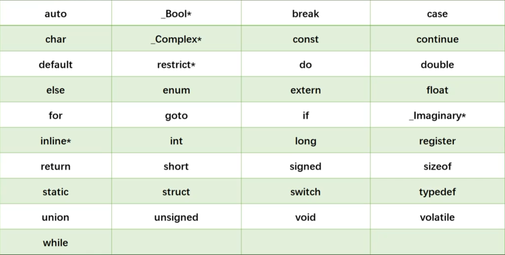

# C语言学习笔记 #1

> 发布于 2026-09-24 14:05:00

```
//这是主函数
int main()  //main:表示一个主函数
{
    //主函数返回值
    return 0; 
}
```

return 表示函数的返回值

```
返回值类型 函数名 (输入参数值)
{
    做点什么事情
    return 函数返回值;
}
```

### 函数定义

```
int add(int a,int b)
{
    return a + b;
}
```

### 主函数

1.所有的C语言代码都有起始入口，这个入口就是主函数main

2.进入主函数后，才能由主函数调用其他函数

3.每个c语言代码，有且只能有一个主函数

```
#include <stdio.h>
int add(int a,int b)
{
return a+b;
}
int main()
[
    int result;
    result = add(2,3);
    printf("%d",result);
    return 0;
]
```

#### 编译器会从上往下阅读，先读到了add函数，知道了add函数是什么意思，再向下阅读到主函数，开始执行，读到result = add(2,3)时，调用add函数

#### 如果将add函数和main函数反过来，编译器读main时将不知道add是什么，就会报错

//

#### 1.主函数被自动调用

#### 2.返回值给调用的程序

#### 3.主函数返回值必须为int

### 变量

#### 变量必须先声明再使用

### 标识符

#### 标识符是由我们自己命名的一个特殊标识 （变量，函数，其他实体）

#### 标识符必须进行声明或定义

### 命名规则（标识符）

#### 1.标识符可以用小写字母大写字母数字下划线命名

#### 2.标识符的第一个字符必须是字母或下划线，不能是数字

#### 3.标识符是区大小写的

### 关键词

#### C语言标准规定的

#### 有特殊的意义和用途

#### 不能作为标识符使用



### 常量

（不需要被声明）

1，2，3，"hello world"等

### printf()

#### printf是系统自带的函数

printf由print（打印）和format（格式）组成

printf除了传入字符串，还可以通过占位符打印

```
int main()
{
    int result;
    result = add(2,3);
    printf("%d",result);  //运行时会使用result来对应%d的位置
    return 0;
}
```

### printf("占位1 占位2 占位3",替换1,替换2,替换3);

##### printf("A=%d B=%d",123,456)

### #include <stdio.h>

用来引用头文件的

stdio.h文件声明了printf
