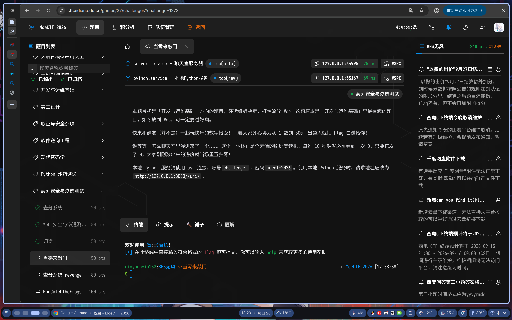
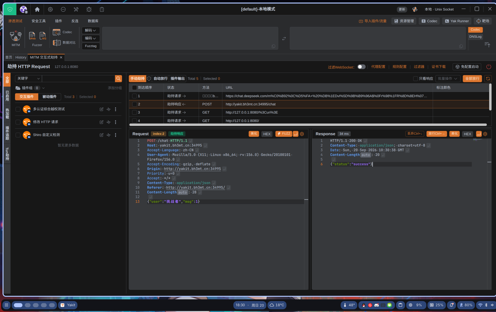
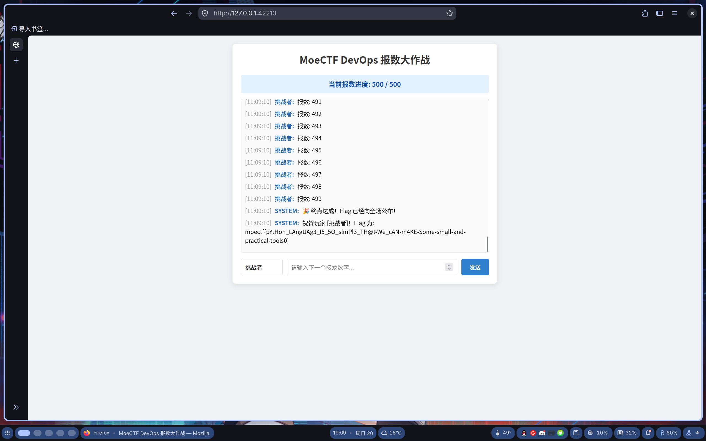

# 西电CTF 2026 当零来敲门

> 发布于 2026-09-20 11:12:01

### 题目



###### （注意，为了让yakit能抓到我本地的包，我将使用yakit.bh3mt.cn代替127.0.0.1）

尝试抓取发送1的包，知道发包的格式



```
POST /chat HTTP/1.1
Host: yakit.bh3mt.cn:34995
Accept-Language: zh-CN
User-Agent: Mozilla/5.0 (X11; Linux x86_64; rv:156.0) Gecko/20100101 Firefox/156.0
Accept-Encoding: gzip, deflate
Origin: http://yakit.bh3mt.cn:34995
Priority: u=0
Accept: */*
Content-Type: application/json
Referer: http://yakit.bh3mt.cn:34995/
Content-Length: 28

{"user":"挑战者","msg":1}
```

ssh连接环境

```
ssh challenger@127.0.0.1 -p 35167
```

使用python循环发包

```
import requests

url = "http://127.0.0.1:8080/chat"

headers = {"Content-Type": "application/json", "User-Agent": "Mozilla/5.0"}

session = requests.Session()

session.trust_env = False

for i in range(1, 501):

    try:

        resp = session.post(url, json={"user": "挑战者", "msg": i}, headers=headers, timeout=10)

        print(f"[{i}] {resp.status_code} {resp.text[:200]}")

    except Exception as e:

        print(f"[{i}] 失败: {e}")
```

注意交互式环境要**逐行输入**，`for` 循环体按 `...` 续行，最后空一行回车执行。

### 完成，得到flag



# 进阶：使用自动化脚本自动ssh+执行python（以下代码使用了AI）

安装paramiko包

```
pip install paramiko
```

```
import paramiko

SSH_HOST = "127.0.0.1"
SSH_PORT = 42701
SSH_USER = "challenger"
SSH_PASS = "moectf2026"

REMOTE_CODE = r'''
import requests, time

url = "http://127.0.0.1:8080/chat"
headers = {"Content-Type": "application/json", "User-Agent": "Mozilla/5.0"}

s = requests.Session()
s.trust_env = False

start = time.time()
last = ""
for i in range(1, 501):
    try:
        r = s.post(url, json={"user": "挑战者", "msg": i},
                   headers=headers, timeout=10)
        last = r.text
        # 命中 flag 立即打印
        if "flag" in r.text.lower() or "moectf" in r.text.lower():
            print(f"[!!!] i={i} 命中: {r.text}")
    except Exception as e:
        print(f"[{i}] ERR: {e}")

print("耗时:", round(time.time() - start, 2), "秒")
print("最后返回:", last[:500])
'''

client = paramiko.SSHClient()
client.set_missing_host_key_policy(paramiko.AutoAddPolicy())
client.connect(SSH_HOST, port=SSH_PORT, username=SSH_USER,
               password=SSH_PASS, timeout=15)
print("[+] SSH 连接成功")

stdin, stdout, stderr = client.exec_command(REMOTE_CODE)
print(stdout.read().decode(errors="ignore"))
err = stderr.read().decode(errors="ignore")
if err:
    print("[stderr]", err)

client.close()
```

```
运行得到
[qinyuanxin132@archlinux0qin Documents]$ /home/qinyuanxin132/Documents/.venv/bin/python /home/qinyuanxin132/Documents/stady/py/2.py
[+] SSH 连接成功
耗时: 1.41 秒
最后返回: {"status":"win"}
```

```
成功拿到flag
 [11:09:10] SYSTEM: 🎉 终点达成！Flag 已经向全场公布！
[11:09:10] SYSTEM: 祝贺玩家 [挑战者]！Flag 为: moectf{pYtHon_LAngUAg3_I5_5O_slmPl3_TH@t-We_cAN-m4KE-Some-small-and-practical-tools0} 
```
