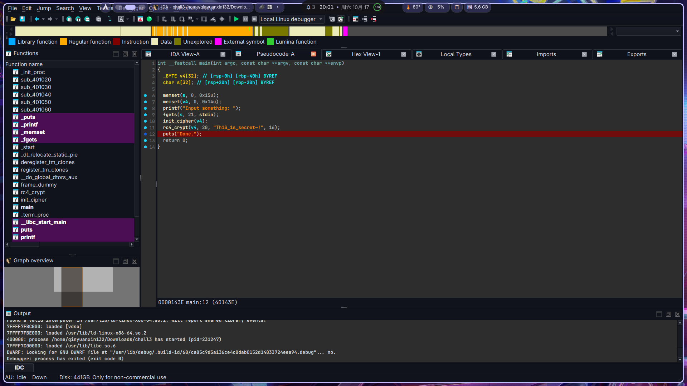

# 西电CTF 2026 反方向的 RC4 wp

> 发布于 2026-10-17 12:06:44

这个题是Linux系统的可执行文件

打开IDA

```
int __fastcall main(int argc, const char **argv, const char **envp)
{
  _BYTE v4[32]; // [rsp+0h] [rbp-40h] BYREF
  char s[32]; // [rsp+20h] [rbp-20h] BYREF

  memset(s, 0, 0x15u);
  memset(v4, 0, 0x14u);
  printf("Input something: ");
  fgets(s, 21, stdin);
  init_cipher(v4);
  rc4_crypt(v4, 20, "Th1S_1s_secret~!", 16);
  puts("Done.");
  return 0;
}
```

大概是让我们找v4的值

init_cipher(v4);

rc4_crypt(v4, 20, "Th1S_1s_secret~!", 16);
我们尝试打断点，获取解密好的v4值

在arch linux上装好ida



F9运行

查看v4

```
[stack]:00007FFFFFFFE2E0 db  6Dh ; m
[stack]:00007FFFFFFFE2E1 db  6Fh ; o
[stack]:00007FFFFFFFE2E2 db  65h ; e
[stack]:00007FFFFFFFE2E3 db  63h ; c
[stack]:00007FFFFFFFE2E4 db  74h ; t
[stack]:00007FFFFFFFE2E5 db  66h ; f
[stack]:00007FFFFFFFE2E6 db  7Bh ; {
[stack]:00007FFFFFFFE2E7 db  4Fh ; O
[stack]:00007FFFFFFFE2E8 db  48h ; H
[stack]:00007FFFFFFFE2E9 db  7Eh ; ~
[stack]:00007FFFFFFFE2EA db  44h ; D
[stack]:00007FFFFFFFE2EB db  79h ; y
[stack]:00007FFFFFFFE2EC db  6Eh ; n
[stack]:00007FFFFFFFE2ED db  34h ; 4
[stack]:00007FFFFFFFE2EE db  6Dh ; m
[stack]:00007FFFFFFFE2EF db  69h ; i
[stack]:00007FFFFFFFE2F0 db  63h ; c
[stack]:00007FFFFFFFE2F1 db  21h ; !
[stack]:00007FFFFFFFE2F2 db  7Dh ; }
```

moectf{OH~Dyn4mic!}
