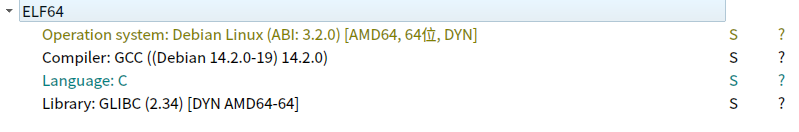
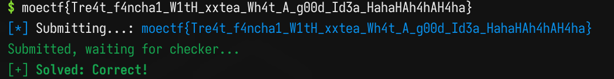

# 西电CTF 2026 请 fanchai 喝茶

> 发布于 2026-11-10 18:07:49

[附件](../fujian/chall7)

die:



直接IDA打开

```c
__int64 __fastcall main(int a1, char **a2, char **a3)
{
  char *v3; // rsi
  __m128i *v4; // rdi
  __int64 v5; // rcx
  unsigned int v6; // edx
  unsigned __int32 v7; // esi
  unsigned __int32 v8; // ebp
  unsigned __int32 v9; // ebx
  unsigned __int32 v10; // r11d
  unsigned __int32 v11; // r10d
  unsigned __int32 v12; // r9d
  unsigned __int32 v13; // r8d
  unsigned __int32 v14; // edi
  __m128i v15; // xmm0
  __m128i v16; // xmm0
  unsigned __int32 v18; // [rsp+0h] [rbp-E8h]
  unsigned __int32 v19; // [rsp+4h] [rbp-E4h]
  unsigned __int32 v20; // [rsp+8h] [rbp-E0h]
  unsigned __int32 v21; // [rsp+Ch] [rbp-DCh]
  unsigned __int32 v22; // [rsp+10h] [rbp-D8h]
  unsigned __int32 v23; // [rsp+14h] [rbp-D4h]
  unsigned __int32 v24; // [rsp+18h] [rbp-D0h]
  unsigned __int32 v25; // [rsp+1Ch] [rbp-CCh]
  __m128i v26; // [rsp+20h] [rbp-C8h] BYREF
  __m128i v27; // [rsp+30h] [rbp-B8h]
  __m128i v28; // [rsp+40h] [rbp-A8h]
  __m128i v29; // [rsp+50h] [rbp-98h]
  char s[136]; // [rsp+60h] [rbp-88h] BYREF

  fwrite("Input flag: ", 1u, 0xCu, stdout);
  fflush(s$@tdout);
  if ( !fgets(s, 66, stdin) )
    goto LABEL_9;
  s[strcspn(s, "\r\n")] = 0;
  if ( strlen(s) != 64 )
    goto LABEL_9;
  v3 = s;
  v4 = &v26;
  v5 = 16;
  v6 = 0;
  while ( v5 )
  {
    v4->m128i_i32[0] = *(_DWORD *)v3;
    v3 += 4;
    v4 = (__m128i *)((char *)v4 + 4);
    --v5;
  }
  v7 = v29.m128i_u32[3];
  v8 = v28.m128i_i32[0];
  v9 = v28.m128i_u32[1];
  v10 = v28.m128i_u32[2];
  v11 = v28.m128i_u32[3];
  v25 = v26.m128i_i32[0];
  v12 = v29.m128i_i32[0];
  v13 = v29.m128i_u32[1];
  v14 = v29.m128i_u32[2];
  v20 = v26.m128i_u32[2];
  v24 = v26.m128i_u32[1];
  v19 = v26.m128i_u32[3];
  v23 = v27.m128i_u32[1];
  v18 = v27.m128i_i32[0];
  v21 = v27.m128i_u32[3];
  v22 = v27.m128i_u32[2];
  do
  {
    v6 += 1597463007;
    v25 += ((v6 ^ v24) + (v7 ^ dword_2020[(v6 >> 2) & 3])) ^ (((4 * v24) ^ (v7 >> 5)) + ((16 * v7) ^ (v24 >> 3)));
    v24 += (((16 * v25) ^ (v20 >> 3)) + ((4 * v20) ^ (v25 >> 5)))
         ^ ((v6 ^ v20) + (v25 ^ dword_2020[((unsigned __int8)(v6 >> 2) ^ 1) & 3]));
    v20 += (((16 * v24) ^ (v19 >> 3)) + ((4 * v19) ^ (v24 >> 5)))
         ^ ((v6 ^ v19) + (v24 ^ dword_2020[((unsigned __int8)(v6 >> 2) ^ 2) & 3]));
    v19 += (((16 * v20) ^ (v18 >> 3)) + ((4 * v18) ^ (v20 >> 5)))
         ^ ((v6 ^ v18) + (v20 ^ dword_2020[~(unsigned __int8)(v6 >> 2) & 3]));
    v18 += (((16 * v19) ^ (v23 >> 3)) + ((4 * v23) ^ (v19 >> 5))) ^ ((v6 ^ v23) + (v19 ^ dword_2020[(v6 >> 2) & 3]));
    v23 += (((16 * v18) ^ (v22 >> 3)) + ((4 * v22) ^ (v18 >> 5)))
         ^ ((v6 ^ v22) + (v18 ^ dword_2020[((unsigned __int8)(v6 >> 2) ^ 5) & 3]));
    v22 += (((16 * v23) ^ (v21 >> 3)) + ((4 * v21) ^ (v23 >> 5)))
         ^ ((v6 ^ v21) + (v23 ^ dword_2020[((unsigned __int8)(v6 >> 2) ^ 6) & 3]));
    v21 += (((16 * v22) ^ (v8 >> 3)) + ((4 * v8) ^ (v22 >> 5)))
         ^ ((v8 ^ v6) + (v22 ^ dword_2020[((unsigned __int8)(v6 >> 2) ^ 7) & 3]));
    v8 += (((16 * v21) ^ (v9 >> 3)) + ((4 * v9) ^ (v21 >> 5))) ^ ((v9 ^ v6) + (v21 ^ dword_2020[(v6 >> 2) & 3]));
    v9 += (((16 * v8) ^ (v10 >> 3)) + ((4 * v10) ^ (v8 >> 5)))
        ^ ((v10 ^ v6) + (v8 ^ dword_2020[((unsigned __int8)(v6 >> 2) ^ 9) & 3]));
    v10 += (((16 * v9) ^ (v11 >> 3)) + ((4 * v11) ^ (v9 >> 5)))
         ^ ((v11 ^ v6) + (v9 ^ dword_2020[((unsigned __int8)(v6 >> 2) ^ 0xA) & 3]));
    v11 += (((16 * v10) ^ (v12 >> 3)) + ((4 * v12) ^ (v10 >> 5)))
         ^ ((v12 ^ v6) + (v10 ^ dword_2020[((unsigned __int8)(v6 >> 2) ^ 0xB) & 3]));
    v12 += (((16 * v11) ^ (v13 >> 3)) + ((4 * v13) ^ (v11 >> 5))) ^ ((v13 ^ v6) + (v11 ^ dword_2020[(v6 >> 2) & 3]));
    v13 += (((v12 >> 5) ^ (4 * v14)) + ((v14 >> 3) ^ (16 * v12)))
         ^ ((v14 ^ v6) + (v12 ^ dword_2020[((unsigned __int8)(v6 >> 2) ^ 0xD) & 3]));
    v14 += (((v13 >> 5) ^ (4 * v7)) + ((v7 >> 3) ^ (16 * v13)))
         ^ ((v7 ^ v6) + (v13 ^ dword_2020[((unsigned __int8)(v6 >> 2) ^ 0xE) & 3]));
    v7 += (((16 * v14) ^ (v25 >> 3)) + ((4 * v25) ^ (v14 >> 5)))
        ^ ((v6 ^ v25) + (v14 ^ dword_2020[((unsigned __int8)(v6 >> 2) ^ 0xF) & 3]));
  }
  while ( v6 != 1492265175 );
  v28.m128i_i64[0] = __PAIR64__(v9, v8);
  v26.m128i_i64[0] = __PAIR64__(v24, v25);
  v28.m128i_i64[1] = __PAIR64__(v11, v10);
  v26.m128i_i64[1] = __PAIR64__(v19, v20);
  v29.m128i_i64[0] = __PAIR64__(v13, v12);
  v27.m128i_i64[0] = __PAIR64__(v23, v18);
  v29.m128i_i64[1] = __PAIR64__(v7, v14);
  v27.m128i_i64[1] = __PAIR64__(v21, v22);
  v15 = _mm_or_si128(
          _mm_or_si128(
            _mm_xor_si128(_mm_load_si128((const __m128i *)&xmmword_2030), v27),
            _mm_xor_si128(_mm_load_si128((const __m128i *)&xmmword_2040), v26)),
          _mm_or_si128(
            _mm_xor_si128(_mm_load_si128((const __m128i *)&xmmword_2050), v29),
            _mm_xor_si128(_mm_load_si128((const __m128i *)&xmmword_2060), v28)));
  v16 = _mm_or_si128(v15, _mm_srli_si128(v15, 8));
  if ( !_mm_cvtsi128_si32(_mm_or_si128(v16, _mm_srli_si128(v16, 4))) )
  {
    puts("Correct!");
    return 0;
  }
  else
  {
LABEL_9:
    puts("Wrong.");
    return 1;
  }
}
```

好长的解密，好在看似不难

先尝试简单理解

```
  fwrite("Input flag: ", 1u, 0xCu, stdout);
  fflush(stdout);
```

这段话是用来打印`Input flag`的

```
  s[strcspn(s, "\r\n")] = 0;
```

这是读取某文件的文本数据，猜测这是让还原的flag

数据给到了s

`s[strcspn(s, "\r\n")] = 0;` 

这是把\r\n排除在外

```
  if ( strlen(s) != 64 )
    goto LABEL_9;
```

s的长度是64

```
  v3 = s;
  v4 = &v26;
  v5 = 16;
  v6 = 0;
```

来看循环

```
  while ( v5 )
  {
    v4->m128i_i32[0] = *(_DWORD *)v3;
    v3 += 4;
    v4 = (__m128i *)((char *)v4 + 4);
    --v5;
  }
```

v4是指向m128i_i32[0]的指针

AI：`__m128i 是 Intel SIMD 使用的 128 位数据类型，可以把它理解成一个能容纳 4 个 32 位整数的容器`

`*(_DWORD *)v3`的意思是把v3强制转换为DWORD（4字节）然后取地址的值

这样一个指针的步进正好是4字节

v3 += 4 指走4个步进

`v4 = (__m128i *)((char *)v4 + 4);`

同样，v4步进是1，+4是走四个字节

这样64个字节的数据循环中一次读4个写4个，一共循环16次，正好与v5 = 16对应 `--15`

**循环作用**：把原本的64字节数据变成了16个32位整数

`v4 = &v26;`这是v4的起始地址

观察他们在栈上的位置

```
  __m128i v26; // [rsp+20h] [rbp-C8h] BYREF
  __m128i v27; // [rsp+30h] [rbp-B8h]
  __m128i v28; // [rsp+40h] [rbp-A8h]
  __m128i v29; // [rsp+50h] [rbp-98h]
```

重新整理成原始输入顺序

```c
0	v26[0]	v25
1	v26[1]	v24
2	v26[2]	v20
3	v26[3]	v19
4	v27[0]	v18
5	v27[1]	v23
6	v27[2]	v22
7	v27[3]	v21
8	v28[0]	v8
9	v28[1]	v9
10	v28[2]	v10
11	v28[3]	v11
12	v29[0]	v12
13	v29[1]	v13
14	v29[2]	v14
15	v29[3]	v7
```

准备写解密脚本

```c
.rodata:0000000000002030 xmmword_2030    xmmword 8D9F4D2760AA5AF399F3CEE58EEA087Ch
.rodata:0000000000002030                                         ; DATA XREF: main+5DC↑r
.rodata:0000000000002040 xmmword_2040    xmmword 0C4D0A55837778398646BE35884EBDFDDh
.rodata:0000000000002040                                         ; DATA XREF: main+5E8↑r
.rodata:0000000000002050 xmmword_2050    xmmword 8608800C4E5EAE9C3FEE9E5824AD1E8h
.rodata:0000000000002050                                         ; DATA XREF: main+669↑r
.rodata:0000000000002060 xmmword_2060    xmmword 229B995445F537C35977949789F425F4h
```
注意小端序！如果这是 IDA 显示的 128 位整数值，那么转换成内存字节顺序是：

```python
b2030 = [
    0x7C, 0x08, 0xEA, 0x8E,
    0xE5, 0xCE, 0xF3, 0x99,
    0xF3, 0x5A, 0xAA, 0x60,
    0x27, 0x4D, 0x9F, 0x8D
]

b2040 = [
    0xDD, 0xDF, 0xEB, 0x84,
    0x58, 0xE3, 0x6B, 0x64,
    0x98, 0x83, 0x77, 0x37,
    0x58, 0xA5, 0xD0, 0xC4
]

b2050 = [
    0xE8, 0xD1, 0x4A, 0x82,
    0xE5, 0xE9, 0xFE, 0xC3,
    0xE9, 0xEA, 0xE5, 0xC4,
    0x00, 0x88, 0x60, 0x08
]

b2060 = [
    0xF4, 0x25, 0xF4, 0x89,
    0x97, 0x94, 0x77, 0x59,
    0xC3, 0x37, 0xF5, 0x45,
    0x54, 0x99, 0x9B, 0x22
]
```
写解密脚本
```python
b2030 = [
    0x7C, 0x08, 0xEA, 0x8E,
    0xE5, 0xCE, 0xF3, 0x99,
    0xF3, 0x5A, 0xAA, 0x60,
    0x27, 0x4D, 0x9F, 0x8D
]#对应v27

b2040 = [
    0xDD, 0xDF, 0xEB, 0x84,
    0x58, 0xE3, 0x6B, 0x64,
    0x98, 0x83, 0x77, 0x37,
    0x58, 0xA5, 0xD0, 0xC4
]#对应v26

b2050 = [
    0xE8, 0xD1, 0x4A, 0x82,
    0xE5, 0xE9, 0xFE, 0xC3,
    0xE9, 0xEA, 0xE5, 0xC4,
    0x00, 0x88, 0x60, 0x08
]#对应v29

b2060 = [
    0xF4, 0x25, 0xF4, 0x89,
    0x97, 0x94, 0x77, 0x59,
    0xC3, 0x37, 0xF5, 0x45,
    0x54, 0x99, 0x9B, 0x22
]#对应v28
v7  = 0x08608800
v8  = 0x89F425F4
v9  = 0x59779497
v10 = 0x45F537C3
v11 = 0x229B9954

v25 = 0x84EBDFDD
v12 = 0x824AD1E8
v13 = 0xC3FEE9E5
v14 = 0xC4E5EAE9

v20 = 0x37778398
v24 = 0x646BE358
v19 = 0xC4D0A558

v23 = 0x99F3CEE5
v18 = 0x8EEA087C
v21 = 0x8D9F4D27
v22 = 0x60AA5AF3
#.rodata:0000000000002020 dword_2020      dd 4D4F4543h, 54463230h, 32365858h, 54454121h
dword_2020 = [0x4D4F4543, 0x54463230,0x32365858,0x54454121]
v6 = 1492265175
count = 0
while v6 != 0:
    v7  = (v7 -  ((((16 * v14) ^ (v25 >> 3)) + ((4 * v25) ^ (v14 >> 5)))  ^ ((v6 ^ v25) + (v14 ^ dword_2020[(((v6 >> 2)&0xff) ^ 0xF) & 3])))) & 0xffffffff
    
    v14 = (v14 - ((((v13 >> 5) ^ (4 * v7))   + ((v7 >> 3) ^ (16 * v13)))  ^ ((v7 ^ v6)  + (v13 ^ dword_2020[(((v6 >> 2)&0xff) ^ 0xE) & 3]))))& 0xffffffff
    
    v13 = (v13 - ((((v12 >> 5) ^ (4 * v14))  + ((v14 >> 3) ^ (16 * v12))) ^ ((v14 ^ v6) + (v12 ^ dword_2020[(((v6 >> 2)&0xff) ^ 0xD) & 3])))) & 0xffffffff
    
    v12 = (v12 - ((((16 * v11) ^ (v13 >> 3)) + ((4 * v13) ^ (v11 >> 5))) ^ ((v6 ^ v13) + (v11 ^ dword_2020[(v6 >> 2) & 3])))) & 0xffffffff

    v11 = (v11 - ((((16 * v10) ^ (v12 >> 3)) + ((4 * v12) ^ (v10 >> 5))) ^ ((v6 ^ v12) + (v10 ^ dword_2020[(((v6 >> 2) & 0xff) ^ 0xB) & 3])))) & 0xffffffff

    v10 = (v10 - ((((16 * v9) ^ (v11 >> 3)) + ((4 * v11) ^ (v9 >> 5))) ^ ((v6 ^ v11) + (v9 ^ dword_2020[(((v6 >> 2) & 0xff) ^ 0xA) & 3])))) & 0xffffffff

    v9 = (v9 - ((((16 * v8) ^ (v10 >> 3)) + ((4 * v10) ^ (v8 >> 5))) ^ ((v6 ^ v10) + (v8 ^ dword_2020[(((v6 >> 2) & 0xff) ^ 9) & 3])))) & 0xffffffff

    v8 = (v8 - ((((16 * v21) ^ (v9 >> 3)) + ((4 * v9) ^ (v21 >> 5))) ^ ((v6 ^ v9) + (v21 ^ dword_2020[(v6 >> 2) & 3])))) & 0xffffffff

    v21 = (v21 - ((((16 * v22) ^ (v8 >> 3)) + ((4 * v8) ^ (v22 >> 5))) ^ ((v6 ^ v8) + (v22 ^ dword_2020[(((v6 >> 2) & 0xff) ^ 7) & 3])))) & 0xffffffff

    v22 = (v22 - ((((16 * v23) ^ (v21 >> 3)) + ((4 * v21) ^ (v23 >> 5))) ^ ((v6 ^ v21) + (v23 ^ dword_2020[(((v6 >> 2) & 0xff) ^ 6) & 3])))) & 0xffffffff

    v23 = (v23 - ((((16 * v18) ^ (v22 >> 3)) + ((4 * v22) ^ (v18 >> 5))) ^ ((v6 ^ v22) + (v18 ^ dword_2020[(((v6 >> 2) & 0xff) ^ 5) & 3])))) & 0xffffffff

    v18 = (v18 - ((((16 * v19) ^ (v23 >> 3)) + ((4 * v23) ^ (v19 >> 5))) ^ ((v6 ^ v23) + (v19 ^ dword_2020[(v6 >> 2) & 3])))) & 0xffffffff

    v19 = (v19 - ((((16 * v20) ^ (v18 >> 3)) + ((4 * v18) ^ (v20 >> 5))) ^ ((v6 ^ v18) + (v20 ^ dword_2020[(~((v6 >> 2) & 0xff)) & 3])))) & 0xffffffff

    v20 = (v20 - ((((16 * v24) ^ (v19 >> 3)) + ((4 * v19) ^ (v24 >> 5))) ^ ((v6 ^ v19) + (v24 ^ dword_2020[(((v6 >> 2) & 0xff) ^ 2) & 3])))) & 0xffffffff

    v24 = (v24 - ((((16 * v25) ^ (v20 >> 3)) + ((4 * v20) ^ (v25 >> 5))) ^ ((v6 ^ v20) + (v25 ^ dword_2020[(((v6 >> 2) & 0xff) ^ 1) & 3])))) & 0xffffffff

    v25 = (v25 - (((v6 ^ v24) + (v7 ^ dword_2020[(v6 >> 2) & 3])) ^ (((4 * v24) ^ (v7 >> 5)) + ((16 * v7) ^ (v24 >> 3))))) & 0xffffffff

    v6 = (v6 - 1597463007) & 0xffffffff
    count += 1
    print(count, hex(v6), flush=True)

v26 = [0,0,0,0]
v27 = [0,0,0,0]
v28 = [0,0,0,0]
v29 = [0,0,0,0]

v29[3] = v7
v28[0] = v8
v28[1] = v9
v28[2] = v10
v28[3] = v11
v26[0] = v25
v29[0] = v12
v29[1] = v13
v29[2] = v14
v26[2] = v20
v26[1] = v24
v26[3] = v19
v27[1] = v23
v27[0] = v18
v27[3] = v21
v27[2] = v22

result1 = [[0] * 4 for _ in range(4)]
result2 = [[0] * 4 for _ in range(4)]
result3 = [[0] * 4 for _ in range(4)]
result4 = [[0] * 4 for _ in range(4)]


for i in range(4):
    x = v26[i]
    for shift in [0, 8, 16, 24]:
        a = shift // 8
        result1[i][a] = ((x >> shift) & 0xff)

for i in range(4):
    x = v27[i]
    for shift in [0, 8, 16, 24]:
        a = shift // 8
        result2[i][a] = ((x >> shift) & 0xff)

for i in range(4):
    x = v28[i]
    for shift in [0, 8, 16, 24]:
        a = shift // 8
        result3[i][a] = ((x >> shift) & 0xff)

for i in range(4):
    x = v29[i]
    for shift in [0, 8, 16, 24]:
        a = shift // 8
        result4[i][a] = ((x >> shift) & 0xff)
print(result1)
print(result2)
print(result3)
print(result4)
```
按照原始内存顺序 v26 → v27 → v28 → v29 拼接
moectf{Tre4t_f4ncha1_W1tH_xxtea_Wh4t_A_g00d_Id3a_HahaHAh4hAH4ha}

