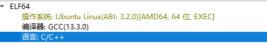

# 西电CTF 2026 逆向工程入门指北

> 发布于 2026-09-23 07:06:47

DIE

查文件类型、架构、编译器、加壳、熵值

dnSpy

.NET 程序反编译 + 调试，直接看 C# 源码

Ghidra

开源反汇编 + 反编译，多架构，IDA 替代品

IDA Pro / IDA Free

交互式反汇编，CTF 静态分析主力，F5 反编译

x64dbg

Windows 动态调试器，下断点、单步、看内存寄存器

```
先扔进 DIE
看它是什么：PE / ELF / .NET / 加壳 / 多少位。

如果是 .NET → 直接上 dnSpy

如果是 UPX 等壳 → 先脱壳，再进 IDA

如果是普通 Windows exe → IDA/Ghidra 静态 + x64dbg 动态
```

先将二进制文件拖入IDE



得到文件的信息

将文件拖入IDA
得到这个阶段看不懂的汇编语言

使用F5反编译
得到类C语言

```
int __fastcall main(int argc, const char **argv, const char **envp)
{
  char s[128]; // [rsp+0h] [rbp-C0h] BYREF
  char s2[64]; // [rsp+80h] [rbp-40h] BYREF

  strcpy(s2, "moectf{C0ngr4tuLati0N_On_find1n9_your_1st_RE_f1aggggg!!!}");
  printf("Input flag: ");
  if ( !fgets(s, 128, stdin) )
    return 1;
  s[strcspn(s, "\n")] = 0;
  if ( !strncmp(s, s2, 0x3Au) )
    puts("yes");
  else
    puts("no");
  return 0;
}
```

得到flag

看它是什么：PE / ELF / .NET / 加壳 / 多少位。

如果是 .NET → 直接上 dnSpy

如果是 UPX 等壳 → 先脱壳，再进 IDA

如果是普通 Windows exe → IDA/Ghidra 静态 + x64dbg 动态
