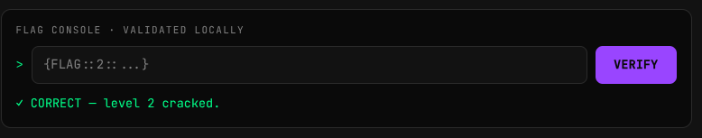

# Z3约束求解入门

> 发布于 2026-11-11 13:33:42

## 1.安装

为了不污染 Arch Linux 的系统 Python

我们在vscode的py虚拟环境下执行

```
python -m pip install z3-solver
```

我们创建一个python文件：[test_z3.py](../fujian/test_z3.py)

```
from z3 import *

a = BitVec('a', 8)
b = BitVec('b', 8)

s = Solver()
s.add(a + b == 100)
s.add(a == 40)

print(s.check())
print(s.model())
```

运行

```
sat
[a = 40, b = 60]
```  

**z3安装成功**  

## 2.基本操作

```python
from z3 import *

a = BitVec('a', 8)  #创建一个未知的八位整数
b = BitVec('b', 8)  

s = Solver()        #创建约束求解器

s.add(a + b == 100) #添加必须满足的条件
s.add(a == 40)      #添加必须满足的条件

print(s.check())    #检查有没有解
print(s.model())    #获取满足条件的一组结果
#特别注意，BitVec 是固定宽度位向量，8 位加法会按模 256 回绕。这在 Reverse 中非常有用
```

## 3.小尝试

```C
int check(unsigned char *s)
{
    if (strlen((char *)s) != 4)
        return 0;

    for (int i = 0; i < 4; i++)
        if (s[i] < 32 || s[i] > 126)
            return 0;

    if (s[0] + s[1] != 151)
        return 0;

    if (s[1] + 17 != s[2])
        return 0;

    if ((s[2] ^ s[3]) != 119)
        return 0;

    if (s[3] + 49 != s[0])
        return 0;

    return 1;
}
```
``` python
from z3 import *
a0 = BitVec('a0',8)
a1 = BitVec('a1',8)
a2 = BitVec('a2',8)
a3 = BitVec('a3',8)

s = Solver() 

s.add(a0 >= 32)
s.add(a0 <= 126)
s.add(a1 >= 32)
s.add(a1 <= 126)  
s.add(a2 >= 32)
s.add(a2 <= 126)  
s.add(a3 >= 32)
s.add(a3 <= 126) 
s.add(a0 + a1 == 151)
s.add(a1 + 17 == a2)
s.add(a2 ^ a3 == 119)
s.add(a3 + 49 == a0)

print(s.check())
print(s.model())
```

运行

```
sat
[a2 = 65, a1 = 48, a3 = 54, a0 = 103]
```

完美解出，你已经学会z3了

BitVec 创建未知量 → Solver 添加约束 → check() 判断可解性 → model()

## 4.进阶尝试

```c
int check(unsigned char *s)
{
    if (strlen((char *)s) != 4)
        return 0;

    for (int i = 0; i < 4; i++)
        if (s[i] < 32 || s[i] > 126)
            return 0;

    if (((s[0] << 1) ^ s[1]) != 135)
        return 0;

    if (s[1] + s[2] != 130)
        return 0;

    if ((s[2] ^ s[3]) != 4)
        return 0;

    if (s[0] + s[3] != 165)
        return 0;

    return 1;
}
```

```python
from z3 import *
a0 = BitVec('a0',8)
a1 = BitVec('a1',8)
a2 = BitVec('a2',8)
a3 = BitVec('a3',8)

s = Solver() 

s.add(a0 >= 32)
s.add(a0 <= 126)
s.add(a1 >= 32)
s.add(a1 <= 126)  
s.add(a2 >= 32)
s.add(a2 <= 126)  
s.add(a3 >= 32)
s.add(a3 <= 126) 
s.add((a0 << 1)^a1 == 135)
s.add(a1 + a2 == 130)
s.add(a2 ^ a3 == 4)
s.add(a0 + a3 == 165)

print(s.check())
print(s.model())

m = s.model()
print(''.join(chr(m.eval(a).as_long()) for a in [a0, a1, a2, a3]))
```

## 注意左移和右移

三种移位的区别：

操作|二进制结果|十进制
---|---|---
a << 1|00101100|44
LShR(a, 1)|01001011|75
a >> 1|11001011|203（按无符号解释）

做 CTF Reverse 时：

```
uint32_t x;
x = x >> 1;
```

对应：
```
x = LShR(x, 1)
```

而：

```
uint32_t x;
x = x << 1;
```

对应：
```
x = x << 1
```

## 再进阶

### 先学一个新知识：Concat

```
uint32_t x = s[0]
           | (s[1] << 8)
           | (s[2] << 16)
           | (s[3] << 24);
```

它的意思是：把四个字节按照小端序拼成一个 32 位整数

z3:

```python
from z3 import *

a0 = BitVec('a0', 8)
a1 = BitVec('a1', 8)
a2 = BitVec('a2', 8)
a3 = BitVec('a3', 8)

x = Concat(a3, a2, a1, a0)
```

注意：Concat 从高位到低位排列，所以小端字节序需要写成 a3, a2, a1, a0\

### 进阶题

```c
#include <stdint.h>

int check(const unsigned char *s)
{
    for (int i = 0; i < 4; i++)
        if (s[i] < 32 || s[i] > 126)
            return 0;

    uint32_t x =
          (uint32_t)s[0]
        | ((uint32_t)s[1] << 8)
        | ((uint32_t)s[2] << 16)
        | ((uint32_t)s[3] << 24);

    uint32_t y = (x + 0x6D2B79F5U) ^ (x >> 7);

    uint32_t z = (x ^ 0xA5A5F00DU) + (x << 3);

    if (y != 0x8EE34101U)
        return 0;

    if (z != 0x90855F0FU)
        return 0;

    return 1;
}
```

尝试写python脚本

```python
from z3 import *
a0 = BitVec('a0',8)
a1 = BitVec('a1',8)
a2 = BitVec('a2',8)
a3 = BitVec('a3',8)

x = Concat(a3, a2, a1, a0)
y = 0x8EE34101
z = 0x90855F0F

s = Solver() 

s.add(y == (x + 0x6D2B79F5) ^ (LShR(x, 7)))
s.add(z == (x ^ 0xA5A5F00D) + (x << 3))

print(s.check())

m = s.model()
print(''.join(chr(m.eval(a).as_long()) for a in [a0, a1, a2, a3]))
```

## 实战测试

进入 Crackme Lab，下载挑战包

https://www.hacktivists.in/ctf.html?utm_source=chatgpt.com

> 我们选择 Level 02：license_check

IDA打开
```c
__int64 __fastcall main(__int64 a1, char **a2, char **a3)
{
  _BOOL4 v3; // esi
  char *v4; // rax
  int v5; // edx
  char *v6; // rax
  char v7; // dl
  unsigned __int64 *v8; // rax
  __int64 v9; // rdx
  __int64 v10; // rcx
  __int64 v11; // r8
  __int64 v12; // r9
  unsigned __int64 v14; // [rsp+0h] [rbp-A8h] BYREF
  _BYTE v15[24]; // [rsp+8h] [rbp-A0h] BYREF
  char dest[16]; // [rsp+20h] [rbp-88h] BYREF
  _BYTE v17[88]; // [rsp+30h] [rbp-78h] BYREF
  unsigned __int64 v18; // [rsp+88h] [rbp-20h]

  v18 = __readfsqword(0x28u);
  sub_1229(a1, a2, a3);
  if ( (int)a1 <= 1 )
  {
    __printf_chk(2, "Enter License Key: ");
    if ( !fgets(dest, 100, stdin) )
      return 1;
    dest[strcspn(dest, "\n")] = 0;
  }
  else
  {
    strncpy(dest, a2[1], 0x63u);
    v17[83] = 0;
  }
  puts("checking license key...");
  v3 = 0;
  if ( strlen(dest) == 16 )
  {
    v4 = dest;
    v5 = 0;
    do
      v5 += (unsigned __int8)*v4++;
    while ( v4 != v17 );
    v3 = v5 == 1600;
  }
  if ( dest[0] != 75 )
    goto LABEL_18;
  v6 = dest;
  v7 = 0;
  do
    v7 ^= *v6++;
  while ( v6 != v17 );
  if ( v3 && v7 == 66 )
  {
    puts("\n[+] LICENSE VALID! Welcome to the premium version.");
    v14 = 0x959D9DE0E6EBE1DCLL;
    *(_QWORD *)v15 = 0xF8CFC4D3E7F79D9DLL;
    *(_QWORD *)&v15[7] = 0xFEF8C1EEF894EAF8LL;
    *(_QWORD *)&v15[15] = 0xDAC9E7E4F8D297LL;
    v8 = &v14;
    do
    {
      *(_BYTE *)v8 ^= 0xA7u;
      v8 = (unsigned __int64 *)((char *)v8 + 1);
    }
    while ( v8 != (unsigned __int64 *)&v15[22] );
    __printf_chk(2, "    %s\n", (const char *)&v14);
  }
  else
  {
LABEL_18:
    puts("\n[-] INVALID LICENSE. Please purchase a key.");
  }
  __printf_chk(2, "\nPress Enter to exit...", v9, v10, v11, v12, v14, *(_QWORD *)v15, *(_OWORD *)&v15[8]);
  getc(stdin);
  return 0;
}
```
分析：

`if ( strlen(dest) == 16 )`

说明是16位

```
  {
    d = dest;
    v5 = 0;
    do
      v5 += (unsigned __int8)*d++;
    while ( d != v17 );
    v3 = v5 == 1600;
  }
```

和为1600

```
 v6 = dest;
  v7 = 0;
  do
    v7 ^= *v6++;
  while ( v6 != v17 );
  if ( v3 && v7 == 66 )
```

异或议论后 == 66

`if ( dest[0] != 75 )`

dest[0]是75


尝试写python解密脚本

```python
from z3 import *
a0 = BitVec('a0',8)
a1 = BitVec('a1',8)
a2 = BitVec('a2',8)
a3 = BitVec('a3',8)
a4 = BitVec('a4',8)
a5 = BitVec('a5',8)
a6 = BitVec('a6',8)
a7 = BitVec('a7',8)
a8 = BitVec('a8',8)
a9 = BitVec('a9',8)
a10 = BitVec('a10',8)
a11 = BitVec('a11',8)
a12 = BitVec('a12',8)
a13 = BitVec('a13',8)
a14 = BitVec('a14',8)
a15 = BitVec('a15',8)
s = Solver() 

s.add(a0+a1+a2+a3+a4+a5+a6+a7+a8+a9+a10+a11+a12+a13+a14+a15 == 1600)
s.add(a0^a1^a2^a3^a4^a5^a6^a7^a8^a9^a10^a11^a12^a13^a14^a15 == 66)
s.add(a0 == 75)


print(s.check())
print(s.model())
```

输出：
```
sat
[a3 = 0,
 a4 = 0,
 a11 = 0,
 a15 = 0,
 a9 = 0,
 a2 = 0,
 a12 = 0,
 a14 = 0,
 a8 = 0,
 a7 = 0,
 a6 = 0,
 a10 = 190,
 a5 = 242,
 a13 = 0,
 a1 = 69,
 a0 = 75]
```

错误1：

创建的每个变量都是 8 位 BitVec，所以它们相加的结果仍然是 8 位。

8 位整数最大只能表示 255。

正确处理方式：BV2Int

Z3 提供了一个转换函数：

`BV2Int(a, is_signed=False)`

它可以把 8 位 BitVec 转换成普通整数。

总和约束应该改成：

```
s.add(
    Sum([BV2Int(a, is_signed=False) for a in [
        a0,a1,a2,a3,a4,a5,a6,a7,
        a8,a9,a10,a11,a12,a13,a14,a15
    ]]) == 1600
)
```

错误2:strlen 的约束

`strlen(dest) == 16`

这意味着前 16 个字节都不能是 0。

需要增加

```
for a in [a0,a1,a2,a3,a4,a5,a6,a7,
          a8,a9,a10,a11,a12,a13,a14,a15]:
    s.add(a != 0)
```

改之后python解密脚本

```py
from z3 import *
a0 = BitVec('a0',8)
a1 = BitVec('a1',8)
a2 = BitVec('a2',8)
a3 = BitVec('a3',8)
a4 = BitVec('a4',8)
a5 = BitVec('a5',8)
a6 = BitVec('a6',8)
a7 = BitVec('a7',8)
a8 = BitVec('a8',8)
a9 = BitVec('a9',8)
a10 = BitVec('a10',8)
a11 = BitVec('a11',8)
a12 = BitVec('a12',8)
a13 = BitVec('a13',8)
a14 = BitVec('a14',8)
a15 = BitVec('a15',8)
s = Solver() 

for a in [a0,a1,a2,a3,a4,a5,a6,a7,
          a8,a9,a10,a11,a12,a13,a14,a15]:
    s.add(a != 0)

for a in [a0,a1,a2,a3,a4,a5,a6,a7,
          a8,a9,a10,a11,a12,a13,a14,a15]:
    s.add(UGE(a, 32))
    s.add(ULE(a, 126))
s.add(
    Sum([BV2Int(a, is_signed=False) for a in [
        a0,a1,a2,a3,a4,a5,a6,a7,
        a8,a9,a10,a11,a12,a13,a14,a15
    ]]) == 1600
)
s.add(a0^a1^a2^a3^a4^a5^a6^a7^a8^a9^a10^a11^a12^a13^a14^a15 == 66)
s.add(a0 == 75)
print(s.check())
print(s.model())
```

输出：

```py
[a3 = 126,
 a4 = 95,
 a11 = 95,
 a9 = 126,
 a15 = 94,
 a2 = 95,
 a12 = 95,
 a8 = 126,
 a14 = 95,
 a7 = 126,
 a6 = 123,
 a10 = 78,
 a1 = 63,
 a5 = 93,
 a13 = 95,
 a0 = 75]
```

验证：
```fish
 ./license_check 'K?_~_]{~~~N____^'
======================================
       PREMIUM LICENSE CHECKER       
======================================
checking license key...

[+] LICENSE VALID! Welcome to the premium version.
    {FLAG::2::P@tch_M3_If_Y0u_C@n}

Press Enter to exit...
```

